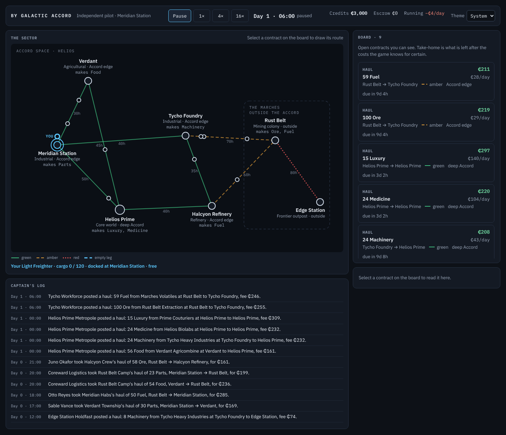
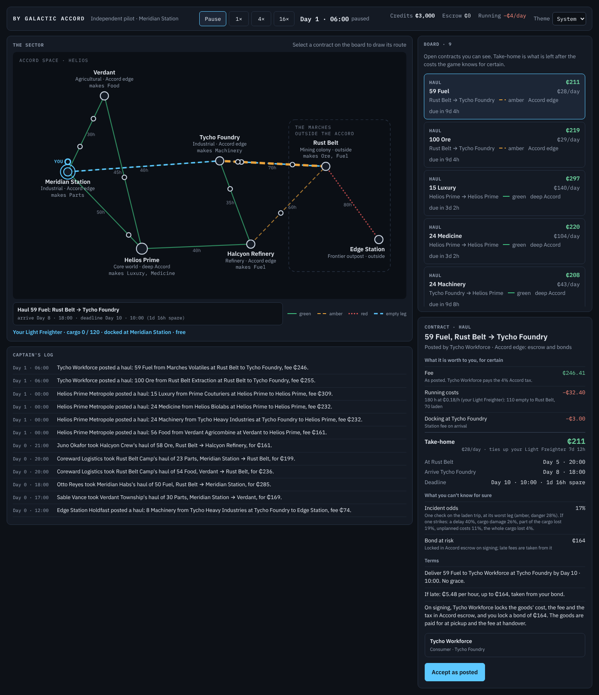
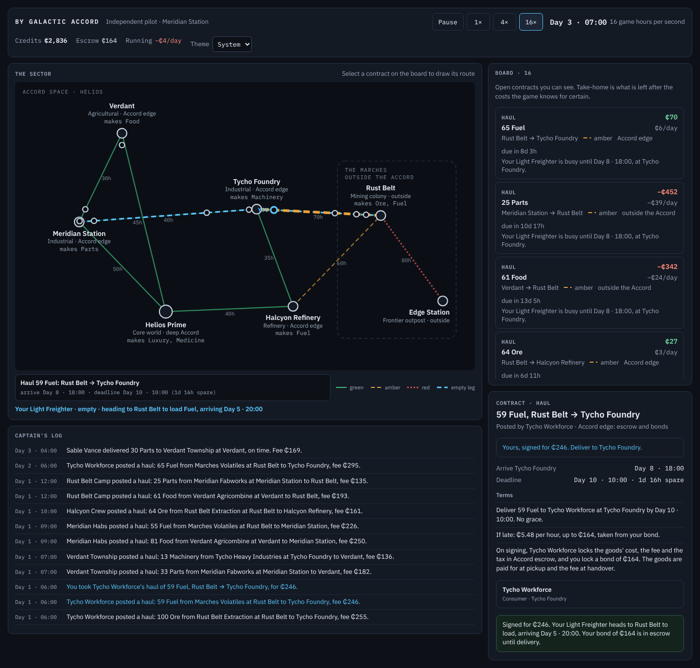
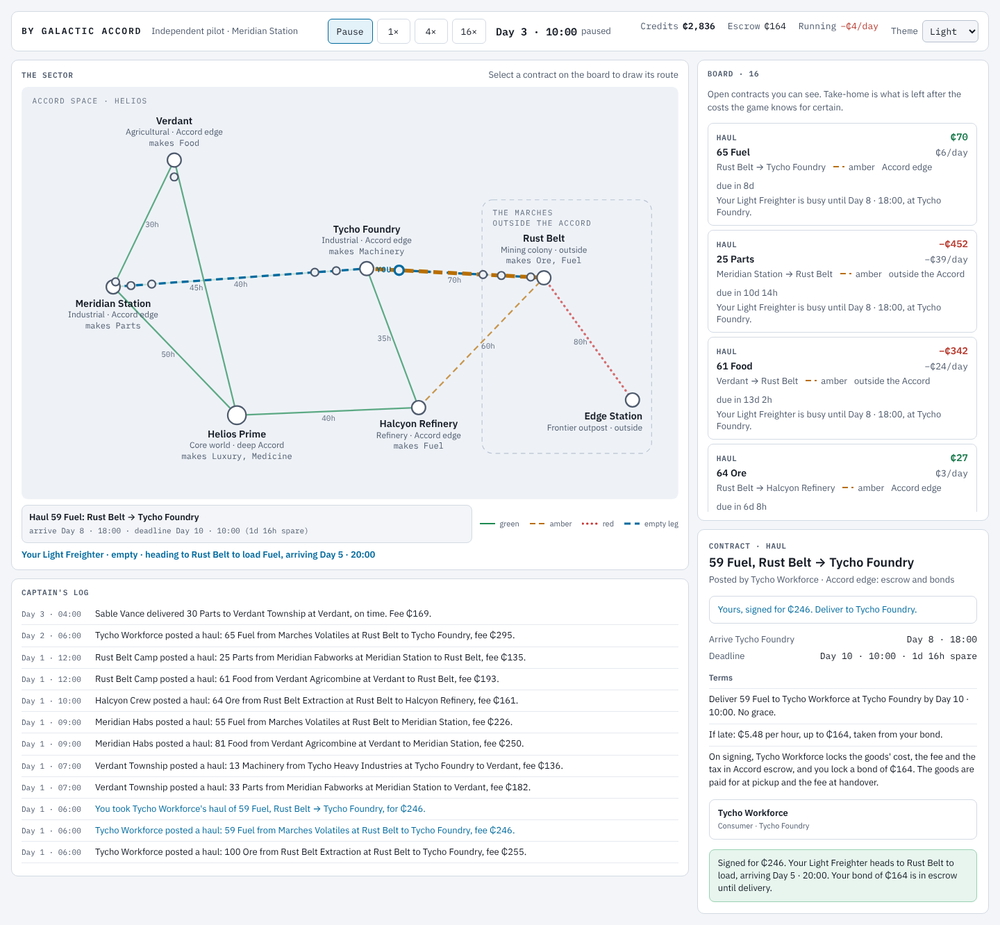

# S2 — The Blazor client, on the current engine

The step's goal, deliverable and verify are in [`plan.md`](../plan.md) §3, with a status line that links here.
Section references (§n) are to the design, [`by_galactic_accord_gdd_v0.3.md`](../../by_galactic_accord_gdd_v0.3.md).

*S2 status (2026-10-26): done.* The game is playable in a browser again. `ByGalacticAccord.Client` (Blazor
WebAssembly) runs the existing simulation in the page and shows it the way the mockup does: the schematic
sector map with routes in colour *and* line style by danger and ships moving along their courses, the time bar
(pause, 1×, 4×, 16×), the board with each contract's take-home, the contract as a document, and the captain's
log, in dark and light themes from one set of colour tokens. You can take a haul as posted, through the same
engine path an AI hauler uses. Every sentence on screen is a template in a resource file. **The engine runs at
about 21,800 game hours a second in WebAssembly**, over 1,300 times what 16× needs (risk R4), and after 20,000
hours it reaches exactly the state desktop .NET does (risk R6). The browser check passes with no console
errors. The engine's simulation results are unchanged: a million-tick soak gives identical telemetry before
and after, for both seeds.

| Start (dark) | A contract selected |
|---|---|
|  |  |
| **Signed and running at 16×** | **Light theme** |
|  |  |

[Phone width](S2/05-phone.png): the columns stack and the map scrolls inside its frame.

## What was built

- **Three new parts.** The client (`src/ByGalacticAccord.Client/`) only renders. What it renders comes from
  a new class library, **`ByGalacticAccord.Presentation`**: the text templates, the view models and the game
  clock, all plain C# with no Razor or browser, so the test project can run them on desktop .NET. The
  **browser check** (`tools/client-check/check.cjs`, Playwright) drives the published client. The design's
  architecture table (§18) names only the client; the presentation library is the client's logic, split
  out to be testable (see Decisions).
- **The game clock** (`GameSession`, §8.3). 1× is one game hour per real second. Each frame (about 30 a second)
  advances a fractional clock by the real time elapsed times the speed, capped at a quarter of a second, so
  a hidden tab doesn't leap days when it returns. The simulation runs to the clock's whole ticks; the fraction
  is only for drawing ships between hours. When the engine raises a player alert (an incident on your ship),
  `RunTo` stops and so does the clock: the hard pause. Resuming acknowledges it. The session starts paused at
  Day 1 · 06:00, after a day of the world running, so the board has posts; tick 0's board is empty.
- **The map** (§11.1): SVG drawn from world data. Locations sit at map points that are now world data on
  `Location` (`MapPoint`, set by `WorldGenerator` from the mockup's layout). Green routes are solid, amber
  dashed, red dotted. Each label goes on the side of its location that fewer routes leave from, and labels
  near the frame's edge run inwards. The Marches get a dashed frame sized to their labels. Ships are drawn
  along their **course**. This is a new engine field: `Ship.Course` (path, departure, arrival) is set for
  the empty leg when a hauler signs and for the laden leg at departure. An incident's delay moves its arrival,
  and arriving clears it. The ship's `Location` now becomes the pickup when it loads; it used to stay where
  the ship was when it signed. The client interpolates by share of the path's hours (§19: the engine never
  does). Selecting a contract draws its empty leg (dashed, accent) and laden legs (thick, by danger) and dims
  the routes beneath.
- **The board and the contract panel** (§11.2, §11.3). The board lists the open hauls the player can see
  (`Visibility`, as AI haulers see them), newest first. Each row shows its kind, route, danger,
  jurisdiction, due date, take-home and take-home per day, plus one note: why you can't fly it, or what its
  figures already count against you. The panel is the contract as a document: what it is worth for certain,
  line by line with where each number comes from; the schedule; what can't be known (incident odds, the
  bond at risk, whether a frontier payer pays); the terms as sentences; the poster. "Accept as posted" signs
  it through `PlayerActions`, at the current tick, paused or not.
- **Take-home** (`HaulEstimate`) uses the engine's own rules and formulas:
  - the fee as posted;
  - running costs for the empty and laden legs;
  - docking at the destination;
  - outside the Accord, the goods the pilot pays for at pickup;
  - a warranty refund the trip's length makes certain (food decays below its warranty on every route);
  - a late fee the arrival time makes certain, capped at the bond as the engine caps it.
  The incident odds are the engine's exact probability (scale × worst leg's danger × hull modifier), and the
  outcome table's shares come from `IncidentResolver.Share`, so the text can't drift from the resolver. A
  test signs a haul, runs it, and checks the estimate predicted the settlement's tick, fee, refund and late
  fee, and the credits to the cent.
- **The template layer** (§11.5). `Text/Templates.resx` has 192 templates with named fields (`{good}`), keyed
  by journal entry type (`HaulTaken`, `Incident.CargoDamage`) and by fact type (`Good.Food`,
  `Jurisdiction.AccordEdge.Long`, `Line.Running.Note`). `Templates.Fill` throws on a missing key or field, so
  rendering a template in a test proves it complete. The player's own events have `.You` twins ("You took
  …"), because the player's actor is named "You" and that only reads well at the start of a sentence.
  Numbers are formatted with the invariant culture ("₵1,234", "−₵42.00", "4.8%"), so every browser shows the
  same.
- **The journal records data, not prose.** `JournalEntry` has eight kinds (`ContractPostedEntry`,
  `HaulTakenEntry`, `HaulDeliveredEntry`, `PaymentDefaultedEntry`, `DeliveryFailedEntry`,
  `ContractExpiredEntry`, `IncidentEntry`, `FaucetAdjustedEntry`), each carrying ids and that moment's numbers.
  A player alert is now the entry itself, so the client words it with the same templates. The poster's
  reservation fee is in no entry; the old "Posted" line printed it.
- **`PlayerActions` returns codes** (`HaulBlock`, `HaulAcceptance`) instead of English, and `AcceptHaul`
  refuses a contract that is no longer open (the plan put that defect in S3; it is fixed here because the
  client now calls it).
- **Colour tokens** (§11.1) on `:root`: dark by default (the mockup's palette), light under
  `prefers-color-scheme: light` or when picked (`data-theme` on `<html>`, remembered in `localStorage` behind a
  `try`). Colour encodes data only: danger, gain and loss, yours (one accent). Figures are IBM Plex Mono with
  tabular digits. Plex Sans and Mono are vendored as Latin woff2 files under the OFL, so the page loads
  nothing from outside its site.
- **The speed probe** (`?bench=N`, a developer view) runs a world with no player for N hours in the browser and
  shows the time and a **state fingerprint** (`StateFingerprint`, moved into the engine from the tests'
  `Signature`). The CLI prints the desktop one: `dotnet run --project src/ByGalacticAccord.Cli -- fingerprint 20000 --seed 42`.
- **The browser check** (`node check.cjs`, from `tools/client-check/`; CI runs it after the soak tests):
  1. Publishes the client and gets the desktop fingerprint.
  2. Loads `?seed=42` and checks it starts paused at Day 1 · 06:00 with a populated board, seven locations,
     nine routes and ten ships.
  3. Selects a contract that pays, checks the take-home, the route overlay and the terms, and accepts it.
  4. Runs two game days at 16× (resuming any alert) and checks your ship moved.
  5. Switches to the light theme, then to phone width (no sideways scroll).
  6. Runs the speed probe and compares the fingerprints.

  It screenshots each step and fails on any console error, page error or failed request.

## Checks and measurements

All on this cloud container: 4 cores, .NET SDK 10.0.403, Node 22, Playwright 1.63 with its Chromium, Linux.

| Measure | Before (S1) | After |
|---|---|---|
| Tests | 80: 58 fast, 22 soak | 139: 117 fast, 22 soak |
| `dotnet test -c Release` | — | 117 pass, 2 s test time, 4.7 s wall |
| `dotnet test -c Release --filter Category=Soak` | — | 22 pass, 18 s test time, 20.9 s wall |
| `dotnet build -c Release` (whole solution, client included) | 0 warnings | 0 warnings |
| Soak harness, 1M ticks, seeds 20260619 and 42 (Release) | 4.6 s, 4.1 s | 5.4 s, 4.0 s; telemetry identical |
| Engine in the browser (WebAssembly, interpreted), 20,000 hours, seed 42 | — | 918–928 ms: about 21,800 hours a second, roughly 11 times slower than desktop .NET's 240,000 |
| State after 20,000 hours, WebAssembly vs desktop | — | identical fingerprint |
| Client ready in headless Chromium, from a local server | — | 0.9–1.5 s |
| 16× in the browser | — | 48–49 game hours in 3.0 s |
| Published client | — | 12 MB on disk; the framework's Brotli files total 2.1 MB |
| `node check.cjs` end to end (publish, fingerprint, browser) | — | 14 s, all checks pass |
| C# and Razor lines | 4,325 | 7,738: engine 3,610, presentation 1,539, client 717 (plus 279 of CSS), harness 208, tests 1,664 |

- **Same results.** The engine changes (structured journal, ship courses, the ship's location at loading,
  map points, named incident bounds, the fingerprint) change no simulation outcome. The soak harness's full
  telemetry at a million ticks is byte-identical to the pre-S2 build for seeds 20260619 and 42, and every
  determinism test passes. A new test checks that the clock, advanced frame by frame, reaches the same world
  as one `RunTo`.
- **The screenshots match the mockup's layout and visual language** (judged by eye against
  <https://claude.ai/artifact/VUfFWMFGd7p4ryYau2g7Pg>): the time bar across the top; the map and the log on
  the left; the board and the contract on the right; the same palette, type and danger styles. What the
  mockup has and S2 doesn't belongs to later steps:
  - the timeline (S9);
  - The Daily Accord and the signals (S6);
  - My posts and Talks (S5);
  - Orders and the ship sheet (S7);
  - the counterparty's record (S6).
- **`dotnet run --project src/ByGalacticAccord.Client`** serves the client at <http://localhost:5180>.

## Decisions taken in code

- **A presentation library beside the client.** Referencing a Blazor WebAssembly project from the xUnit
  project is awkward (it is an executable for another runtime). Keeping the view models and templates in a
  plain library lets 59 new tests cover them on desktop .NET, and the client stays a thin renderer.
- **Take-home counts running costs, though the engine doesn't charge the player them yet.** The design
  defines take-home that way (§11.2); the defect is the engine's and S3 fixes it. Until then the player's
  credits rise by more than the take-home, by exactly the running costs (a test checks this).
- **Map points are world data on `Location`,** like a route's hours, rather than a client-side table keyed by
  name, so a later world (or S10's seeded start) keeps its layout with its locations.
- **The journal's entries are typed records,** keyed by type name in the templates. Causal links (S4) can be
  added as one more field.
- **The game-time words stay in `GameTime`** (S1 left open moving them into the templates). The client formats
  every date through it, so there is still one source; translating "Day" and "ago" means moving them then.
- **The log shows every entry about a contract the player can see,** not only the player's own: with no player
  activity yet, a log of yours alone would be empty. The player's lines are in the accent colour. When S6
  tightens visibility, the log follows, since it asks `Visibility.CanSee`.
- **The session starts at Day 1 · 06:00,** after the world has run a day. S10's seeded start replaces this.
- **"Accept as posted" is the only command.** It is the smallest player action that makes S2 playable, and it
  goes through the engine path S3 reworks. Countering waits for S5.
- **No ship names.** The engine has none, so the interface says "your Light Freighter" where the mockup says
  "Kestrel"; names come with ship histories (S7).
- **Blocked reasons can reveal a little.** "Verdant can't supply 90 Food right now" follows from the engine's
  own check, which reads the producer's stock; S6's information rules should reword it.

## Gotchas

- **Razor and SVG `<text>`:** inside a code block, `<text>` is Razor's own text tag and can't take attributes,
  so each SVG `<text>` sits inside a `<g>` or another element.
- **String parameters need `@`.** `Fleet="_header.Fleet"` passes the literal string; it must be
  `Fleet="@_header.Fleet"`. Razor treats other parameter types as expressions, so the mistake shows only on
  screen, which is how the first browser run caught it.
- **Razor trims whitespace** at the ends of elements, so "Credits ₵3,000" needs a gap in CSS, not a space in
  the markup.
- **Decimal noise.** The engine's fee divisions leave noise in the 26th decimal place, so a test comparing
  credits does so to the cent, as the design's conservation rule reads (§20.2).
- **Frame times in tests** use steps a double holds exactly (0.125 s, 0.25 s): forty frames of 0.1 s sum to
  3.9999…, which floors to one tick short.
- **Playwright in this container** uses the preinstalled Chromium (`PLAYWRIGHT_BROWSERS_PATH`); the pinned
  `playwright` package is the same version. On another machine, run `npx playwright install chromium` once; CI
  installs it with `--with-deps`.
- **The repository's `.gitignore` ignores `artifacts/`**, which is where the check publishes and screenshots;
  the screenshots here were copied into `log/S2/`.

## What the client showed about the engine

Making every number explain itself turned up two defects nobody had seen; both are now in the plan's
defect table and `CODEMAP.md` §8:

- **Outside the Accord the pilot pays for the goods and is paid only the fee.** `Settlement.Pickup` moves the
  goods' cost from the pilot to the producer and `Fulfill` pays back only the fee. Nearly every frontier haul
  on the board shows a loss (Tycho → Edge Station machinery: −₵351), and AI haulers take them anyway because
  `Score` ignores the goods. This is probably part of why AI haulers end long soaks near ₵0. S3's split into
  Sale and Haul replaces this contract.
- **Hauls that go nowhere.** Helios Prime's consumer buys Luxury and Medicine from Helios Prime's own
  producers through a one-hour "haul" from Helios Prime to Helios Prime. S3 replaces this with Sales that
  have a handover place.
- **The reservation fee still leaks,** through the terms rather than the log: the late fee is 1% of the
  hidden fee per hour and its cap, which is the bond, is 30%. The client must show the terms, so S5 has to
  change how they are set.

## Hand-off: where to start reading

- `src/ByGalacticAccord.Presentation/Session/GameSession.cs`: the clock and the player's command.
- `src/ByGalacticAccord.Presentation/Views/HaulEstimate.cs`: take-home by the engine's rules.
- `src/ByGalacticAccord.Presentation/Text/Templates.resx` and `JournalText.cs`: where every sentence lives.
- `src/ByGalacticAccord.Client/Shell.razor`: the frame loop and what is rebuilt when.
- `tools/client-check/check.cjs`: what "checked in a browser" means.

## Commands

```bash
dotnet build -c Release                         # from ByGalacticAccord/; the client builds with the rest
dotnet test -c Release                          # fast tests
dotnet test -c Release --filter Category=Soak   # soak-length tests
dotnet run --project src/ByGalacticAccord.Cli -- soak 1000000 --seed 42
dotnet run --project src/ByGalacticAccord.Cli -- fingerprint 20000 --seed 42
dotnet run --project src/ByGalacticAccord.Client           # http://localhost:5180, ?seed=N, ?bench=N
cd tools/client-check && npm ci && node check.cjs          # screenshots in artifacts/client-check/screenshots
```

## Files

- Added:
  - `src/ByGalacticAccord.Presentation/`: the project, `Properties/AssemblyInfo.cs`,
    `Text/Templates.resx`, `Templates.cs`, `Format.cs`, `JournalText.cs`, `Session/GameSession.cs`,
    `Views/HaulEstimate.cs`, `BoardView.cs`, `ContractView.cs`, `MapView.cs`, `LogView.cs`, `HeaderView.cs`,
    `Tone.cs`.
  - `src/ByGalacticAccord.Client/`: the project, `Properties/launchSettings.json`, `Program.cs`,
    `_Imports.razor`, `Shell.razor`, `Components/` (`TimeBar`, `SectorMap`, `MapLayers`, `ShipLayer`,
    `BoardPanel`, `ContractPanel`, `CaptainsLog`, `BenchPanel`), `wwwroot/index.html`, `css/app.css`,
    `js/client.js`, `fonts/` (six woff2 files and two OFL licences).
  - `src/ByGalacticAccord.Engine/Simulation/StateFingerprint.cs`, `src/ByGalacticAccord.Cli/Fingerprint.cs`.
  - `tools/client-check/check.cjs`, `package.json`, `package-lock.json`.
  - Tests: `JournalTests.cs`, `ShipCourseTests.cs`, `PlayerActionsTests.cs`, `TemplateTests.cs`,
    `FormatTests.cs`, `SessionTests.cs`, `HaulEstimateTests.cs`, `ViewTests.cs`.
  - `log/S2.md`, `log/S2/*.png`.
- Changed:
  - Engine: `Actors/DecisionEngine.cs`, `PlayerActions.cs`; `Domain/Location.cs`, `Ship.cs`;
    `Economy/InflationMonitor.cs`; `Events/ControlEvents.cs`, `TransitEvents.cs`;
    `Simulation/EventJournal.cs`, `IncidentResolver.cs`, `Settlement.cs`, `SimulationContext.cs`,
    `WorldGenerator.cs`.
  - `src/ByGalacticAccord.Cli/Program.cs`; `tests/ByGalacticAccord.Tests/ByGalacticAccord.Tests.csproj`,
    `TestWorld.cs`; `ByGalacticAccord.slnx`.
  - `../.github/workflows/ci-bygalacticaccord.yml`; `CODEMAP.md`, `README.md`, `plan.md`, `log/README.md`.

## Next: S3, possession, Sale and Haul

- **Fix the two defects above as part of the split.** A delivered Sale pays for the goods; a Haul's shipper
  owns them. A consumer at a producer's own location buys with a Sale and handover there, no haul. With those
  and running costs for the player, every line of the take-home becomes something the engine charges.
- **Each new event needs a journal entry kind and its templates,** with a `.You` twin when the player can be its
  subject. `TemplateTests.Every_journal_entry_reads_as_a_sentence_for_an_ai_and_for_the_player` lists them, so
  extend it. `JournalText.Describe` throws on an entry it doesn't know.
- **`HaulEstimate` mirrors the settlement rules.** When S3 changes how a haul or a Sale settles, change the
  estimate in the same commit; `HaulEstimateTests` will catch a drift on a clean run.
- **Kinds on the board** (S3's client work): `BoardRow.Kind` already comes from `Templates.ContractKind`; Sale
  needs its own title, route and note templates, and the take-home of a delivered Sale includes buying the goods.
- **Possessions in the ledger:** the time bar has the money; stock and storage need a panel. The mockup's tab
  row over the board is where My posts, Talks and Orders go later.
- **Performance has room.** Views are rebuilt only when the clock crosses an hour or the player acts, and the
  board estimates every row each time; at 16× that is about 16 rebuilds a second, well inside a frame.
