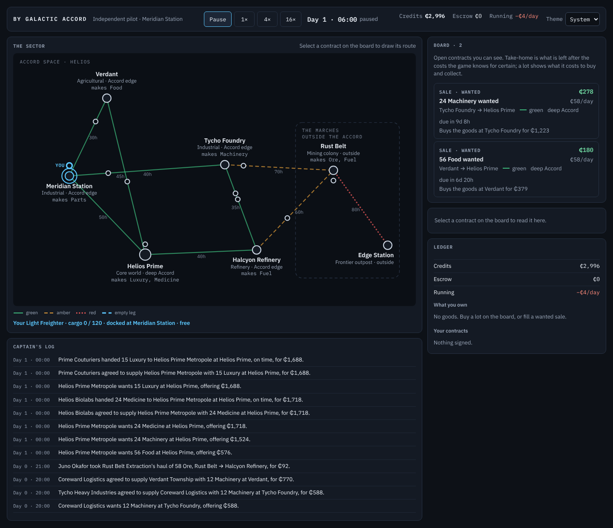
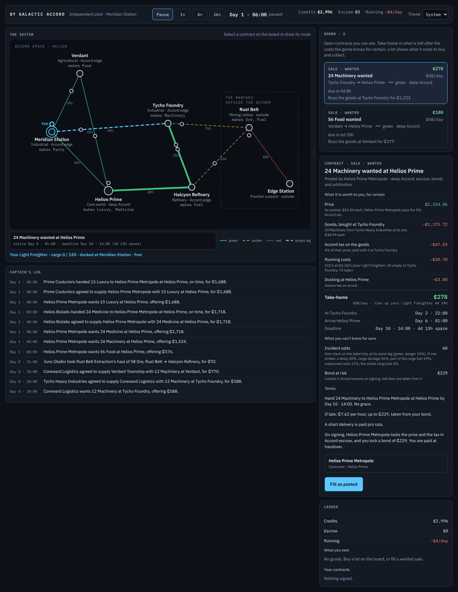
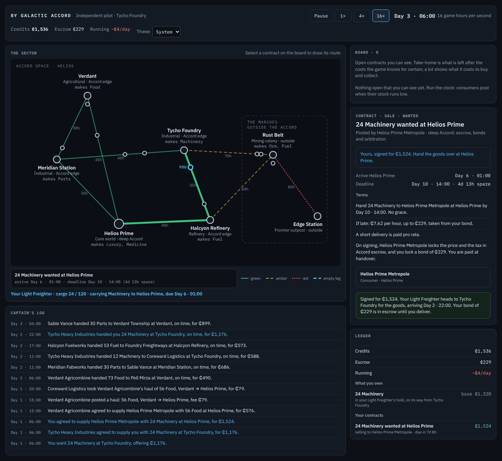
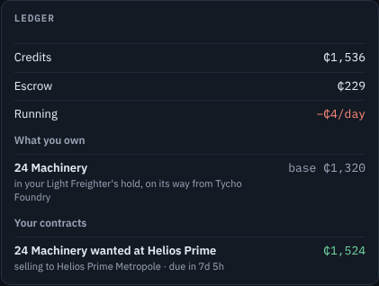

# S3 — Possession, Sale and Haul

The step's goal, deliverable and verify are in [`plan.md`](../plan.md) §3, with a status line that links here.
Section references (§n) are to the design, [`by_galactic_accord_gdd_v0.3.md`](../../by_galactic_accord_gdd_v0.3.md).

*S3 status (2026-10-26): done.* v0.2's bundled "buy and haul" contract is gone. Goods now belong to an actor
and are somewhere: in its stock, in storage it rents from a station operator, or in a ship's hold, and the
invariants count every unit (produced = consumed + lost + held). Two kinds of contract move them. A **Sale** is
goods wanted or for sale, handed over at a place; a **Haul** carries goods the shipper owns. Consumers post
delivered wanted Sales; producers sell lots, answer wanted Sales at their location and sell delivered; traders
carry Hauls, fill Sales by buying and carrying, and post Hauls when their ships are busy. All of them, and the
player, act through one set of market commands. The player pays running costs like everyone else, and food and
medicine keep as long as §15.3 says. **Over a million ticks every invariant holds for both seeds, the money supply
drifts 1.3–1.8%, and about 109,000 contracts settle (S1: 5,600 and 25,000).** In the client the board shows each
contract's kind, the contract panel prices a haul, a fill or a lot by the engine's rules, and a new ledger shows
what the player owns and where, with a button to store goods at a station or load them back aboard.

| Start (dark) | A wanted Sale selected |
|---|---|
|  |  |
| **Signed and running at 16×** | **The ledger** |
|  |  |

[Light theme](S3/05-light.png) · [phone width](S3/06-phone.png).

## What was built

- **Possession** (§16.1). `ActorState` stock now has a reserved part, so goods set aside for a contract can't be
  sold twice. A ship's hold is a list of **lots**, each with an owner, so a carrier can hold its own goods and a
  shipper's at once. Storage is a **`StorageContract`** between a renter and the location's **station operator**
  (a new role, "Meridian Station Docks" and so on, one per location). It opens when goods are first stored there
  and closes when it is emptied, at ₵0.10 a unit a day. Perishables decay lazily: a `Lot` computes its quality
  when it is read, so nothing ticks while goods sit. The goods ledger (`Produce`, `Consume`, `Lose`, and stock,
  storage and hold moves) is the only way goods appear, move or go, and a new invariant checks it per good. It
  also checks that nothing is over-reserved and that every signed contract is being performed.
- **Contract kinds** (§16.2). `Contract` is now abstract, with `SaleContract` (side: wanted or for sale; good,
  quantity, handover place; where the buyer takes the goods; where the seller set them aside), `HaulContract`
  (origin, destination, the holding the goods are picked up from, the Sale it serves if any) and
  `StorageContract`. Jurisdiction is where a contract is performed: a Sale's place, a Haul's destination, a
  storage's location.
- **Terms, simply** (`Terms`): every Sale and Haul has a deadline with no grace, a late fee per hour up to a cap
  (Sale 0.5% of the price an hour to 15%; Haul 1% of the fee to 30%), and for perishables a quality warranty
  that refunds up to half below 70%. The cap is the performer's bond. Every figure scales from the posted
  price, never the poster's hidden reservation, which fixes S5's reservation leak early.
- **Market commands** (`Market`): post a Sale or Haul, withdraw, expire, and sign. In the Accord, signing locks
  the payer's price and tax and the performer's bond in escrow. On top of these sit the compound deals: `Supply`
  a wanted Sale from stock or storage; `BuyLot`; `TakeHaul`; `BuyAtSource` (buy at a producer's door by posting
  a wanted Sale there, which it answers at once); `FillWithShip` (buy, carry, hand over); `FillViaHaul` (buy into
  storage, post a Haul that serves the Sale). Ships take a **`ShipJob`** (whose goods, from where, by which
  contract, to where) in place of v0.2's one active contract and manifest.
- **Settlement per kind** (`Settlement`). A handover pays pro rata for what arrived, refunds by the warranty
  and takes the late fee from the bond. Outside the Accord the payer pays at handover or defaults, and the seller
  keeps its goods. A failure forfeits the bond to the payer and frees what was set aside, and a Haul's failure
  fails the Sale it was delivering. A signed contract that nothing is performing fails once its late fee reaches
  the cap (`ContractDefaultCheck`), S3's stand-in for S4's cancellation for default.
- **The AI, rewired per role** (`DecisionEngine`, now four files):
  - **consumers** post delivered wanted Sales, priced from the cheapest source and their own price memory, or buy
    a cheap lot and have it hauled home;
  - **producers** answer wanted Sales at their location at once, sell to remote ones delivered and post the Haul,
    and post lots when their warehouse is three-quarters full, never below cost;
  - **traders** take Hauls and fill Sales with their free ships, choosing by utility. With every ship busy they
    broker: buy into storage and post a Haul. Goods left on their hands go into storage and are sold off as
    lots;
  - **station operators** collect rent.

  Every role takes posts as posted (haggling is S5) and learns its own prices from how its posts fare
  (`PriceMemory`): an offer taken within a day was too generous, one that expired too mean.
- **Defects fixed:**
  - **the player pays running costs:** every heartbeat charges every ship, earning or idle, the player's too;
  - **food and medicine keep to §15.3:** 7 and 2 days to the warranty in a standard hold, five times that
    refrigerated, so food survives Verdant to Rust Belt and medicine reaches the frontier only refrigerated;
  - **the frontier goods-cost defect is gone with the bundled contract:** a delivered Sale pays for the goods;
  - **same-place hauls are gone too:** a consumer at a producer's door buys with a Sale handed over there.
- **The client** (§11.2, §11.3):
  - the board lists open Sales and Hauls, each row headed by its kind ("Sale · wanted", "Sale · for sale",
    "Haul"), with take-home, or a lot's cost;
  - the contract panel prices each kind by the engine's rules (`DealEstimate` replaces `HaulEstimate`): a fill
    shows the goods bought at the source and their tax, the running costs of the empty and laden legs,
    docking, and what the terms will certainly take back;
  - "Accept", "Fill" or "Buy as posted" signs through `PlayerActions`, the same `Market` commands an AI uses;
  - the **ledger** shows money, what the player owns (in its hold or in storage, with freshness and rent) and
    its signed contracts. "Store at …" and "Load aboard" move goods between a docked ship and storage there;
  - the log words every new entry for an AI or for the player, on either side of a contract.

## Checks and measurements

All on this cloud container: 4 cores, .NET SDK 10.0.403, Node 22, Playwright 1.63 with its Chromium, Linux.

| Measure | Before (S2) | After |
|---|---|---|
| Tests | 139: 117 fast, 22 soak | 173: 151 fast, 22 soak |
| `dotnet test -c Release` | 117 pass, 2 s test time, 4.7 s wall | 151 pass, 6–8 s test time, 11 s wall |
| `dotnet test -c Release --filter Category=Soak` | 22 pass, 18 s test time | 22 pass, 1 min 8–10 s test time |
| `dotnet build -c Release` (whole solution) | 0 warnings | 0 warnings |
| Soak harness, 1M ticks, seeds 20260619 and 42 (Release) | 5.4 s, 4.0 s | 14.0 s, 13.7 s (the world now settles 4–20 times as many contracts) |
| Engine in the browser, 20,000 hours, seed 42 | 918–928 ms, about 21,800 hours a second | 3,476–3,523 ms, about 5,700 hours a second: over 350 times what 16× needs |
| State after 20,000 hours, WebAssembly vs desktop | identical | identical |
| Client ready in headless Chromium | 0.9–1.5 s | 1.0–1.2 s |
| `node check.cjs` end to end (publish, fingerprint, browser) | 14 s | 27 s, all checks pass |
| C# and Razor lines (`.cs`, `.razor`) | engine 3,610, presentation 1,403, client 717, harness 208, tests 1,549 | engine 6,351, presentation 2,080, client 817, harness 246, tests 2,654 |

**Invariants over a million ticks:** all hold for both seeds, checked every 5,000 ticks by the soak harness
(credit conservation, escrow, goods conservation per good, nothing over-reserved, every signed contract being
performed), and by `InvariantTests` at 1M and 250k.

**The economy against S1's baseline** (the S2 build, whose telemetry S2 showed identical to S1's; 1M ticks):

| | S1, seed 20260619 | S3, seed 20260619 | S1, seed 42 | S3, seed 42 |
|---|---|---|---|---|
| Money supply drift | +5.4% | +1.8% | +1.8% | +1.3% |
| Faucet multiplier at the end (the monitor's knob) | 0.18 | 0.60 | 0.09 | 0.60 |
| Contracts fulfilled | 25,076 | 109,007 | 5,592 | 109,471 |
| Breached (performer) / defaulted (payer) | 177 / — | 5,397 / 390 | 465 / — | 4,714 / 379 |
| Goods consumed (S1: delivered) | 1,069,931 | 2,116,561 | 245,414 | 2,122,223 |
| Goods lost in transit or written off | 11,419 | 18,868 | 27,635 | 20,966 |
| Traders' credits at the end | ₵0–₵521 | ₵10, then ₵11,885–₵50,345 | ₵0–₵813 | ₵193, then ₵11,202–₵50,530 |
| Richest actor | Edge Station Holdfast (consumer), ₵164,927 | Foundry Freightways, ₵50,345 | Edge Station Holdfast, ₵92,852 | Foundry Freightways, ₵50,530 |

- **Stable, and alive where S1 was starving.** S1's monitor had cut the faucet to 0.09–0.18 because two
  frontier consumers were hoarding the money supply; S3's sits at 0.60 and the supply stays within 2%. The two
  seeds now agree closely with each other, where S1's differed by a factor of four.
- **Demand met** (what each consumer used of what it wanted to), seed 42: the core 70–98% (Meridian food 91%,
  Helios Prime machinery 98%, Verdant machinery 70%); the frontier 48–80% (Rust Belt Camp food 61%, parts 80%;
  Edge Station food 51%, medicine 48%, machinery 76%). Seed 20260619 is within a few points of each. The frontier
  is plan risk R1's concern; medicine needs a refrigerated hold to get there at all.
- **Failure rate:** 4.4% (seed 42) and 5.0% (seed 20260619) of signed Sales and Hauls fail or default, against
  S1's 7.7% and 0.7%. Most failures (3,888 of 4,714 for seed 42) are a producer's delivered Sale whose Haul nobody took
  in time; the plan's defect table carries it to S4 and S5.
- **Lifecycle tests:** `SaleTests` (11), `HaulAndStorageTests` (5) and `GoodsTests` (5) cover every path a Sale,
  a Haul and a storage can take; `DecisionTests` (7) each role's rules; `PlayerActionsTests` (9) each player
  command and refusal; `DealEstimateTests` (6) that the estimate predicts a clean haul, a late haul, a fill and a
  lot to the cent.
- **The browser check passes:** the board's kinds, the ledger, signing a fill while paused, the log line, the
  goods aboard in the ledger after two days at 16×, both themes, phone width, the speed probe and the fingerprint,
  with no console errors.

## Decisions taken in code

- **Storage is a station's standing offer, not a board post.** Putting goods into storage at a location signs a
  `StorageContract` with its operator at the station's rate; it never appears on the board. Rent is settled
  whenever what is held changes and on the operator's heartbeat, and a station's rent above its float leaves as
  upkeep (a sink).
- **AI producers answer a wanted Sale at their location the moment it is posted** (§4.3: an actor re-evaluates
  when a contract it can see appears). That is also how anyone buys at a producer's door (`BuyAtSource`). S5 makes
  replies take game time.
- **Everyone takes posts as posted until S5.** The closed-form `Negotiation.ResolveAi` let traders take most of
  the spread and consumers went broke. Instead each actor learns its own offers from how its posts fare
  (`PriceMemory`). `ResolveAi` is now used only by its tests.
- **A lot is bought whole**, and a Sale is one handover; partial fills wait for S4's partial-delivery term.
- **Jurisdiction is where a contract is performed,** and nothing is taxed outside the Accord.
- **A contract nothing is performing fails when its late fee reaches the cap.** S4 turns this into the
  counterparty's decision to cancel for default.
- **AI actors keep a working capital and pay out the rest** (consumers 90 days' income, producers four warehouses
  at cost, traders one and a half times their fleet's value, stations their float). Without this sink a saver
  soaks up the money supply and the inflation monitor starves everyone else, which is what S1 showed. Growth (S7)
  and insolvency (S8) should replace it; the plan's defect table says so.
- **Prices respond to wealth:** a consumer flush with savings pays up to 1.6 times its willingness, and a producer
  with more than its working capital gives up its margin. A lot is never priced below the unit cost.
- **A trader writes off goods it couldn't sell in 30 days** (booked as lost), so stale leftovers don't circulate
  as lots forever.
- **Docking is charged once, at the job's destination;** collecting a lot or loading at a pickup is free.
- **Buying at a source is itself a Sale,** so the player's ledger shows "buying from Tycho Heavy Industries"
  until the goods are aboard.
- **The journal is a ring buffer** (it was a list trimmed from the front, which cost O(cap) per entry once full),
  and `Contract.Places`, adjacency and `ActorsOrdered` are cached: the S3 world settles twenty times as many
  contracts, and these kept a million ticks under 15 s.

## Gotchas

- **The test world is quiet.** `TestWorld.Quiet` pushes every heartbeat beyond the test's horizon and turns
  incidents off, so a test drives the market itself and a trip takes exactly its hours. It also means no
  running costs are charged there: `DealEstimateTests` compare the change in credits with take-home plus
  running costs. `PlayerActionsTests` checks the daily charge in a normal world.
- **Price memory must learn from every post, not the last.** With several posts open at once, a memory of only
  the latest never saw most outcomes and prices stuck (Edge Station's at its starting guess).
- **Counting journal entries after a long run undercounts:** the ring keeps 5,000. Count during the run, as the
  soak harness's counters do.
- **Decimal decay comparisons** need a precision (12 places): lazy decay over different splits of the same
  hours differs in the 26th decimal place.
- **`InternalsVisibleTo`:** tests reach internal transitions (`Sign`, `Dispatch`, stock reservations) to set up
  states; nothing outside the engine can.
- **A record's positional property and a static helper can't share a name** (`DealEstimate.Running`).

## What the step showed

- **The board is thin for the player.** At Day 1 · 06:00 it shows two contracts, both wanted Sales: AI producers
  answer local posts at once and traders take most of the rest within a heartbeat. The player competes on
  speed and nothing else until S5 (countering, replies over time) and S6 (what each actor knows) give it an edge.
- **Lots mostly expire** (about 35,000 producer lots over a million ticks for seed 42): consumers buy one only
  when it is cheap enough to haul home, and traders prefer delivered Sales. Lots matter more once the player can
  post (S5) and factories need inputs (S7).
- **One hull doesn't pay.** Dust Runner Kael's armoured freighter costs more to run than it earns here and ends
  every soak near ₵0. Actors can't change their fleets until S7.

## Hand-off: where to start reading

- `src/ByGalacticAccord.Engine/Simulation/Market.cs`: every command, and the compound deals.
- `src/ByGalacticAccord.Engine/Simulation/Settlement.cs`: handover, delivery, failure, default, pickup and arrival.
- `src/ByGalacticAccord.Engine/Domain/Contract.cs` and `Ship.cs`: the kinds, holdings, lots and jobs.
- `src/ByGalacticAccord.Engine/Actors/DecisionEngine*.cs`: each role, in its own file.
- `src/ByGalacticAccord.Presentation/Views/DealEstimate.cs` and `LedgerView.cs`: the take-home per kind and the ledger.
- `CODEMAP.md` §3 and §5: a Sale's life, and the only paths money and goods move through.

## Commands

```bash
dotnet build -c Release                         # from ByGalacticAccord/
dotnet test -c Release                          # fast tests
dotnet test -c Release --filter Category=Soak   # soak-length tests
dotnet run --project src/ByGalacticAccord.Cli -- soak 1000000 --seed 42       # telemetry above
dotnet run --project src/ByGalacticAccord.Cli -- soak 1000000 --seed 20260619
dotnet run --project src/ByGalacticAccord.Client           # http://localhost:5180
cd tools/client-check && npm ci && node check.cjs          # screenshots in artifacts/client-check/screenshots
```

## Files

- Added:
  - Engine: `Actors/DecisionEngine.Producers.cs`, `DecisionEngine.Consumers.cs`, `DecisionEngine.Traders.cs`,
    `PriceMemory.cs`; `Domain/Lot.cs`; `Simulation/Market.cs`, `Terms.cs`; `Properties/AssemblyInfo.cs`.
  - Presentation: `Views/DealEstimate.cs` (replaces `HaulEstimate.cs`), `Views/LedgerView.cs`.
  - Client: `Components/LedgerPanel.razor`.
  - Tests: `SaleTests.cs`, `HaulAndStorageTests.cs`, `GoodsTests.cs`, `DecisionTests.cs`, `DealEstimateTests.cs`
    (replaces `HaulEstimateTests.cs`).
  - `log/S3.md`, `log/S3/*.png`.
- Changed:
  - Engine: `Actors/ActorRole.cs`, `ActorState.cs`, `DecisionEngine.cs`, `PlayerActions.cs`, `Profiles.cs`;
    `Domain/Cargo.cs`, `Clause.cs`, `Contract.cs`, `Goods.cs`, `Ship.cs`, `ShipType.cs`; `Economy/PriceModel.cs`,
    `Visibility.cs`; `Events/ControlEvents.cs`, `TransitEvents.cs`; `Simulation/EventJournal.cs`, `Invariants.cs`,
    `Settlement.cs`, `SimulationConfig.cs`, `SimulationContext.cs`, `StateFingerprint.cs`, `WorldGenerator.cs`.
  - Presentation: `Session/GameSession.cs`; `Text/JournalText.cs`, `Templates.cs`, `Templates.resx`;
    `Views/BoardView.cs`, `ContractView.cs`, `HeaderView.cs`, `LogView.cs`, `MapView.cs`.
  - Client: `Shell.razor`, `wwwroot/css/app.css`. Harness: `Soak.cs`. Browser check: `check.cjs`.
  - Tests: `DomainTests.cs`, `EconomyTests.cs`, `JournalTests.cs`, `PlayerActionsTests.cs`, `SessionTests.cs`,
    `ShipCourseTests.cs`, `TemplateTests.cs`, `TestWorld.cs`, `ViewTests.cs`.
  - `CODEMAP.md`, `README.md`, `plan.md`, `log/README.md`.

## Next: S4, terms and failure

- **`Terms` is the seam.** It builds every Sale's and Haul's clauses from the posted price; S4's structured terms
  and the strict, standard and lenient packages replace it. `Settlement.Due` is where they are applied.
- **`ContractDefaultCheck` is the stand-in to replace:** a contract nothing is performing fails when its late fee
  is capped. In S4 the counterparty decides (AI by utility; the player through a prompt and the hard pause).
- **Grace and cancellation should cut the producer failures** (most of S3's breaches): a producer whose Haul
  nobody takes could cancel early, or its buyer could wait.
- **Every lifecycle event will want a cause.** `JournalEntry` records are typed; a causal link is one more field.
  The templates are keyed by entry type and contract kind, with `.You` and `.ToYou` twins, and
  `TemplateTests.Every_journal_entry_reads_as_a_sentence_for_an_ai_and_for_the_player` builds every combination.
- **Keep `DealEstimate` in step with settlement.** `DealEstimateTests` will catch a drift on a clean run.
