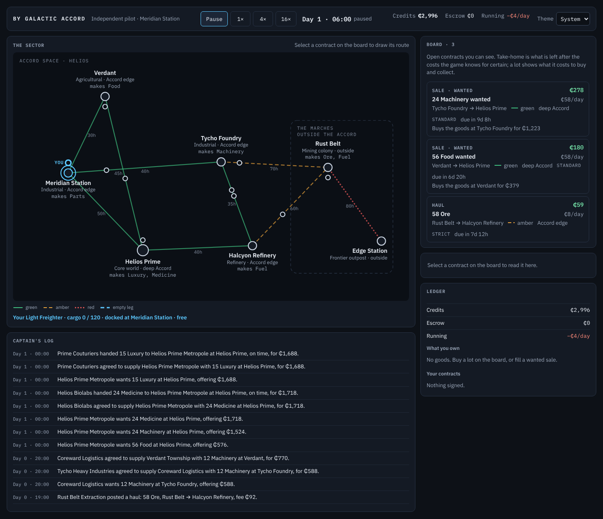
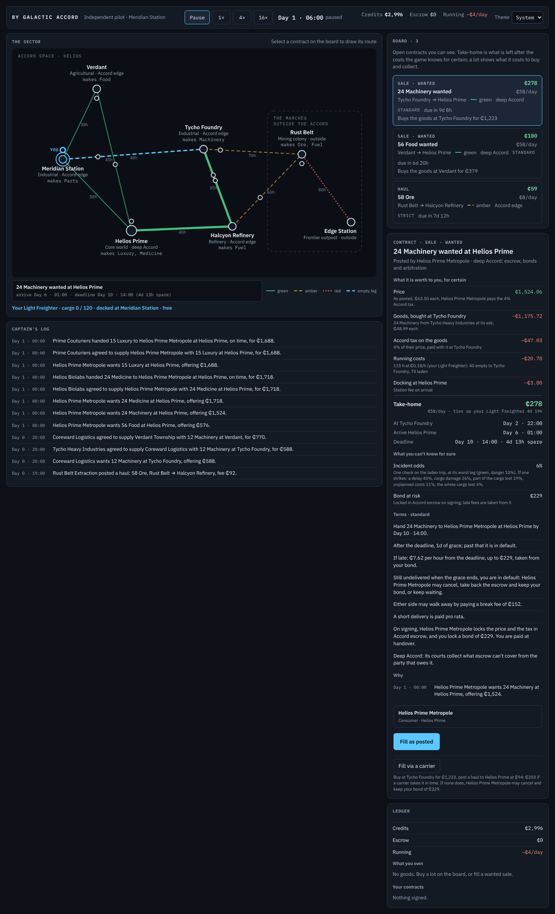
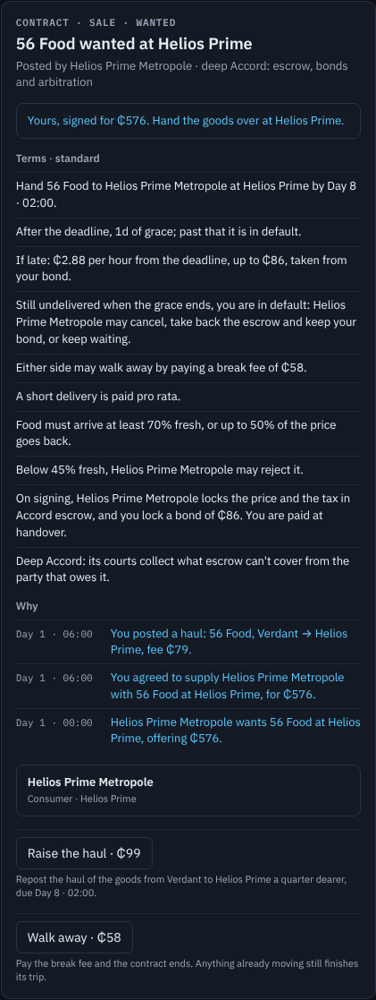
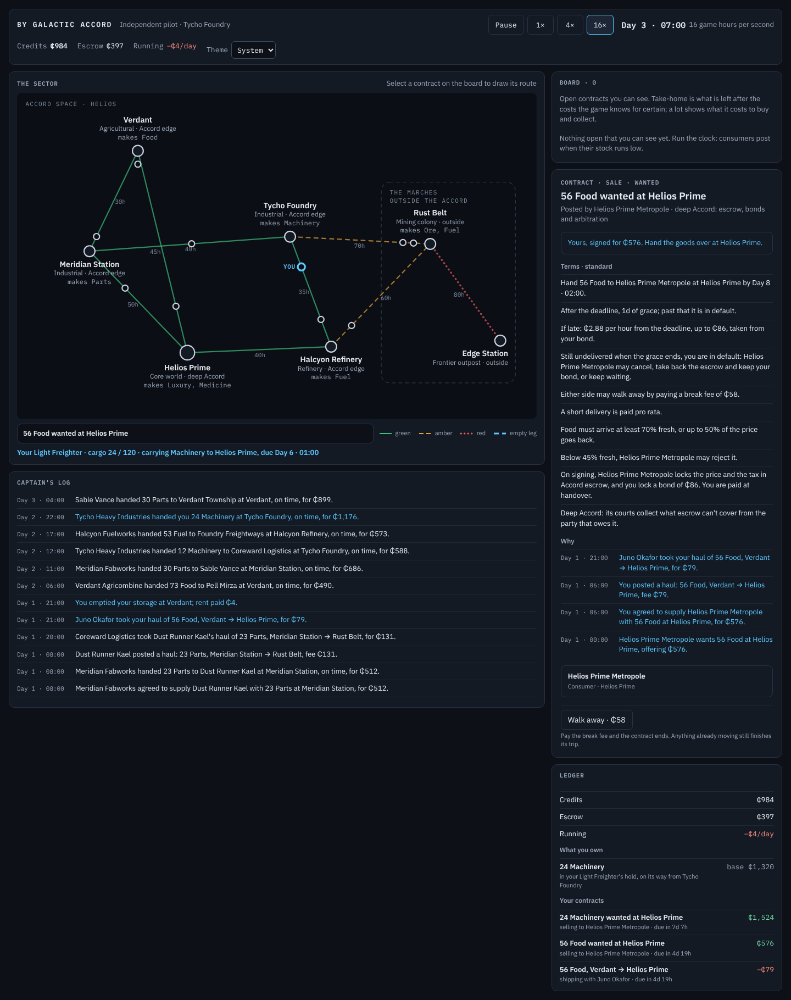

# S4 — Terms and failure

The step's goal, deliverable and verify are in [`plan.md`](../plan.md) §3, with a status line that links here.
Section references (§n) are to the design, [`by_galactic_accord_gdd_v0.3.md`](../../by_galactic_accord_gdd_v0.3.md).

*S4 status (2026-10-26): done.* Every Sale and Haul now carries structured **terms** (§3.4) in a **strict,
standard or lenient** package: a deadline and a grace, a late fee up to a cap that is also the bond,
cancellation for default once the grace is gone, cancellation at will for a break fee, what a short delivery is
(pro rata, or a failure), a quality warranty with a floor below which goods may be rejected, and a haul's cargo
liability. When a contract goes wrong its terms settle it, and the jurisdiction decides how far: the deep
Accord collects in full, its edge as far as escrow holds, the frontier only off the payment. A decision the terms
hand a party (cancel for default or wait; accept spoiled goods or reject them) is made by AI actors by utility
and by the player at a hard pause. Every journal entry records its cause, so any outcome reads back as a chain.
**Over a million ticks every invariant holds for both seeds, escrow reconciles exactly (it now moves whole
cents), every failure path S4 brings happens hundreds or thousands of times, and the economy settles as many
contracts as S3 (about 110,000) with a failure share of 4.3–4.8% (S3: 4.4–5.0%).** In the client the board shows
each contract's package, the contract panel reads every term as a sentence from the player's side and its record
back through its causes ("Why"), the player can fill a Sale through a carrier, walk away, cancel for default and
raise an untaken haul, and a decision stops the clock until it is answered.

| Start (dark) | A wanted Sale: its terms and its "why" |
|---|---|
|  |  |
| **Filled through a carrier** | **Running at 16×** |
|  |  |

[Ledger](S4/04-ledger.png) · [light theme](S4/05-light.png) · [phone width](S4/06-phone.png).

## What was built

- **Structured terms** (§3.4; `Domain/ContractTerms.cs`, `Simulation/Terms.cs`). `ContractTerms` replaces S3's
  clause list: package, grace hours, late fee (`PenaltyOnLateDelivery`), break fee, `PartialDelivery`, a
  `QualityWarranty` with a `RejectBelow` floor, and a `CargoLiability` for hauls; the bond is the late fee's cap
  (§16.4). Every figure scales from the posted price (a haul's liability from its goods' declared value: the unit
  price of the Sale it serves, else the base value), never the hidden reservation:

  | | Sale: strict | standard | lenient | Haul: strict | standard | lenient |
  |---|---|---|---|---|---|---|
  | Grace | 6 h | 24 h | 72 h | 6 h | 24 h | 72 h |
  | Late fee per hour | 1% | 0.5% | 0.25% | 2% | 1% | 0.5% |
  | Late-fee cap (the bond) | 25% | 15% | 8% | 50% | 30% | 15% |
  | Break fee | 20% | 10% | 5% | 30% | 20% | 10% |
  | A short delivery is | a failure | pro rata | pro rata | a failure | pro rata | pro rata |
  | Warranty (perishables): minimum, most refunded, may reject below | 80%, 100%, 60% | 70%, 50%, 45% | 60%, 30%, — | the same, on decay in the hold | | |
  | Cargo liability cap | — | — | — | 100% of the goods | 50% | — |

  Posters choose by personality (`Terms.PackageFor`: quality bias and risk aversion make an actor strict); the
  player posts standard until S5's composer. A buyer of perishables relaxes terms no standard hold could meet
  from the cheapest source (`Terms.Meetable`), but keeps a floor where only refrigeration could (medicine on a
  long run). A lot waiting in storage is warranted *as seen*: no more than the quality it will still have at its
  deadline.
- **Lifecycle** (§16.2). New statuses `PartlyFulfilled` and `Cancelled` (with a `Cancellation`: who, why, what it
  cost). S3's `ContractDefaultCheck` is gone: signing what someone waits on schedules **`GraceEnded`** at deadline
  + grace. Still unperformed, the contract is **in default** (`ContractInDefaultEntry`) and its payer decides.
- **Settlement per term and jurisdiction** (`Settlement`). A delivery is paid pro rata; the warranty refunds below
  its minimum; the late fee, then a haul's liability for lost units, are collected up to `Settlement.Collectable`:
  the payment off the frontier, the payment and the bond at the Accord's edge, and in the deep Accord, where its
  courts reach (`Contract.Arbitrated`), the performer's account too. A short delivery under strict terms fails;
  goods below the floor are inspected and may be rejected (the seller keeps them, the sale fails, the bond goes to
  the buyer). A haul's warranty judges what the hold did to the goods (their quality as a share of what it was
  when loaded): a carrier answers only for its own hold. `Settlement.Cancel` handles both cancellations; anything
  already moving finishes its trip and is set down for its owner.
- **Decisions by utility** (§4.3; `DecisionEngine`). `ReviewDefault`/`WouldCancel`: a payer cancels unless the
  goods are on their way and worth more to it than its money back and the bond (it then looks again daily); a
  haul's goods are the shipper's and arrive whatever it decides, so a shipper always cancels. `WouldReject`: a
  buyer rejects spoiled goods unless they are worth more at their quality than what it would pay. `WouldWalkAway`:
  a seller no carrier can save in time walks away when the break fee costs less than the bond it would forfeit
  (outside the Accord, only an actor that minds its record pays). Traders now judge terms when they take
  contracts: arrival inside the grace, goods the buyer (or shipper) won't refuse, the warranty's refund, and
  `TermsRisk`, what the terms stand to cost if an incident strikes (strict terms cost more).
- **The player's decisions and the hard pause** (§8.3). The engine raises a `PlayerDecision`; `RunTo` returns
  `RunStop.PlayerDecision` and does not move until `PlayerActions.Decide` answers. Goods under inspection wait set
  aside in the seller's storage, or, when the player's ship collects, where they are, with the ship waiting.
- **The player's new commands** (`PlayerActions`, `GameSession`): **fill via a carrier** (`Broker`: buy into
  storage at the source, post a haul at the usual offer, as a trader with no free ship does), **raise the haul**
  (`HaulAgain`: withdraw an untaken haul and repost it a quarter dearer, or replace one that expired),
  **walk away** (`CancelAtWill`), **cancel for default** (`CancelForDefault`), and answering decisions.
- **Causal links** (§16.2, §19). Every entry gets a `Seq` and a `Cause`: by default the previous entry about its
  contract, or about a haul delivering it; a recorder names another cause where one applies (a lost haul failing
  its Sale, a cancellation withdrawing a haul, a haul posted for a Sale). `EventJournal.Find` and
  `ContractView.Why` read a chain back.
- **Escrow in whole cents** (`SimulationContext`): locks, releases, forfeits and tax move cents, and the last payout
  of a settlement takes exactly what is left, so escrow's books reconcile exactly and a settled contract holds
  nothing (a new invariant).
- **The client** (§11.3): the board names each row's package; the contract panel's "Terms · standard" block reads
  every term as a sentence from the player's side (as the performer it would be, or as the payer of a lot or of its
  own haul), a "Why" block reads the record back (six lines; clicking one opens its contract), and actions sit
  under the accept button, each with what it does and what it risks ("…₵203 if a carrier takes it in time. If none
  does, Helios Prime Metropole may cancel and keep your bond of ₵229."). A decision opens a panel above the map
  that stops the clock; the time bar says "waiting for your decision" and won't start until it is answered.
- **Failure-path telemetry**: `FailureKind` tallies per §16.3 path, printed by the soak harness with the failure
  rate per package.

## Checks and measurements

All on this cloud container: 4 cores, .NET SDK 10.0.403, Node 22, Playwright 1.63 with its Chromium, Linux.

| Measure | Before (S3) | After |
|---|---|---|
| Tests | 173: 151 fast, 22 soak | 215: 191 fast, 24 soak |
| `dotnet test -c Release` | 151 pass, 6–8 s test time, 11 s wall | 191 pass, 5 s test time, 8 s wall |
| `dotnet test -c Release --filter Category=Soak` | 22 pass, 1 min 8–10 s | 24 pass, 1 min 12 s |
| `dotnet build -c Release` (whole solution) | 0 warnings | 0 warnings |
| Soak harness, 1M ticks, seeds 20260619 and 42 (Release) | 14.0 s, 13.7 s | 13.3 s, 13.0 s |
| Engine in the browser, 20,000 hours, seed 42 | 3,476–3,523 ms, about 5,700 hours a second | 3,226–3,389 ms, 5,900–6,200 hours a second |
| State after 20,000 hours, WebAssembly vs desktop | identical | identical |
| Client ready in headless Chromium | 1.0–1.2 s | 1.0–1.9 s |
| `node check.cjs` end to end | 27 s, all checks pass | 40–60 s (it now runs ten more game days), all checks pass |
| C# and Razor lines | engine 6,351, presentation 2,080, client 817, harness 246, tests 2,654 | engine 7,463, presentation 2,509, client 928, harness 277, tests 3,630 |

**A test per §16.3 path, for an AI actor and through the player's commands** (`FailurePathTests`'s doc comment
maps each path to its tests):

| Path | AI actor | The player |
|---|---|---|
| Late delivery | the late fee from the seller's bond (`SaleTests`) | delivering a haul late: the fee from its bond |
| Default by the performer | the buyer cancels for the bond (nothing on its way); the buyer waits (goods on the way) | asked when its carrier defaults: the world waits; it cancels (takes the bond, and the goods still arrive) or waits (gets the late fee); in default itself, cancelled by the shipper |
| Short delivery | pro rata (`SaleTests`); a failure under strict terms | short on a haul: paid pro rata, owing liability for goods lost; deep Accord collects liability beyond escrow, the edge doesn't |
| Quality shortfall | a refund (`SaleTests`); rejection below the floor | inspects a stale lot: rejects it, or accepts it with the refund |
| Cancellation at will | a producer no carrier can save walks away | walks away from a haul, the break fee from its bond |
| Payer default | the frontier buyer that can't pay (`SaleTests`) | can't pay its carrier on the frontier |
| Expiry | an unsold lot (`SaleTests`) | its haul raised, then expired, then its sale cancelled for default |

Supply failure and substitution come with parts (S7), insolvency with debt (S8).

**Soak telemetry counts every failure kind above zero** (`EconomyTests.Every_failure_path_happens_over_a_million_ticks`
asserts it for both seeds). A contract can count under several:

| Path, 1M ticks | Seed 42 | Seed 20260619 |
|---|---|---|
| Late delivery | 3,414 | 3,224 |
| In default (grace ran out) | 786 | 703 |
| Cancelled for default | 651 | 482 |
| Cancelled at will | 4,434 | 3,485 |
| Short, paid pro rata | 1,241 | 1,034 |
| Short, a failure | 147 | 325 |
| Quality refund | 1,500 | 3,225 |
| Rejected below the floor | 21 | 150 |
| Whole cargo lost | 325 | 308 |
| Cargo liability charged | 121 | 281 |
| Payer default | 41 | 239 |
| Expired | 56,695 | 56,896 |

**Escrow reconciles exactly:** `InvariantTests` now asserts Σ held = Σ locked − Σ released − Σ forfeited with no
tolerance, and that every settled contract holds exactly ₵0, at 20,000 and 250,000 ticks; the invariant checker
asserts the second on every soak checkpoint.

**The economy against S3** (1M ticks):

| | S3, seed 20260619 | S4, seed 20260619 | S3, seed 42 | S4, seed 42 |
|---|---|---|---|---|
| Money supply drift | +1.8% | −1.7% | +1.3% | −2.7% |
| Faucet multiplier at the end | 0.60 | 0.60 | 0.60 | 0.69 |
| Contracts fulfilled (S4: in full or pro rata) | 109,007 | 109,889 | 109,471 | 111,188 |
| Breached / defaulted / cancelled | 5,397 / 390 / — | 783 / 239 / 3,967 | 4,714 / 379 / — | 493 / 41 / 5,085 |
| Failed or cancelled, of signed | 5.0% | 4.3% | 4.4% | 4.8% |
| Goods consumed | 2,116,561 | 2,145,149 | 2,122,223 | 2,148,578 |
| Edge Station: food, medicine, machinery met | 51%, 48%, 76% | 54%, 35%, 78% | 51%, 48%, 76% | 52%, 37%, 79% |

- **Stable.** The money supply stays within 3% and the inflation monitor barely moves; more goods are consumed than
  in S3. Elsewhere demand met is within a few points of S3 or better (seed 42: Helios Prime medicine 72% → 91%,
  Verdant machinery 70% → 77%, Rust Belt parts 80% → 86%).
- **Edge Station's medicine fell** (48% → 35–37%). In S3 much of it arrived spoiled in standard holds and was eaten
  anyway at a refund; now a buyer rejects medicine below the floor, so only refrigerated holds supply the frontier,
  as design §15.3 intends. Plan risk R1 keeps watching it.
- **By package:** strict contracts fail or are cancelled least (3.1% in both seeds): carriers price their risk and
  take fewer of them, and those they take they can meet.
- **Producers' delivered sales** (S3's main failure): about as many are delivered (seed 42: 8,770 against S3's
  8,801; seed 20260619: 6,941 against 7,556). The ones nobody carries now end by the terms: the producer walks away
  for a break fee (less than the bond it would lose) or its buyer cancels for the bond. Walking away frees it to
  sell again sooner, so more are attempted and the cancelled count is higher than S3's breaches.

**The browser check passes:** each row's package on the board; eight terms and a "why" on an open contract; signing a
fill; filling another Sale through a carrier while paused (the ledger lists the posted haul; the signed Sale offers
"Raise the haul" and "Walk away" and reads back through its haul); 16× for two game days and ten more, answering
any decision; both themes, phone width, the speed probe and the fingerprint; no console errors.

## Decisions taken in code

- **Cancellation ends the contract, not the trip.** Goods already moving finish their trip and are set down for
  their owner: a carrier cancelled for default still delivers the shipper's goods (they are aboard and not its
  own), and hands them over under the Sale they serve if that is still on. A shipper therefore always does better
  cancelling a haul in default, and AI shippers do; carriers lose the fee and the bond for being that late. See the
  questions below.
- **A haul's warranty is about the hold**: arrival quality as a share of quality at loading. Judging absolute
  quality starved two consumers completely in a trial run: food that had waited in storage was refused by every
  carrier forever while the consumer counted it as on its way.
- **Haul rejection is automatic.** The shipper owns the goods whatever it decides, so refusing to pay for spoiled
  carriage is never worse for it; asking would be a question with one answer. Rejecting goods under a Sale is a
  real choice and is asked.
- **The deep Accord's arbitration collects what escrow can't**, up to what the party has (debt is S8's); the
  Accord's edge stops at escrow; the frontier enforces only what comes off the payment.
- **Escrow moves whole cents.** A clearing house holds money, not 28-digit fractions; with cents the books
  reconcile exactly. A payer short of the rounding-up locks the cents it has.
- **The player's terms are standard**, and its haul offer is the usual one (1.6 times the usual fee), until S5's
  post composer and haggling let it choose.
- **Payer default stays involuntary**: a frontier payer defaults when it can't pay. Choosing not to pay is a
  decision S4 doesn't add.
- **A seller gives its haul its full chance**: it walks away only once nothing is up for its Sale and no carrier
  near the goods could deliver inside the grace. Walking away earlier cancelled sales that would still have been
  delivered.
- **A carrier in default can't save itself by arriving inside the grace**: AI carriers don't take a haul they would
  deliver past it, and don't fill a Sale they would deliver past its grace.
- `IPlayerPrompt` (never implemented) is gone; `PlayerDecision` is the hard pause.

## Gotchas

- **`PostSale`'s storage lots are "as seen"; everything else is warranted fresh.** An earlier version decayed every
  Sale's warranty over its offer period, which quietly set a wanted Sale's minimum to 0%.
- **A decision about a contract that ended another way lapses** (`SimulationContext.PlayerDecisions` prunes); answer
  through `PlayerActions.Decide`, which refuses an answer that doesn't fit the question.
- **Two `GraceEnded` at the same tick run in insertion order**: a Sale's (scheduled at signing) before the haul
  delivering it (scheduled when a carrier took it). Tests that check who decides first depend on that.
- **`Record` returns the entry as kept.** Hold on to that one (it has its `Seq`) when you need to name it as a cause
  or raise it as an alert.
- **A test that walks a loop to "now + N" must fix the start first.** `GameSession.Now` moves with the clock.

## What the step showed

- **Filling through a carrier pays only for an attentive player.** A bot that takes every such deal the panel
  shows at ₵100 or more ends 50 days about where an idle player does: one in seven of those sales is cancelled when
  no carrier takes its haul at the usual offer, costing the bond and leaving bought goods in storage. The same bot
  raising an untaken haul after a day gets 50 of 53 delivered and ends ₵136 ahead of idling. The action's note now
  says what is at risk. S5 (posting, haggling) and S6 (what carriers can see) change this.
- **Decisions rarely land on the player yet.** It is a payer only of the hauls it posts and the lots it buys, and
  AI carriers avoid finishing past a grace, so a cancel-or-wait prompt comes only after an incident delay on a
  late-planned haul (in 6 of 60 seeds, filling through a carrier for weeks). The browser check answers one if it
  comes; the prompts themselves are checked by `ViewTests` and `SessionTests`. S5 makes the player a buyer, which
  puts it on the receiving end of defaults and inspections.
- **The board stays thin** at Day 1 · 06:00 (three contracts); S5 and S6 are what give the player a reason and a
  way to look further.

## Questions for review

- **Cancelling a carrier in default leaves the shipper with the goods delivered for free.** That follows from the
  terms (escrow back, the bond forfeited) and from goods that are the shipper's; the design doesn't say what
  becomes of goods in transit on cancellation. Alternatives: the carrier is still owed a pro-rata fee for carriage
  it finishes, or cancellation of a laden haul isn't allowed (the payer can only wait, with the late fee capped).
  The current rule makes being late past the grace very costly for carriers, AI and player alike.
- **Should a frontier payer be able to choose not to pay?** Today it defaults only when it can't.

## Hand-off: where to start reading

- `src/ByGalacticAccord.Engine/Simulation/Terms.cs` and `Domain/ContractTerms.cs`: the packages and the terms.
- `src/ByGalacticAccord.Engine/Simulation/Settlement.cs`: `Due`, `Collectable`, the handovers with inspection,
  `DeliverHaul`, `Fail`, `Cancel`.
- `src/ByGalacticAccord.Engine/Events/ControlEvents.cs` (`GraceEnded`) and `Actors/DecisionEngine.cs`
  (`ReviewDefault`, `WouldReject`, `WouldWalkAway`, `ArrangeTransport`).
- `src/ByGalacticAccord.Engine/Simulation/Decisions.cs` and `SimulationContext.RunTo`: the player's decisions.
- `src/ByGalacticAccord.Presentation/Views/ContractView.cs` (`Terms`, `Why`, the actions) and `DecisionView.cs`.
- `CODEMAP.md` §3: an event table with `GraceEnded`, a Sale's life with its terms, a decision's path, the causes.

## Commands

```bash
dotnet build -c Release                         # from ByGalacticAccord/
dotnet test -c Release                          # fast tests
dotnet test -c Release --filter Category=Soak   # soak-length tests
dotnet run --project src/ByGalacticAccord.Cli -- soak 1000000 --seed 42       # telemetry above
dotnet run --project src/ByGalacticAccord.Cli -- soak 1000000 --seed 20260619
dotnet run --project src/ByGalacticAccord.Client           # http://localhost:5180
cd tools/client-check && npm ci && node check.cjs          # screenshots in artifacts/client-check/screenshots
```

## Files

- Added:
  - Engine: `Simulation/Decisions.cs`; `Domain/ContractTerms.cs` (replaces `Clause.cs`).
  - Presentation: `Views/DecisionView.cs`. Client: `Components/DecisionPanel.razor`.
  - Tests: `FailurePathTests.cs`, `TermsTests.cs`.
  - `log/S4.md`, `log/S4/*.png`.
- Changed:
  - Engine: `Actors/DecisionEngine.cs`, `DecisionEngine.Consumers.cs`, `DecisionEngine.Producers.cs`,
    `DecisionEngine.Traders.cs`, `PlayerActions.cs`; `Domain/Contract.cs`; `Events/ControlEvents.cs`, `ISimEvent.cs`,
    `TransitEvents.cs`; `Simulation/EventJournal.cs`, `Invariants.cs`, `Market.cs`, `RunStop.cs`, `Settlement.cs`,
    `SimulationContext.cs`, `StateFingerprint.cs`, `Terms.cs`.
  - Presentation: `Session/GameSession.cs`; `Text/JournalText.cs`, `Templates.cs`, `Templates.resx`;
    `Views/BoardView.cs`, `ContractView.cs`, `DealEstimate.cs`, `HeaderView.cs`, `LedgerView.cs`.
  - Client: `Shell.razor`, `_Imports.razor`, `Components/BoardPanel.razor`, `ContractPanel.razor`,
    `wwwroot/css/app.css`. Harness: `Soak.cs`. Browser check: `check.cjs`.
  - Tests: `DealEstimateTests.cs`, `DomainTests.cs`, `EconomyTests.cs`, `InvariantTests.cs`, `JournalTests.cs`,
    `PlayerActionsTests.cs`, `SaleTests.cs`, `SessionTests.cs`, `ShipCourseTests.cs`, `TemplateTests.cs`,
    `TestWorld.cs`, `ViewTests.cs`.
  - `CODEMAP.md`, `README.md`, `plan.md`, `log/README.md`.

## Next: S5, posting, responses and haggling

- **The player's posts are standard and its haul offer fixed** (`Terms.PackageFor`, `DecisionEngine.UsualHaulOffer`).
  The post composer should let it choose the package and the price; `Terms.ForSale`/`ForHaul` take any package.
- **Haggling moves "the price, the deadline, the late fee and the term package"** (§16.5): `ContractTerms` is a
  record, so a counter is `terms with { … }` re-scaled from the countered price; `Terms` builds a package's terms
  from a price.
- **Replies over game time** should follow the `GraceEnded`/`DefaultReview` pattern: a scheduled event per reply,
  and the hard pause stays for decisions only (a counter arriving is a notification, §8.3).
- **When the player posts wanted Sales it becomes a buyer**: defaults against it raise cancel-or-wait prompts and
  spoiled goods raise inspections; `Settlement.HandOverCargo` already parks goods for the player's inspection.
- **Producers still lose many delivered sales to untaken hauls**; raising the offer by negotiation is the plan's fix.
