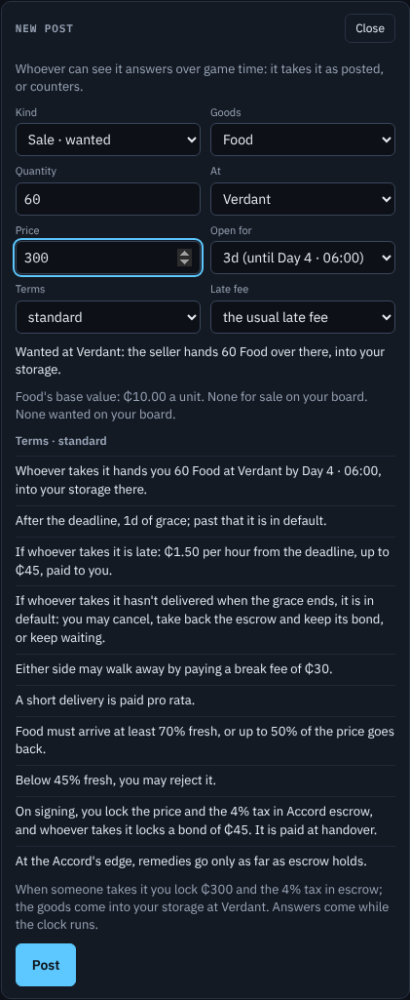
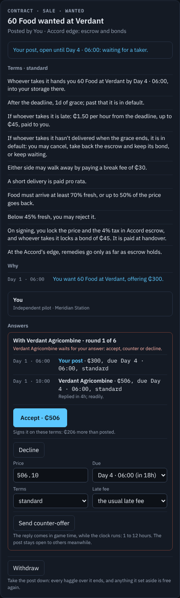
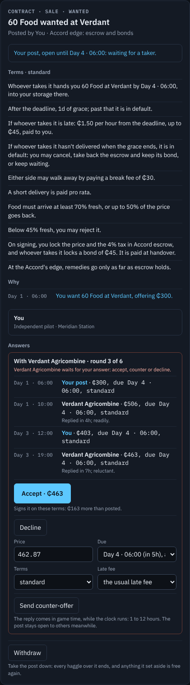
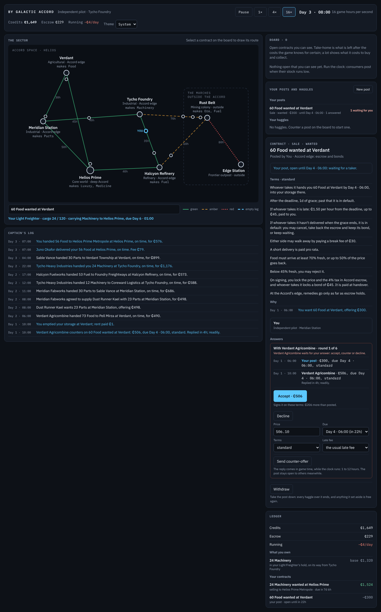

# S5 — Posting, responses and haggling

The step's goal, deliverable and verify are in [`plan.md`](../plan.md) §3, with a status line that links here.
Section references (§n) are to the design, [`by_galactic_accord_gdd_v0.3.md`](../../by_galactic_accord_gdd_v0.3.md).

*S5 status (2026-10-27): done.* The player now **posts** as well as takes (§3.6): a wanted Sale, goods for sale
from its storage, or a haul of its stored goods, at a price, deadline, term package and late fee it chooses. A
post **reaches** the AI actors that can see it by their **presence** (at once where they are, 4 game hours next
door, 8 further), and each **answers in game time**: it takes the post as posted, or counters, which opens a
**haggle**. Either side then accepts, counters (price, deadline, package, late fee) or walks away; every AI reply
comes 1 to 12 game hours later, quicker from an eager actor and slower near its limit, and is worded
"readily", "reluctant" or "appears to be at its limit" (§16.5). The player can also counter anyone's post on
the board. **AI-to-AI deals haggle in closed form**: a post that waits ripens, and a responder that would not take
it as posted settles it at once by the same round rules. **Over a million ticks every invariant holds for both
seeds; AI actors haggle a quarter of wanted Sales (at 1.11× the posted price on average) and 4–6% of hauls
(1.16×); 7% more contracts are fulfilled than in S4 (117,700–119,300), but 6.6–7.5% of those signed fail or are
cancelled (S4: 4.3–4.8%).** The first two **bot players**, a board taker and a market reader, play a million ticks
through the same session the client uses without breaking an invariant. In the client a "Your posts and haggles"
panel opens the **post composer** and lists **my posts** with their answers; a contract shows its haggles as
**threads** with each offer, each reply's time and tell, and a counter form.

| The post composer | Answers: the farm counters in 4 h, "readily" |
|---|---|
|  |  |
| **A haggle, round 3 of 6** | **Running at 16×** |
|  |  |

[Start](S5/01-start.png) · [someone else's post, with a counter form](S5/02-contract.png) ·
[light theme](S5/05-light.png) · [phone width](S5/06-phone.png).

## What was built

- **Offers** (`Domain/Offer.cs`): a price, a deadline, a term package and a late-fee scale (half, the usual, or
  double the package's). `Terms.For(contract, offer)` builds a contract's terms from an offer, every figure
  scaled from the offered price as before; `ContractTerms` gains `LateFeeScale`. An agreed offer amends the
  contract before it signs (`Contract.Amend`; `PostedDeadline` keeps what was posted).
- **Haggles** (`Domain/Negotiation.cs`): a `Negotiation` between a contract's poster and one responder, its `Bid`s
  (round, tick, who, the offer, and for a reply its hours and `Tell`), whose turn it is, when a reply is due, and how
  it ended (`NegotiationEnd`: agreed, declined, walked away as too wide or after six rounds, could no longer
  perform, the post closed). The registry is in `SimulationContext` (`Negotiation`, `NegotiationWith`,
  `NegotiationsOn`, `CloseNegotiationsOn`). The unused `ContractStatus.Negotiating` is gone: a contract under haggle
  stays open to everyone, and whoever signs first ends the other haggles.
- **The haggling rules** (`Actors/Haggling.cs`, replacing `Actors/Negotiation.cs`, whose closed form only the tests called): `Opening` (a counter
  opens 8–33% from the side's reservation, wider for a slow conceder), `Concede` (part of the way toward it, never
  past), `Crosses`, `TooWide` (more than 35% from it: walk away), `TellFor` (within 4% of the limit "at its limit",
  within 15% "reluctant", else "readily"), `ReplyHours` (1 h, plus up to 4 for a slow conceder, plus up to 6 near
  the limit, plus a spread of an hour computed from the haggle's ids; 1–12 h) and `Resolve`, the closed form.
- **AI-to-AI haggling in closed form** (`DecisionEngine.Haggling.cs`). A trader scoring a haul, a fill or a
  brokered fill, a producer answering a wanted Sale or selling delivered, and a consumer buying a lot take the post
  as posted if it clears their floor (found by false position, `LeastPrice`). If not, and the AI poster would give
  more, `Haggling.Resolve` plays the rounds out at once and the deal signs at the offer accepted
  (`Market.SignAgreed`). Where a poster stands is `PosterReservation`: nothing on a fresh post; as it waits it gives
  ground, after two days up to a personality's share (0.25 + 0.5 × (1 − liquidity preference)) of the way to its
  hidden reservation; a haul serving a Sale already signed gives that share at once; a payer never goes past what
  it can pay from credits it hasn't already promised (`Uncommitted`). `PriceMemory` learns from haggled prices.
- **The player's posts and their answers** (§16.6). `PlayerActions.CheckPost`/`Post` (a `PostDraft`: kind, good,
  quantity, place, destination for a haul, price, how long it stays open, package, late fee) posts through
  `Market.PostSale`/`PostHaul`; `DecisionEngine.NoticePost` schedules a **`PostReached`** for each AI actor whose
  habits answer that kind (carriers hauls; producers of the good and carriers wanted Sales; consumers of the good
  lots) and that can see it, after its reach (`Visibility.Presence`, `ReachHours`: 0, 4 or 8 h) and its reply hours.
  There it quotes on the post (`CarrierQuote`, `FillerQuote`, `ProducerQuote`, `BuyerQuote`, each with the nearest
  terms it can meet, `Fit`) and takes it (`TakeOn`, by its own command) or counters (`Market.Counter`).
- **Replies over game time.** An offer to an AI (the player's counter, on its own post or on someone else's)
  schedules **`ReplyDue`** (`ExpectReply`): its hours follow from what the AI expects to say, and what it says is
  decided again when it comes (`Decide` on the AI's `Quote`: accept if it crosses, walk away if too wide or after six
  rounds, else concede). An AI poster's quote (`PosterQuote`) values the terms too: a later deadline, looser package
  or smaller late fee costs the player. The player answers with `PlayerActions.AcceptOffer`, `Counter`, `Decline`
  or `Withdraw`; accepting signs by the performer's own command (`TakeOn`), so a ship that has meanwhile been
  taken can no longer perform (`Signing.CannotPerform`) and the haggle ends.
- **Journal**: `OfferMadeEntry`, `OfferAcceptedEntry`, `NegotiationEndedEntry` (`INegotiationEntry`), worded from the
  player's side by `JournalText.Haggle`.
- **The client** (§11.3): a "Your posts and haggles" panel with **New post** (the composer: kind, goods, quantity,
  place, destination, price, open for, terms, late fee; the reference price from the base value and the board; the
  terms as sentences from the poster's side; what posting commits; why it can't be posted) and **my posts** (each
  with its answers and "n waiting for you"), and the player's haggles over others' posts. The contract panel shows
  the haggles as threads (each offer, its time, the reply's hours and tell, whose turn, when a reply can come at
  the latest), with accept, decline and a counter form, and a counter form on any post it may take. A reply is a log
  line and a flag, not a pause: the hard pause stays for decisions.
- **Bot players** (§20.3; `Presentation/Bots`): a `Bot` plays through `GameSession` as the client does; `BotRun`
  runs the clock four game hours at a time, answers decisions by the AI's rule and checks the invariants every
  5,000 ticks. The **board taker** takes the board's best deal as posted whenever its ship is free. The **market
  reader** (a first cut) looks for a delivered wanted Sale that pays well over the goods' cost at a producer's door,
  posts its own wanted Sale there, haggles the answers down to its budget and fills the Sale with the goods;
  otherwise it takes the board's best deal, but counters at 1.12× a post that has waited 36 hours. The CLI's
  **`bots`** command runs both side by side.
- **Telemetry**: the soak harness counts signed Sales and Hauls by kind and how many were haggled to a price other
  than posted, and at what ratio.

## Checks and measurements

All on this cloud container: 4 cores, .NET SDK 10.0.403, Node 22, Playwright 1.63 with its Chromium, Linux. The
S4 figures for the soak harness and the engine in the browser were measured again here, from S4's commit, for a
fair comparison; S4's test times are from its log.

| Measure | Before (S4) | After |
|---|---|---|
| Tests | 215: 191 fast, 24 soak | 238: 213 fast, 25 soak |
| `dotnet test -c Release` | 191 pass, 5 s test time, 8 s wall | 213 pass, 8 s test time, 11 s wall |
| `dotnet test -c Release --filter Category=Soak` | 24 pass, 1 min 12 s | 25 pass, 1 min 45–48 s (the new one plays both bots for a million ticks) |
| `dotnet build -c Release` (whole solution) | 0 warnings | 0 warnings |
| Soak harness, 1M ticks, seeds 42 and 20260619 (Release, one at a time) | 12.9 s, 13.8 s | 16.7 s, 16.2 s |
| Bot players (`bots`), 200,000 ticks, both bots | — | 7.5 s (seed 42), 7.5 s (seed 20260619) |
| Engine in the browser, 20,000 hours, seed 42 | 3,937–4,088 ms, 4,900–5,100 hours a second | 4,008–4,316 ms, 4,600–5,000 hours a second |
| State after 20,000 hours, WebAssembly vs desktop | identical | identical |
| Client ready in headless Chromium | 1.0–1.9 s (S4's log) | 1.1 s |
| `node check.cjs` end to end | 40–60 s (S4's log), all checks pass | 49 s (it now posts, haggles and waits for a reply), all checks pass |
| C# and Razor lines | engine 7,463, presentation 2,509, client 928, harness 277, tests 3,630 | engine 9,106, presentation 3,722, client 1,428, harness 353, tests 4,332 |

The harness is about a fifth slower: 7% more contracts, 8% more journal entries, and a floor found by false
position wherever a post isn't taken as posted.

**The plan's checks** (in `HagglingTests` unless named):

| Verify | Test |
|---|---|
| Reply timing is deterministic per seed | `Reply_timing_is_deterministic_per_seed` (a full world, the player's post and its counters over three days, run twice: every haggle entry at the same tick, in the same order, with the same cause); `NegotiationTests.Replies_take_one_to_twelve_hours…` |
| A food post at Verdant draws the producer's response | `A_food_post_at_verdant_draws_the_producers_counter_and_accepting_it_hands_the_food_over`, and the browser check |
| Haggling cannot advance while paused | `Haggling_cannot_advance_while_paused` (forty paused frames: no game time, no answer; at 16× the answers come), and the browser check (paused after the counter: no game time passes; at 4× the reply comes) |
| The bots run a full soak without breaking invariants | `BotTests.Both_bots_play_a_full_soak_without_breaking_an_invariant` (seed 42, a million ticks each) |
| The reservation leak is gone | `PostingViewTests.No_view_gives_away_a_posters_hidden_reservation`: two worlds alike but for one wanted Sale's hidden reservation (₵900 or ₵2,400) read the same on the board, the contract, the posts, the ledger and the log |

The rest of the haggle has tests too: taken as posted after the reply time; an AI poster holds a fresh post and
settles a ripe one in closed form; a counter moving the package, late fee and deadline re-scales the terms; an AI
poster concedes round by round; too wide is walked away from; six rounds run out; the player posts a lot and a
haul of its stored goods; withdrawing ends the haggles and another taker ends the rest; the player as a buyer is
asked when its seller defaults. `PostingViewTests` and `ViewTests` check the composer, the threads and the posts.

**Soak telemetry, 1M ticks** (a contract can count under several failure paths):

| | S4, seed 20260619 | S5, seed 20260619 | S4, seed 42 | S5, seed 42 |
|---|---|---|---|---|
| Money supply drift | −1.7% | −2.0% | −2.7% | −3.2% |
| Faucet multiplier at the end | 0.60 | 0.60 | 0.69 | 0.59 |
| Contracts fulfilled (in full or pro rata) | 109,889 | 117,675 | 111,188 | 119,266 |
| Breached / payer defaulted / cancelled | 783 / 239 / 3,967 | 1,094 / 474 / 8,023 | 493 / 41 / 5,085 | 573 / 601 / 7,296 |
| Failed or cancelled, of signed | 4.3% | 7.5% | 4.8% | 6.6% |
| Expired unsigned | 56,896 | 50,236 | 56,695 | 51,852 |
| Goods consumed | 2,145,149 | 2,161,652 | 2,148,578 | 2,172,230 |
| Wanted Sales haggled by AI actors | — | 24.2%, at 1.11× posted | — | 24.3%, at 1.11× |
| Hauls haggled | — | 4.4%, at 1.16× | — | 6.1%, at 1.16× |
| Lots (for sale) haggled | — | 0.2%, at 0.91× | — | 0.3%, at 0.91× |
| Edge Station: food, medicine, machinery met | 54%, 35%, 78% | 59%, 34%, 84% | 52%, 37%, 79% | 55%, 35%, 85% |

| Failure path, 1M ticks | S4, 42 | S5, 42 | S4, 20260619 | S5, 20260619 |
|---|---|---|---|---|
| Late delivery | 3,414 | 5,817 | 3,224 | 5,468 |
| In default (grace ran out) | 786 | 1,360 | 703 | 1,987 |
| Cancelled for default | 651 | 1,117 | 482 | 1,565 |
| Cancelled at will | 4,434 | 6,179 | 3,485 | 6,458 |
| Short, paid pro rata | 1,241 | 1,377 | 1,034 | 1,059 |
| Short, a failure | 147 | 188 | 325 | 393 |
| Quality refund | 1,500 | 2,584 | 3,225 | 4,460 |
| Rejected below the floor | 21 | 56 | 150 | 338 |
| Whole cargo lost | 325 | 329 | 308 | 363 |
| Cargo liability charged | 121 | 114 | 281 | 334 |
| Payer default | 41 | 601 | 239 | 474 |
| Expired | 56,695 | 51,852 | 56,896 | 50,236 |

- **More trade, and more of it goes wrong.** Haggling signs posts that expired in S4 (expiries fall by 4,800–6,700)
  and fills more Sales, so more goods are consumed. But the deals it adds are the marginal ones: a post that waited
  two days, a performer who wouldn't take it as posted. Late deliveries rise by 70%, cancellations by 40% (seed 42)
  and 100% (seed 20260619), and the failure share by two to three points. Strict terms still fail least (4.3% and
  5.8%).
- **Payer default rose** (41 → 601, 239 → 474): more of the frontier's wanted Sales sign, and a poster checks its
  credits in hand, not what it has already promised to other posts (see the questions).
- **Demand met** moves within a few points for most consumers. The frontier holds or improves (Edge Station's
  machinery 78–79% → 84–85%, food up 3–5 points); Halcyon's ore rises 9–11 points. Seed 42 loses some: Verdant
  machinery 77% → 66%, Helios Prime luxury 99% → 78% and medicine 91% → 83%, Rust Belt parts 86% → 76%. Seed
  20260619 loses less: Meridian fuel 86% → 79%, Tycho fuel 90% → 86%, Rust Belt parts 81% → 78%. I haven't traced
  the luxury drop.
- **Producers' delivered sales are not saved by haggling.** Walking away (cancelled at will) rose from 4,434 to
  6,179 and from 3,485 to 6,458. Carriers near the goods are busy, not underpaid: haggled fills keep them busier,
  and a dearer haul offer doesn't free a ship. The defect stays open for S6 (what carriers can see) and S7.

**The bots** (`dotnet run --project src/ByGalacticAccord.Cli -- bots`; every run kept every invariant):

| | Seed 42, 200,000 ticks | Seed 20260619, 200,000 ticks | Seed 42, 1M ticks |
|---|---|---|---|
| Board taker: end credits, deals | ₵45,531, 1,290 | ₵61,708, 1,436 | ₵99,612, 5,489 |
| Market reader: end credits, deals | ₵56,522, 1,334 | ₵46,849, 1,290 | ₵83,100, 5,415 |
| Market reader: its own posts, counters | 2, 406 | 7, 389 | 2, 1,515 |
| Decisions put to either | 0 | 0 | 0 |

Both start with ₵3,000 and end far ahead; they gain ₵5–7 a game day over the first 8,333 days and about ₵2 over a
million ticks. Neither is reliably better.

**The browser check passes:** S4's steps, plus the counter form on someone else's post; composing and posting a
wanted Sale of 60 food at Verdant for ₵300; the farm's answer arriving as a thread with its reply time and tell;
countering it halfway back to ₵300; paused, no game time passes; the reply at 4×; the log wording the haggle; both themes, phone width, the speed probe and the fingerprint; no console errors.

## Decisions taken in code

- **The closed form plays the rounds; it doesn't split the difference.** A first version settled every AI-to-AI deal
  at the midpoint of the two reservations: consumers paid away half their surplus on every deal, drained, and
  the faucet multiplier fell to 0.35 in a trial run. `Haggling.Resolve` runs the same opening, concession and
  walk-away rules a haggle with the player follows, so a deal lands where the rounds would take it.
- **A fresh post means its price.** An AI poster gives nothing on a fresh post and ground in step with its waiting,
  all it ever will after two days (`PosterReservation`), so a post's price holds while it is fresh and haggling is what a post that waits turns to.
  A haul serving a Sale already signed is ripe at once: the Sale is at stake. This, the round rules above and the
  cap below together brought the economy back from the trial run's collapse.
- **A payer haggles only with money it hasn't promised.** The cap is `Uncommitted / (1 + tax)`. Posting a wanted
  Sale still checks only the credits in hand: checking what was promised too ended payer default altogether
  (zero over a million ticks, failing S4's "every failure path happens" check). See the questions.
- **Only the player haggles in game time** (`Market.HagglesInGameTime`). AI-to-AI deals settle at once in closed form,
  so the world keeps S4's pace and the only open threads are the player's. A player's purchase at the producer's door
  (`BuyAtSource`, filling a Sale with goods it buys there) stays immediate, as it was.
- **No contract is locked while it is haggled over.** Others may take it as posted meanwhile; a signing, withdrawal or
  expiry ends every haggle over it (`CloseNegotiationsOn`). When the player accepts an AI's offer, the AI signs it
  then, by its own command; if its ship has been taken meanwhile, the haggle ends: it "could no longer do what it
  offered".
- **Replies draw no randomness.** Their hours come from the responder's concession rate, its tell, and a spread from
  ids, so a player's command between events consumes nothing from the seeded stream and reply timing is the same
  for a seed whatever the player does.
- **A reply is a notification, not a pause** (§8.3, as S4's log suggested). The hard pause stays for decisions.
- **A counter may move four things**, as §16.5 lists: the price; the deadline, from a day earlier to three days later;
  the package; and the late fee (half, the usual or double). An AI values a change of terms in money
  (`TermsValue`) and answers with the nearest terms it can meet (`Fit`).
- **The player's posts are answered only by actors whose habits fit** (§4.1): carriers hauls; producers of the good
  and carriers wanted Sales; consumers of the good lots. Test worlds built `Quiet` answer nobody unless asked
  (`SimulationConfig.PostsDrawAnswers`), so S3 and S4's tests of the player's own posts keep their meaning.
- **The bots live in Presentation** and play through `GameSession`, the client's way in, so they exercise the views'
  commands as a player does. They answer decisions by the AI's rule.

## Gotchas

- **`OfferedPrice` is what was posted; `Price` what was agreed.** After a haggle they differ, and so do `DeadlineTick` and
  `PostedDeadline`. The terms on a signed contract are the agreed ones (`Contract.Terms`).
- **What an AI will say is decided twice**: once when the offer is made (to know how long the reply takes), and
  again when the reply is due, from the world as it is then. Tests that expect a counter must leave the world as
  it was, or expect an accept or a walk-away.
- **A test price too far from an AI's limit draws nothing, and one generous enough is taken as posted.** Tests that
  want a counter post inside the 35% and below the limit (₵300 for 60 food at Verdant; a counter at ₵92 on a
  ₵70 haul, not ₵110).
- **A form's select needs `@key` on its options.** The deadline choices drop out as the clock passes them; without a key
  Blazor keeps the selected index and the selection silently moves to another date.
- **A haggle's thread outlives the haggle.** Signing ends it, and the contract panel still shows it (that is how the
  player sees what it agreed to).

## What the step showed

- **Haggling moves money as well as goods.** A quarter of wanted Sales sign at 1.11× posted, so consumers pay more
  for what they get and the inflation monitor reacts (seed 42: faucet 0.69 → 0.59). The economy stays within 3.2% of
  its money supply.
- **The market reader rarely finds a spread worth posting for.** It posted 2 to 7 wanted Sales in 8,333 game days;
  most of what it does differently from the board taker is countering posts that have waited. My reading, not
  measured: on an omniscient board (S6's defect) every AI sees a spread when the reader does, and closes it first.
  S6's verify is "the market reader beats the board taker"; today neither beats the other reliably.
- **Decisions still rarely reach a player.** Neither bot was asked one in 8,333 days. The player-as-buyer path works
  (`The_player_as_buyer_is_asked_when_its_seller_defaults`), but a bot buying a handful of times doesn't meet it.

## Questions for review

- **Haggling everywhere, or not for a sub-contract?** Closed form applies to brokered fills and to producers' delivered
  sales too. In a trial run with it off there, cancellations fell to 1,686 and 2,423 (seeds 42 and 20260619), but
  fulfilled contracts fell to 104,828 and 107,720 (below S4's) and Helios Prime's luxury to 40% and 72% met. I kept
  it on. Is the higher failure share (6.6–7.5%, against 4.3–4.8%) an acceptable price for posts that no
  longer expire unsold, or should a performer weigh lateness more as a price rises?
- **Should a wanted Sale be limited by what its poster has already promised?** Today a poster checks its credits in
  hand, so a frontier buyer can owe more than it has and defaults involuntarily (474–601 times a million ticks).
  Checking promised money removes payer default from the soak entirely. S4's open question (should a frontier payer
  be able to *choose* not to pay?) is the other way to keep the path alive.
- **Is the market reader the right second beat?** It buys into a spread it read off the board. With an omniscient
  board that rarely pays; S6's knowledge store and staleness are what would give it an edge. Should it instead be
  scripted around something S6 brings?
- **Helios Prime luxury in seed 42** fell from 99% to 78% met (seed 20260619: 86% → 84%). I haven't traced why; it
  could be worth a look before S7 adds parts to the supply chain.

## Hand-off: where to start reading

- `src/ByGalacticAccord.Engine/Actors/Haggling.cs`: the round rules and the closed form.
- `src/ByGalacticAccord.Engine/Actors/DecisionEngine.Haggling.cs`: `PosterReservation`, `Price`, `ClosedForm`; for the
  player, `NoticePost`, `Respond`, `ExpectReply`, `Reply`, `Decide`, `TakeOn` and the quotes.
- `src/ByGalacticAccord.Engine/Simulation/Market.Haggling.cs` (`Counter`, `AcceptOffer`, `SignAgreed`),
  `Domain/Negotiation.cs`, `Domain/Offer.cs`, `Events/NegotiationEvents.cs`, `Economy/Visibility.cs` (`ReachHours`).
- `src/ByGalacticAccord.Engine/Actors/PlayerActions.cs`: `Post`, `Counter`, `AcceptOffer`, `Decline`, `Withdraw`.
- `src/ByGalacticAccord.Presentation/Views/ComposerView.cs`, `NegotiationView.cs`, `PostsView.cs`; `Bots/`.
- `CODEMAP.md` §1 (haggling between AI actors, a haggle with the player) and §3 (`PostReached`, `ReplyDue`).

## Commands

```bash
dotnet build -c Release                         # from ByGalacticAccord/
dotnet test -c Release                          # fast tests
dotnet test -c Release --filter Category=Soak   # soak-length tests
dotnet run --project src/ByGalacticAccord.Cli -- soak 1000000 --seed 42       # telemetry above
dotnet run --project src/ByGalacticAccord.Cli -- soak 1000000 --seed 20260619
dotnet run --project src/ByGalacticAccord.Cli -- bots --seed 42               # the bots, 200,000 ticks
dotnet run --project src/ByGalacticAccord.Cli -- bots 1000000 --seed 42
dotnet run --project src/ByGalacticAccord.Client           # http://localhost:5180
cd tools/client-check && npm ci && node check.cjs          # screenshots in artifacts/client-check/screenshots
```

## Files

- Added:
  - Engine: `Actors/Haggling.cs` (replaces `Actors/Negotiation.cs`), `Actors/DecisionEngine.Haggling.cs`;
    `Domain/Negotiation.cs`, `Domain/Offer.cs`; `Events/NegotiationEvents.cs`; `Simulation/Market.Haggling.cs`.
  - Presentation: `Views/ComposerView.cs`, `NegotiationView.cs`, `PostsView.cs`; `Bots/Bot.cs`, `BoardTaker.cs`,
    `MarketReader.cs`, `BotRun.cs`.
  - Client: `Components/ComposerPanel.razor`, `OfferForm.razor`, `PostRow.razor`, `PostsPanel.razor`,
    `ThreadView.razor`. Harness: `Bots.cs`.
  - Tests: `BotTests.cs`, `HagglingTests.cs`, `PostingViewTests.cs`.
  - `log/S5.md`, `log/S5/*.png`.
- Changed:
  - Engine: `Actors/DecisionEngine.cs`, `DecisionEngine.Consumers.cs`, `DecisionEngine.Producers.cs`,
    `DecisionEngine.Traders.cs`, `PlayerActions.cs`, `PriceMemory.cs`; `Domain/Contract.cs`, `ContractTerms.cs`,
    `Ids.cs`; `Economy/Visibility.cs`; `Simulation/EventJournal.cs`, `Market.cs`, `SimulationConfig.cs`,
    `SimulationContext.cs`, `Terms.cs`.
  - Presentation: `Session/GameSession.cs`; `Text/JournalText.cs`, `Templates.cs`, `Templates.resx`;
    `Views/BoardView.cs`, `ContractView.cs`, `LogView.cs`.
  - Client: `Shell.razor`, `_Imports.razor`, `Components/ContractPanel.razor`, `wwwroot/css/app.css`.
  - Harness: `ByGalacticAccord.Cli.csproj` (references Presentation, for the bots), `Program.cs`, `Soak.cs`.
    Browser check: `check.cjs`.
  - Tests: `NegotiationTests.cs`, `TemplateTests.cs`, `TestWorld.cs`, `ViewTests.cs`.
  - `CODEMAP.md`, `README.md`, `plan.md`, `log/README.md`.

## Next: S6, information and the news

- **Presence already exists** (`Visibility.Presence`: home, each ship's location or destination, each storage) and
  sets how soon a post reaches an actor (`ReachHours`). `Visibility.CanSee` is still S2's home-region rule; S6's
  tiers replace it, and `ReachHours` should follow them.
- **A responder's quote reads the world directly** (stock, prices on the board). S6's per-actor knowledge store is
  where its reservation should come from, so that a stale view makes a worse quote (D32).
- **The market reader needs an edge to beat the board taker** (S6's verify). Today the board is omniscient, so a
  spread is taken before the reader can act on it; faded, "as of" information is what it would read.
- **The haggling telemetry** (share haggled, ratio to posted) and the failure paths are the baseline for S6's
  changes; the defects table names what S5 left open: producers' delivered sales (carriers' time, S6/S7), and the
  board's estimate not counting a cancellation for default (S9).
