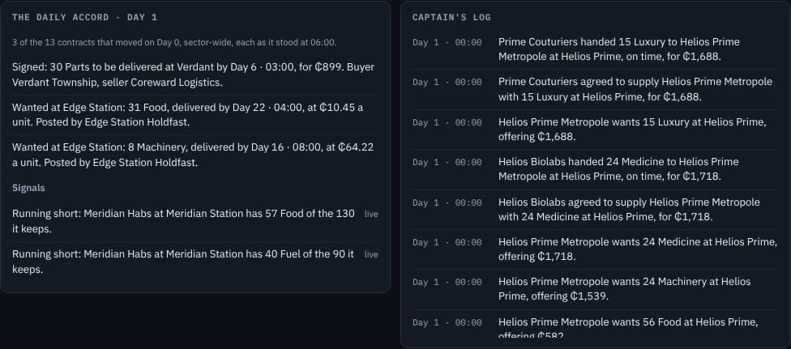
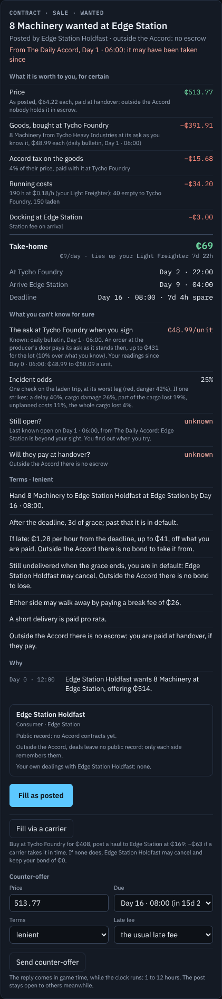
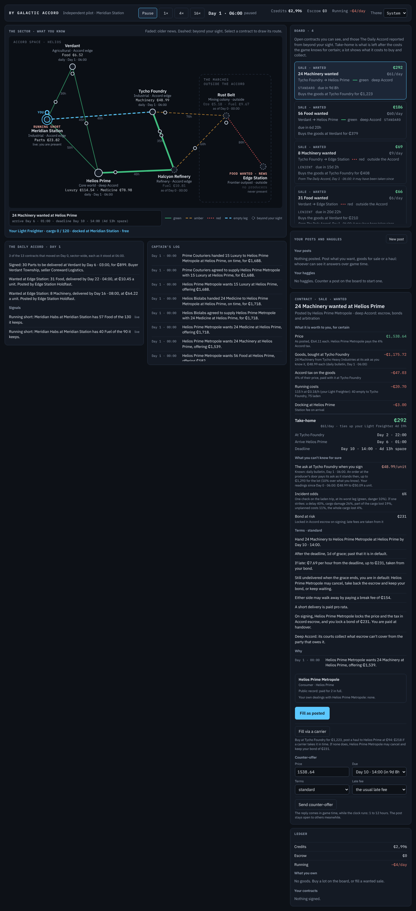

# S6 — Information and the news

The step's goal, deliverable and verify are in [`plan.md`](../plan.md) §3, with a status line that links here.
Section references (§n) are to the design, [`by_galactic_accord_gdd_v0.3.md`](../../by_galactic_accord_gdd_v0.3.md).

*S6 status (2026-10-28): done.* What an actor knows now depends on where it is (§7). Its **presence** is its home,
each of its ships (where it is docked, or where it is heading) and each storage it rents. Each location is **here**
(present: every contract the moment it is posted, live prices and stock), **near** (one jump away: contracts after 4
game hours, the asks from a daily bulletin) or **far** (no contracts, prices as last seen). Every actor keeps a
**knowledge store** of what it last read of each producer, with when, and decides on it: it trusts what it last saw
(D32). **The Daily Accord** goes to press at 06:00 every game day with three of yesterday's contracts, drawn at
weighted chance by size, novelty and failure, and three times likelier from the frontier. It is how far markets reach
anyone. A post it reports open is known to everyone until its deadline, and nobody can tell whether it has been taken
since. Accord contracts leave a **public record** per actor; each party also remembers its own dealings. In the
client, the map marks each location here, near or far and fades what the player knows of it with age, labelled "live",
"daily · …", "as of …" or "never present". Rows on the board known only from the news say so. **The Daily Accord**
panel sits beside the captain's log with the **signals** (an idle producer, a consumer running short, a price well off
the player's readings). A contract shows its party's public record and the player's own dealings with it.
**Over a million ticks every invariant holds on both seeds and the frontier is still supplied (risk R1): Edge Station
gets 51–56% of its food, 35–38% of its medicine and 82–86% of its machinery (S5: 55–59%, 34–35%, 84–85%).** With
less to see, 2–5% fewer contracts are fulfilled (111,900–116,700) and 4–5% fewer goods are consumed, but fewer fail
or are cancelled (6.3–6.5% of those signed; S5: 6.6–7.5%). The news keeps much of that trade going: without it, seed
42 fulfils 8% fewer contracts. **The market reader beats the board taker**: over ten seeds at 200,000 ticks it wins
9 and ends with 1.16× the taker's credits. Its edge is judgement, not a wider view: it prices in the risk a deal
carries and asks what the board offers from where the deal ends.

| What the player knows, by tier | The Daily Accord and the signals |
|---|---|
|  |  |
| **A contract known only from the news** | **The party's public record** |
|  |  |

[Running at 16×](S6/03-running.png) · [the post composer](S6/09-composer.png) · [answers](S6/10-answers.png) ·
[light theme](S6/05-light.png) · [phone width](S6/06-phone.png).

## What was built

- **Presence and the tiers** (`Economy/Visibility.cs`, rewritten). `Visibility.Of(context, actor)` builds a `Sight`:
  the actor's presence (`Visibility.Presence`: home, each ship's location or, in transit, its destination, each storage
  it rents) and the `Tier` of every location from it: `Here` where it is present, `Near` one jump from any of those
  places, `Far` beyond. `Sight.CanSee(contract)`: its own contracts; one with a place here at once; near after
  `ReachNear` (4) hours; far never. `ReachHours` follows the same tiers (S5's 8 hours for "further" is gone: further
  is far). The same rules apply to every actor, the player too. This replaces S2's home-region rule (Helios covered 5
  of 7 locations) and the v0.2 scouting it carried (`Scout`, `HasFreshScout`, `ScoutFreshnessTicks`).
- **The knowledge store** (`Economy/Knowledge.cs`). Each actor has an `ActorKnowledge`. It holds its last
  `PriceReading` of every producer it has known (the ask and when, the stock free to sell and when, and how it learnt
  it: `Live`, `Seen`, `Daily`, `News`, `Start`), a history of one ask a day for 14 days, when it was last present at
  each location, the contracts the news told it of that it found closed, and the producers that turned down its order
  at the door. Only events write it:
  - world generation (`Knowledge.Seed`: everyone knows the sector as it starts);
  - the actor's heartbeat (`Look`: live where it is present);
  - its ship's pickup and arrival (`LookAt`);
  - **`PricesPosted`**, the morning bulletin at 06:00 (`PriceBulletin`: every producer's ask; each actor notes the
    asks one jump from its presence);
  - the news (a producer's lot: its unit price);
  - signing (a contract found closed) and refusal.

  `Knowledge.ReadingOf` answers what an actor knows of a producer now: live here, the bulletin's ask near, what it
  remembers far. A stock it saw counts only while no newer ask has been read (`PriceReading.CurrentStock`).
- **AI decides on its own knowledge** (D32). Traders and the player plan fills from what they know
  (`DecisionEngine.FillSources`, through `Knowledge.KnownAsk`). Consumers choose lots and wanted posts from what they
  know of the producers. Every actor ranks only the contracts it believes open (`Knowledge.OpenContracts`, through
  `Known<T>`): those it sees live, plus those the news reported open that it hasn't found closed and whose deadline
  hasn't passed. Trusting a stale view has consequences:
  - **An order at a producer's door** (`Market.BuyAtSource`, `SaleContract.AtTheDoor`) is posted at what the buyer
    expects to pay plus `DoorTolerance` (10%, `DoorLimit`). The producer signs it at its ask as it stands. When the ask
    has risen past the limit, the producer turns it down and the buyer leaves that producer out of its plans for a day
    (`Knowledge.RefusalHours`).
  - **A post believed open may be gone.** Trying to take it returns `Signing.NotOpen` and the actor notes it closed
    (`Knowledge.NoteClosed`). A trader tries at most two such options a heartbeat.
- **The public record** (`Economy/TrackRecord.cs`). `Records.PublicRecordOf(actor)` counts how the actor's contracts
  in Accord space ended:
  - as performer: delivered on time, late or short; failed; cancelled for its default; walked away from;
  - as payer: paid in full; defaulted; walked away from.

  The frontier leaves no public record. Each party also remembers its own dealings with each counterparty, frontier
  ones too (`DealingsWith`). `Settlement` notes each ending.
- **The Daily Accord** (`Economy/News.cs`, `Events/InformationEvents.cs`). **`NewsPublished`** goes to press at 06:00,
  after the bulletin. It gathers every contract with a journal entry yesterday (orders at the door aside) and words
  each by where it stands at press time (`NewsKind`: posted, signed, delivered, short, failed, cancelled, defaulted,
  expired). Each `NewsItem` carries the facts its sentence needs: how late, why it failed, who cancelled, and the
  week's sector average a unit for a Sale. It then draws `NewsItemsPerDay` (3) by weighted chance from `Rng`. The
  weight (`NewsDesk.Weight`) is size × novelty × outcome × frontier:
  - size: √(price / ₵500), from 0.5 to 4;
  - novelty: 1 + 2 × how far the price is off the week's average a unit, or off the usual haul offer, up to 4;
  - outcome: failed, cancelled or defaulted 4; short or late 2; posted or expired 1.5; else 1;
  - frontier: 3× for a contract with a place outside the Accord (`NewsFrontierWeight`, for R1).

  A post the news reports open is known to every actor from then on (`NewsDesk.ReportedOpen`, `Knowledge.FromNews`).
  A lot in the news tells every reader the producer's unit price. The player's own posts reach, through the news, the
  actors who couldn't see them (`DecisionEngine.NoticePost(fromNews: true)`).
- **The interface** (`Presentation`):
  - `InfoText`: ages ("live", "daily bulletin, Day 4 · 06:00", "as of Day 2 · 14:00", "from the news", "last
    present", "never present"; `Age`: live, today, days, old) and the record as sentences.
  - `NewsText`: every kind of item as a headline worded from the player's side, with how far a price is from the
    week's average when it is more than a tenth off.
  - `NewsView`: the latest issue, and the signals in what the player knows, each with its age:
    - an idle producer (its warehouse full);
    - a consumer running short (both seen only where the player is present);
    - a price 15% or more off the player's own readings of it (three days of readings at least).
  - `MapView`: each node's tier, the asks the player knows there with their age, its most pressing signal as a
    badge, and a legend for what is beyond sight.
  - `BoardView`: what the player believes open, with how it knows each row (`Seen`: "From The Daily Accord, Day 1 ·
    06:00: it may have been taken since") and its age.
  - `ContractView`: how the player knows the contract; the party's public record, a note that frontier deals leave
    none, and the player's own dealings with it; the goods line priced "at its ask as you know it, as of …"; "Still
    open?" and "The ask at Verdant when you sign" among the uncertain inputs.
  - `GameSession`: `Sight` and `KnownOpen`, which the composer and the bots read too.
- **The client:**
  - `Components/NewsPanel.razor`: The Daily Accord and the signals, beside the captain's log; a headline selects its
    contract.
  - The map draws each location by its tier (`data-tier`), fainter with age, with a dashed ring beyond sight, the
    asks' age under the name and a badge.
  - Board rows carry `data-seen` (live or news) and fade with age.
  - The contract panel shows the record and how it is known.
- **The market reader** (`Bots/MarketReader.cs`, `Bot.ReadDeal`). It ranks the deals it could take as posted by
  take-home a day after their risk (`Bot.Risk`: the incident odds on the laden leg times a fifth of what is at stake,
  the price, the goods and the bond; outside the Accord also a tenth of the price, for a payer who may not pay). It adds half of the best deal the board shows from where
  the first one ends (`NextLegWeight`). It still counters a post that has waited (`Haggles`). Its S5 purchase plans
  (posting its own wanted Sale at a producer's door) are now off unless asked (`PlansPurchases`; see the
  measurements). It prices them from the asks it knows.
- **Telemetry**: the soak harness prints an information section with:
  - orders at producers' doors and how many were turned down, for the price or for stock;
  - The Daily Accord's issues, items a day, of how many contracts, how many about the frontier and how many open
    posts;
  - contracts signed from the news, and tries that found the post closed.

  Orders at the door are left out of the haggling counts.

## Checks and measurements

All on this cloud container: 4 cores, .NET SDK 10.0.403, Node 22, Playwright 1.63 with its Chromium, Linux. The S5
figures for the soak harness and the bots were measured again here, from S5's commit, the same way (one run at a
time); S5's test times and browser figures are from its log.

| Measure | Before (S5) | After |
|---|---|---|
| Tests | 238: 213 fast, 25 soak | 258: 230 fast, 28 soak |
| `dotnet test -c Release` | 213 pass, 8 s test time, 11 s wall | 230 pass, 10–11 s test time, 12–14 s wall |
| `dotnet test -c Release --filter Category=Soak` | 25 pass, 1 min 45–48 s | 28 pass, 3 min 10–11 s (the new ones: the frontier on two seeds, and both bots over ten seeds) |
| `dotnet build -c Release` (whole solution) | 0 warnings | 0 warnings |
| Soak harness, 1M ticks, seeds 42 and 20260619 (Release, one at a time) | 13.7 s, 13.6 s | 19.7 s, 19.5 s |
| Bot players (`bots`), 200,000 ticks, both bots | 6.4 s, 6.5 s | 8.8 s, 9.1 s |
| Engine in the browser, 20,000 hours, seed 42 | 4,008–4,316 ms, 4,600–5,000 hours a second | 4,648–4,719 ms, 4,200–4,300 hours a second |
| State after 20,000 hours, WebAssembly vs desktop | identical | identical |
| Client ready in headless Chromium | 1.1 s | 1.0 s |
| `node check.cjs` end to end | 49 s, all checks pass | 48–57 s, all checks pass |
| C# and Razor lines | engine 9,106, presentation 3,722, client 1,428, harness 353, tests 4,332 | engine 10,189, presentation 4,281, client 1,515, harness 362, tests 4,873 |

The harness is 40% slower:
- Every actor now reads what it sees at every heartbeat, pickup and arrival, about 12 million readings a million
  ticks.
- Every decision builds a `Sight`.
- The news gathers yesterday's contracts every day. It costs about 3.5 s, and it is also what fulfils 10,000 more
  contracts (below).

A profile found the knowledge store's allocations first: readings are now a value type, a `Sight` is an array by
location id, and the history trims in batches. That brought it from 22.6 s to 19.1 s (one of those changes moved the
results; see the gotchas). The browser still runs the engine about 265 times faster than 16× needs.

**The plan's checks:**

| Verify | Test |
|---|---|
| Tier tests | `InformationTests`: the tiers from the player's presence, then from a ship heading elsewhere, then from storage it rents; contracts here at once, near after four hours, never far; here live, near the bulletin's ask, far as last seen, a newer ask superseding an older stock |
| The frontier still gets supplied (R1) | `EconomyTests.The_frontier_is_still_supplied_when_only_the_news_reaches_it` (seeds 42 and 20260619, a million ticks each): every consumer outside the Accord gets at least 30% of each good it wants, and someone signs a contract known only from the news |
| The market reader beats the board taker | `BotTests.The_market_reader_beats_the_board_taker`: over ten seeds (1–8, 42, 20260619) at 200,000 ticks, the reader must win at least 7 and end with more than 1.05× the taker's credits together |

`InformationTests` also covers:
- an AI trader trusting a stale ask, and paying the ask as it stands at the door;
- a refusal leaving a producer out of its plans for a day;
- the news reporting yesterday's contracts as they stand;
- a far post known everywhere until found closed;
- the player's far post reaching actors through the news;
- the news weights, and the same news for a seed;
- the public record and own dealings.

`InformationViewTests` covers:
- every kind of item as a headline, for an AI and for the player;
- the map's tiers and ages;
- the signals with their ages and badges;
- a board row and contract known from the news;
- the public record, and the goods line's "as you know it".

**Soak telemetry, 1M ticks** (a contract can count under several failure paths):

| | S5, seed 20260619 | S6, seed 20260619 | S5, seed 42 | S6, seed 42 |
|---|---|---|---|---|
| Money supply drift | −2.0% | +1.4% | −3.2% | +1.9% |
| Faucet multiplier at the end | 0.60 | 0.55 | 0.59 | 0.59 |
| Contracts fulfilled (in full or pro rata) | 117,675 | 111,934 | 119,266 | 116,734 |
| Breached / payer defaulted / cancelled | 1,094 / 474 / 8,023 | 947 / 804 / 6,029 | 573 / 601 / 7,296 | 590 / 691 / 6,522 |
| Failed or cancelled, of signed | 7.5% | 6.5% | 6.6% | 6.3% |
| Expired unsigned | 50,236 | 51,570 | 51,852 | 50,078 |
| Goods consumed | 2,161,652 | 2,077,376 | 2,172,230 | 2,056,092 |
| Wanted Sales haggled by AI actors | 24.2%, at 1.11× posted | 22.4%, at 1.10× | 24.3%, at 1.11× | 21.5%, at 1.11× |
| Hauls haggled | 4.4%, at 1.16× | 4.5%, at 1.15× | 6.1%, at 1.16× | 4.1%, at 1.17× |
| Orders at a producer's door, turned down (price / stock) | — | 25,741 (121 / 15) | — | 35,495 (483 / 3,064) |
| The Daily Accord: items a day, of contracts; about the frontier | — | 3.0 of 8.3; 57% | — | 2.9 of 7.9; 58% |
| Signed from the news; tries that found the post closed | — | 7,349; 9,194 | — | 6,671; 7,511 |
| RNG draws | 63,110 | 183,670 | 64,474 | 184,772 |

| Demand met, 1M ticks | S5, 20260619 | S6, 20260619 | S5, 42 | S6, 42 |
|---|---|---|---|---|
| Meridian Habs: food, fuel | 91%, 79% | 90%, 74% | 88%, 85% | 68%, 88% |
| Verdant Township: parts, machinery | 88%, 68% | 91%, 54% | 88%, 66% | 92%, 62% |
| Helios Prime: food, machinery, medicine, luxury | 85%, 98%, 86%, 84% | 87%, 66%, 91%, 94% | 92%, 99%, 83%, 78% | 83%, 72%, 87%, 96% |
| Tycho Workforce: ore, fuel | 82%, 86% | 73%, 87% | 81%, 90% | 82%, 91% |
| Rust Belt Camp (frontier): food, parts | 62%, 78% | 60%, 77% | 63%, 76% | 52%, 83% |
| Edge Station (frontier): food, medicine, machinery | 59%, 34%, 84% | 56%, 35%, 82% | 55%, 35%, 85% | 51%, 38%, 86% |
| Halcyon Crew: ore | 82% | 80% | 80% | 80% |

- **Less is seen, so less trades, and what does trade fails less.** Fulfilled contracts fall 2% (seed 42) and 5%
  (seed 20260619), and goods consumed 4–5%. Cancellations fall by a tenth to a quarter, so the failure share falls by
  0.3 to 1 point. I haven't traced why; my guess is that fewer marginal far deals are signed.
- **Walking away (cancelled at will, mostly producers' delivered sales) fell**: 6,179 → 5,185 and 6,458 → 4,678.
  Cancelled for default moved both ways (1,117 → 1,337; 1,565 → 1,351). Carriers' hours still bind; S7's fleets are
  the fix.
- **The frontier holds** (R1): Edge Station's medicine and machinery hold and its food is 3–4 points lower. Rust Belt's
  food is 11 points lower in seed 42 and 2 in seed 20260619; its parts are up 7 in seed 42. 57–58% of the news is about
  the frontier, and 6,700–7,300 contracts a million ticks are signed by actors who knew of them only from the news.
- **The news carries 8% of the trade.** With `NewsItemsPerDay` 0, seed 42 fulfilled 109,301 contracts against 119,349
  with 3 (measured before the bulletin change in the gotchas; same code otherwise). Five items a day fulfilled 2% more
  than three on seed 20260619 (113,903 against 111,878) and moved demand met by one to three points. I kept three: it
  reads as a front page, and five bought little.
- **Helios Prime's machinery fell from 98–99% to 66–72%**, and Verdant's from 66–68% to 54–62%. In S5, Helios bought
  its machinery almost entirely as lots: in 300,000 ticks of seed 42 it posted 3 wanted Sales of machinery. Tycho
  Heavy Industries posts its lots at Tycho Foundry, two jumps from Helios, so in S6 Helios sees them only when the news
  carries one. In the same run of an earlier S6 build it posted 298 wanted Sales instead, and 85 of them expired.
  Helios' luxury rose 10–18 points the other way, and its medicine 4–5.
- **Meridian Habs' food in seed 42** fell from 88% to 68% (seed 20260619: 91% → 90%). Part of it is the bulletin change
  in the gotchas: before it, the same seed gave 74%. One lead, not confirmed over a million ticks: in a 300,000-tick
  diagnostic of an earlier S6 build, Verdant's farm filled fewer of Meridian's food Sales itself (418, against S5's
  748) and some of Rust Belt's (242; S5: none), which it can know of only from the news.
- **More draws**: The Daily Accord's weighted draw takes three a day, so every seed's world differs from S5's after
  the first morning.

**The bots** (`dotnet run --project src/ByGalacticAccord.Cli -- bots`; every run kept every invariant):

| Seed (200,000 ticks) | Board taker: credits and escrow, deals | Market reader: credits and escrow, deals, counters | Reader ÷ taker |
|---|---|---|---|
| 1 | ₵69,893, 1,377 | ₵72,966, 1,472, 367 | 1.04× |
| 2 | ₵60,219, 1,285 | ₵67,049, 1,294, 250 | 1.11× |
| 3 | ₵59,703, 1,285 | ₵69,379, 1,300, 260 | 1.16× |
| 4 | ₵65,401, 1,357 | ₵78,328, 1,464, 439 | 1.20× |
| 5 | ₵53,654, 1,269 | ₵74,199, 1,433, 355 | 1.38× |
| 6 | ₵51,177, 1,325 | ₵65,102, 1,407, 292 | 1.27× |
| 7 | ₵59,576, 1,263 | ₵54,718, 1,383, 287 | 0.92× |
| 8 | ₵66,689, 1,318 | ₵69,297, 1,419, 347 | 1.04× |
| 42 | ₵52,435, 1,299 | ₵67,066, 1,417, 333 | 1.28× |
| 20260619 | ₵55,714, 1,336 | ₵72,245, 1,370, 284 | 1.30× |
| All ten | ₵594,461 | ₵690,349 | 1.16×, 9 of 10 |

- In S5 (measured here from S5's commit), seed 42 gave the taker ₵45,542 and the reader ₵56,542; seed 20260619 gave
  ₵61,727 and ₵46,880. Neither was reliably better.
- Over a million ticks of seed 42 the taker ends with ₵103,765 and the reader with ₵134,914, credits and escrow
  (1.30×; S5's log: ₵99,612 and ₵83,100 in credits).
- Neither bot posted (the reader's purchase plans are off), and neither was put a decision.

**The browser check passes:** S5's steps, plus:
- the map's tiers from Meridian (here, near ×3, far ×3), with each location's age ("live", "daily …", "as of …",
  "never present");
- The Daily Accord out on Day 1 with its items;
- the party's public record and the player's own dealings on the contract panel;
- a board row known from the news, saying so, with "Still open?" (when one is on the board at the start);
- the post of food at Verdant, now 20 units at 0.85× the farm's ask as the map shows it.

Both themes, phone width, the speed probe and the fingerprint pass, with no console errors.

## Decisions taken in code

- **Near is one jump, and far contracts never show** (§7.1). S5 reached "further" places after 8 hours; S6 has no
  such tier: what is two jumps from every presence reaches an actor only through the news. A ship in transit is
  present where it is heading, as the design says, so a departing ship already "sees" its destination.
- **Everyone starts knowing the sector as it is** (`Knowledge.Seed`, readings marked "the start"). Without it, an AI
  far from a producer would never plan a fill from it until its ship happened to go there. With it, the start is
  where every reading of a far place begins, and it ages from there ("as of Day 0 · 00:00").
- **D32, trusting what it last saw, applies to the ask, not to an old stock count.** A reading of the ask alone (the
  bulletin, the news) supersedes an older sight of the stock: the actor last saw a price, not a warehouse
  (`PriceReading.CurrentStock`). A first version kept the last stock seen with every later ask, so an actor that had
  once seen a producer short stopped counting on it until it was there again. On seed 42 (three items a day) that
  version fulfilled 115,637 contracts against 119,349, and Meridian Habs got 66% of its food against 74%. The
  frontier moved by a point or three.
- **An order at the door pays the ask as it stands, up to 10% over what the buyer expected** (`DoorTolerance`). With no
  tolerance, an order would be turned down whenever the ask had risen at all since it was read (I didn't measure how
  often); paying the whole limit would hand every producer the 10%. A refusal costs the buyer a day without that producer in its plans, not a
  failed contract: the trader tries the next source, or another deal.
- **A contract from the news is believed open until its deadline or until the actor finds it closed**; nothing else
  tells it otherwise. It finds out by trying (`Signing.NotOpen`). A trader tries at most two options a heartbeat, so
  a run of closed posts can't take its whole turn.
- **Three items a day, three times likelier from the frontier** (`NewsItemsPerDay`, `NewsFrontierWeight`; design A.2
  leaves the number open). These are first-pass numbers (see the questions).
- **The public record covers Accord space only** (§7.3, D25): a contract that used escrow counts. Each party's own
  dealings cover every contract, the frontier's too. Storage doesn't count.
- **Orders at the door are neither on a board nor in the news** (`SaleContract.AtTheDoor`). They are a purchase, not a
  post: no one else could take them, and they would crowd the news.
- **The reader's edge is judgement, not presence.** I tried a reader that rents storage to make itself present at far
  places (seeing their posts first). Over ten seeds it earned 5% less than one that didn't, and 3% less once it priced
  risk too. My reading, not measured: the AI traders already cover the hubs, so what it gained was the frontier's
  posts. Pricing risk and looking one deal ahead is what beat the taker: 1.12× on the first try (8 of 10 seeds), in a
  quick harness; 1.16× in the bot as built.
- **The reader's purchase plans are off by default.** With them on it earned 0.86–0.87× the board taker over ten seeds;
  a first S6 version with them went broke on one seed. My reading: its ship waits on the producers' answers, and the
  haggle saves less than a deal would have made. They stay switchable (`PlansPurchases`) and the short bot test
  exercises them.
- **The bots are compared over ten seeds.** A bot's deals change the world it plays in, and one seed's world swings
  too far to judge by: the reader as built ranges from 0.92× to 1.38× the taker across the ten.

## Gotchas

- **A test that posts and then looks from elsewhere must wait four hours** (`Visibility.ReachNear`) for a near
  contract, and can't see a far one at all without the news. `TestWorld.PresentAt` gives the player a presence where
  a test needs it.
- **The last "performance" change moved the numbers.** The morning bulletin used to also take a live reading of the
  places each actor was present at. I dropped that because heartbeats already read them, and took it for a speed-up.
  It is a behaviour change: a remembered reading of a place an actor has left is now from its last heartbeat, pickup or
  arrival, not 06:00. Only the interface reads the history and the "last present" times, but the remembered asks feed
  decisions. Seed 42 went from 119,349 to 116,734 fulfilled (Meridian food 74% → 68%); seed 20260619 from 111,878 to
  111,934. I kept it, since an actor reading its own surroundings on its own heartbeat is the cleaner rule, but the
  difference is in the tables above.
- **A reading is a value type now** (`PriceReading` is a `readonly record struct`). `Stored` and `ReadingOf` return
  `PriceReading?`: use `.Value` or a pattern.
- **The browser check can't rely on the first post line or a fixed price.** The first line in "my posts" can be the
  haul the check brokered earlier, and after the busy first day the farm may not have 60 food. The check now picks the
  Verdant post and prices 20 units from the map's ask.
- **The board taker in the browser check must take a live row**, not one from the news: a news row may have been
  taken already (`data-seen="live"`).

## What the step showed

- **Information is a lever on the whole economy.** Hiding far markets cost 2–5% of trade. The news, at three items a
  day, carries a good part of what remains: without it, trade falls a further 8%. I expect the frontier depends on it
  most (57–58% of its items are the frontier's), but I haven't measured the frontier without it.
- **Lots are the first casualty.** A producer's lot is answered by consumers who see it; two jumps away nobody does,
  unless the news carries it. Helios Prime's machinery is the clearest case. S7's parts and yards will post a great
  deal more, and what a yard can see will matter.
- **The market reader beats the board taker by judging, not by seeing more.** Its information is the player's, like
  the taker's. What wins is pricing what the estimate leaves uncertain (§11.2) and where a deal leaves the ship. Its S5
  idea, buying into a spread it read, still loses money; a reader that owns storage at a good spot might do better
  once S7 lets it grow.
- **Decisions still rarely reach a player.** Neither bot met a decision in 8,333 game days, as in S5.

## Questions for review

- **Is D32 meant this way?** I read "trusts what it last saw" as trusting the ask, while a stock count it saw long
  ago is superseded by any newer ask (it knows a price, not the warehouse). Trusting every old stock count cost seed
  42 about 3% of its contracts and 8 points of Meridian's food. Is that the intended reading?
- **The door tolerance and paying the ask.** An AI's order at a producer's door accepts up to 10% over the ask it knew
  and pays the ask as it stands. Should a stale view cost it more than this (it signs at its limit), or should a
  refusal cost more than a day?
- **Three news items a day.** Design A.2 leaves the number open. Three keeps the frontier supplied; five changed little.
  The frontier weight (3×) is also first-pass. Do you want the news thinner, so that it reads as a paper, or richer?
- **Meridian Habs' food in seed 42 (68%) and Helios Prime's machinery (66–72%).** I haven't traced the first beyond
  the bulletin change and the farm's lead above. The second comes from lots no longer seen two jumps away. Should a consumer see
  lots as far as near-tier contracts, or should a producer post a lot it can't sell nearby as a delivered Sale?
- **The market reader's purchase plans** lose money, so they are off. Is the market reader as now (judging risk and the
  next leg) the second beat you want, or should S6's reader be the S5 spread-buyer made to pay?
- **S5's open questions still stand:** whether a wanted Sale should be limited by what its poster has already
  promised, and whether the higher failure share haggling brings is acceptable (S6 brought it down from 6.6–7.5% to
  6.3–6.5%).

## Hand-off: where to start reading

- `src/ByGalacticAccord.Engine/Economy/Visibility.cs`: `Sight`, `Visibility.Of`, `Presence`.
- `src/ByGalacticAccord.Engine/Economy/Knowledge.cs`: `ActorKnowledge`, `ReadingOf`, `KnownAsk`, `OpenContracts`,
  `FromNews`; `PriceBulletin`.
- `src/ByGalacticAccord.Engine/Economy/News.cs`: `NewsDesk.Publish` and `Weight`; `Events/InformationEvents.cs`.
- `src/ByGalacticAccord.Engine/Economy/TrackRecord.cs`: `Records`, `TrackRecord`.
- `src/ByGalacticAccord.Engine/Simulation/Market.cs`: `BuyAtSource`, `DoorLimit`, `Declined`; `Sign`'s `NotOpen`.
- `src/ByGalacticAccord.Engine/Actors/DecisionEngine.cs` (`Known<T>`), `DecisionEngine.Traders.cs` (`FillSources`,
  `RunTrader`), `DecisionEngine.Consumers.cs`, `DecisionEngine.Haggling.cs` (`NoticePost`).
- `src/ByGalacticAccord.Presentation/Views/NewsView.cs`, `MapView.cs`, `BoardView.cs`, `ContractView.cs`;
  `Text/InfoText.cs`, `NewsText.cs`; `Bots/Bot.cs` (`ReadDeal`, `Risk`), `MarketReader.cs`.
- `CODEMAP.md` §1 (what actors know), §3 (`PricesPosted`, `NewsPublished`), §7 (who writes knowledge).

## Commands

```bash
dotnet build -c Release                         # from ByGalacticAccord/
dotnet test -c Release                          # fast tests
dotnet test -c Release --filter Category=Soak   # soak-length tests (the frontier, the bots over ten seeds)
dotnet run --project src/ByGalacticAccord.Cli -- soak 1000000 --seed 42       # telemetry above
dotnet run --project src/ByGalacticAccord.Cli -- soak 1000000 --seed 20260619
dotnet run --project src/ByGalacticAccord.Cli -- bots --seed 42               # the bots, 200,000 ticks
dotnet run --project src/ByGalacticAccord.Cli -- bots 1000000 --seed 42
dotnet run --project src/ByGalacticAccord.Client           # http://localhost:5180
cd tools/client-check && npm ci && node check.cjs          # screenshots in artifacts/client-check/screenshots
```

## Files

- Added:
  - Engine: `Economy/Knowledge.cs`, `News.cs`, `TrackRecord.cs`; `Events/InformationEvents.cs`.
  - Presentation: `Text/InfoText.cs`, `NewsText.cs`; `Views/NewsView.cs`.
  - Client: `Components/NewsPanel.razor`.
  - Tests: `InformationTests.cs`, `InformationViewTests.cs`.
  - `log/S6.md`, `log/S6/*.png`.
- Changed:
  - Engine: `Actors/ActorState.cs`, `DecisionEngine.cs`, `DecisionEngine.Consumers.cs`, `DecisionEngine.Haggling.cs`,
    `DecisionEngine.Producers.cs`, `DecisionEngine.Traders.cs`, `PlayerActions.cs`; `Domain/Contract.cs`;
    `Economy/Visibility.cs`; `Events/ControlEvents.cs`, `TransitEvents.cs`; `Simulation/Market.cs`,
    `Market.Haggling.cs`, `Settlement.cs`, `SimulationConfig.cs`, `SimulationContext.cs`, `WorldGenerator.cs`.
  - Presentation: `Session/GameSession.cs`; `Text/Templates.resx`; `Views/BoardView.cs`, `ComposerView.cs`,
    `ContractView.cs`, `MapView.cs`; `Bots/Bot.cs`, `MarketReader.cs`.
  - Client: `Shell.razor`, `Components/BoardPanel.razor`, `ContractPanel.razor`, `MapLayers.razor`,
    `SectorMap.razor`, `wwwroot/css/app.css`.
  - Harness: `Soak.cs`. Browser check: `check.cjs`.
  - Tests: `BotTests.cs`, `DealEstimateTests.cs`, `DecisionTests.cs`, `EconomyTests.cs`, `FailurePathTests.cs`,
    `PlayerActionsTests.cs`, `TemplateTests.cs`, `TestWorld.cs`, `ViewTests.cs`.
  - `CODEMAP.md`, `README.md`, `plan.md`, `log/README.md`.

## Next: S7, ships from parts

- **Yards bid from their own knowledge** (S7's deliverable): `Knowledge.ReadingOf` and `KnownAsk` are what a yard
  should price parts from, and `Knowledge.OpenContracts` what it sees of parts on offer.
- **Lots two jumps away go unseen** unless the news carries them (Helios Prime's machinery). S7 adds part factories
  that sell lots; where their buyers are relative to them will decide whether they sell.
- **Producers' delivered sales are still lost for want of carriers' hours** (walking away 4,700–5,200 a million
  ticks). Fleets that grow are S7's.
- **Presence is now worth something**: a second ship or a storage widens what an actor sees. When S7 lets fleets
  grow, an actor's reach grows with them; the market reader's test of presence (no gain for one ship) is worth
  repeating with more.
- **The information telemetry** (door orders turned down, news items, contracts signed from the news) is the baseline
  for S7.
