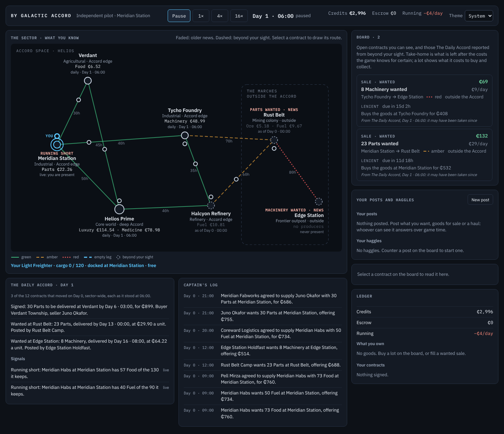
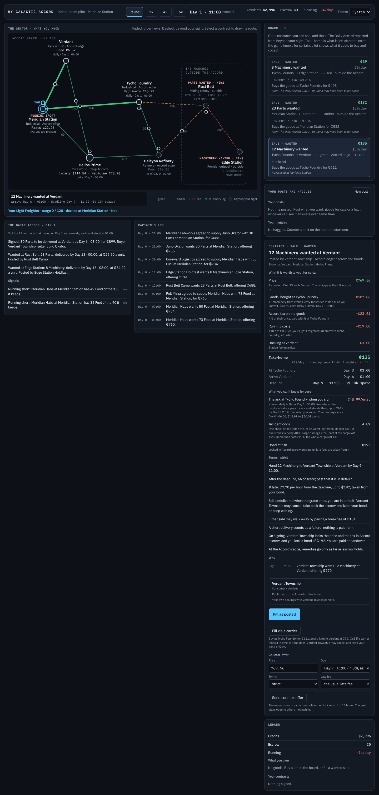

# S6b — Showing a post further

The step's goal, deliverable and verify are in [`plan.md`](../plan.md) §3, with a status line that links here.
Section references (§n) are to the design, [`by_galactic_accord_gdd_v0.3.md`](../../by_galactic_accord_gdd_v0.3.md).

*S6b status (2026-10-28): done.* S6b wasn't in the plan. After S6's review the user proposed it: a post is shown in its
own system (and the odd one in the news), and its poster can pay to show it further out after a delay, the fee rising
steeply with distance, perhaps only in chosen systems. I built switchable versions on S6's code and measured 29 settings
over ten seeds (the review page, <https://claude.ai/artifact/85iRSRx5aKWVk4ckiUiUtQ>, private until shared, has the
rounds and charts), then built the most promising one properly. That is **D38**:

- A post is shown at its places (a Sale's handover place; a Haul's origin and destination) the moment it is posted, and
  nowhere else.
- Its poster can pay to show it in further systems. The fee for each system is 0.05% of the post's price (at least
  ₵0.20), four times as much for each jump further, and goes to that system's station operator.
- It is shown there 4 hours after it is paid for one jump out, a day two jumps out, two days three, three days four.
- An AI actor whose post is still open a day after it was posted (or last shown further) pays for the next ring: every
  system at the next distance, if that costs no more than 5% of the post's price.
- The player ticks systems in the composer ("Shown at", each with its jumps, fee and delay) and pays as the post goes
  up, or ticks more on its open post later. The board says "Advertised at …" on a row the player sees only because its
  poster paid to show it there.

**Over ten seeds at a million ticks every invariant holds, 3% more contracts are fulfilled than in S6 (more on 9
seeds of 10), and fewer fail or are cancelled (5.1% of those signed against 5.8%).** Helios Prime now gets 80–96%
of the machinery it buys as lots from Tycho, two jumps away (S6: 64–74%, the S6 defect). The price is elsewhere:
Helios Prime's food fell from 74–91% to 52–90%, and its luxury and medicine by 5–8 points. The frontier is still
supplied (Edge Station 51–55% of its food, 77–86% of its machinery). Posters pay about ₵590,000 in fees a million
ticks for about 480,000 systems, and a quarter of all signed contracts were seen only through an ad. **The market reader
beats the board taker on all ten seeds, at 1.22× its credits** (S6: 9 of 10, 1.15×). The numbers match what the
experiment predicted for this setting (Helios 92%, +3% trade, 5.1% failing).

| The composer's "Shown at" | The player's own post, shown further |
|---|---|
|  |  |
| **The board at the start** | **A contract seen through an ad** |
|  |  |

[Running at 16×](S6b/03-running.png) · [answers](S6b/10-answers.png) · [light theme](S6b/05-light.png) ·
[phone width](S6b/06-phone.png).

## What was built

**Engine** (`Economy/Advertising.cs`, new):
- `Contract` keeps where it is shown and from when (`ShownFrom(location)`, `Shown`), when it was last advertised and
  whether it ever was. `SimulationContext.Add` shows a new contract at its places (`Advertising.ShowOnPosting`).
- `Sight.CanSee` is now: its own, or shown by now at a place where the actor is present. `Sight.ReachHours` is the
  hours until it is shown there. The tiers stay, for prices only (the bulletin a jump away, prices as last seen
  further). `Sight.TierOf(Contract)`, `Visibility.ReachHere` and `ReachNear` are gone.
- `Advertising`: `JumpsFrom` (from the nearer of a contract's places, `SimulationContext.Jumps`, a cached
  breadth-first count), `FeeAt`, `DelayHours`, `Options` (where it isn't shown yet, nearest first), `Quote`, `Show`
  (all or nothing: each fee to that system's station operator through `TryTransfer`; the player's post is then
  noticed by the actors present only there, `DecisionEngine.NoticePost(newlyShown)`), and `AdvertiseUnsold`, which
  every AI actor's `Run` calls after its role's work.
- `SimulationConfig`: `AdFreeJumps` (0: system only), `AdFeeShare` (0.05%), `AdFeeFloor` (₵0.20), `AdFeeGrowth` (4),
  `AdDelayHours` (0, 4, 24, 48; then a day more a jump), `AdWaitHours` (24), `AdBudgetShare` (5%).
- `PlayerActions`: a `PostDraft` carries `ShowAt`; `CheckPost` counts the fee in what the player must have, and `Post`
  pays it as the post goes up. `CheckAdvertise`/`Advertise` show an open post further (`AdBlock`: not yours, nothing
  chosen, can't afford).
- Telemetry: `AdFeesPaid`, `AdsShown` by jumps, and `SignedViaAd` (a signing whose taker saw the post only where its
  poster paid to show it), in the soak harness's information block.

**Presentation and client:**
- `Views/AdView.cs` (new): `ShowingModel` (the options with fee and delay, the total, `Choose` for the contract panel's
  own ticks), `ForDraft`, `ForPost`, `ShownLine`, `OutcomeText`. Ad fees read to the cent (`Format.MoneyCents`): they
  are often under a credit.
- The composer has a "Shown at" block; its ticks go into the draft (`ComposerDraft.ShowAt`), and what it commits says
  what showing it further costs. A post the player can't afford with its fee says so with the total.
- The contract panel says where an open contract is shown and from when, and on the player's own open post offers the
  further systems with a "Show it there" button (`GameSession.Advertise`).
- `Components/ShowingBlock.razor` (new) draws both. The board's `data-seen` is `live`, `ad` or `news`, and a row seen
  through an ad says where.
- 19 templates (`Ads.*`, `AdBlock.*`, `Outcome.Advertised`, `Board.Seen.Ad`, `Composer.Commits.Showing`,
  `PostBlock.CannotAfford.Showing`).

## Checks and measurements

All on this cloud container: 4 cores, .NET SDK 10.0.403, Node 22, Playwright 1.63 with its Chromium, Linux. "Before"
is S6 with the own-ship fix (`18a5b72c`).

| Measure | Before (S6 and the fix; timings from S6's log) | After |
|---|---|---|
| Tests | 259: 231 fast, 28 soak | 268: 240 fast, 28 soak |
| `dotnet test -c Release` | 231 pass, 10–11 s test time | 240 pass, 13 s test time, 19 s wall |
| `dotnet test -c Release --filter Category=Soak` | 28 pass, 3 min 10–11 s | 28 pass, 3 min 50 s |
| `dotnet build -c Release` (whole solution) | 0 warnings | 0 warnings |
| Soak harness, 1M ticks, seeds 42 and 20260619 (one at a time) | 19.7 s, 19.5 s | 22.4 s, 21.5 s |
| Bot players (`bots`), 200,000 ticks, seed 42 | 8.8 s | 10.6 s |
| Engine in the browser, 20,000 hours, seed 42 | 4,648–4,719 ms, 4,200–4,300 hours a second | 6,232 ms, 3,209 hours a second |
| State after 20,000 hours, WebAssembly vs desktop | identical | identical |
| Client ready in headless Chromium | 1.0 s | 1.1 s |
| `node check.cjs` end to end | 48–57 s, all checks pass | 55 s, all checks pass |
| C# and Razor lines | engine 10,192, presentation 4,281, client 1,515, harness 362, tests 4,897 | engine 10,636, presentation 4,445, client 1,625, harness 364, tests 5,206 |

The engine is 10–20% slower on the desktop and about a third slower in the browser. Part of it is more trade (3% more
contracts, and every AI post that sits a day now buys a ring). Part is the new work: each heartbeat every AI actor looks
over its open posts for one to advertise, `Sight.CanSee` looks a contract's shown-at map up for each place the actor is
present instead of reading a tier, and a signing of an advertised contract builds the taker's `Sight` to count
`SignedViaAd`. I didn't profile it; the browser still runs the engine 200 times faster than 16× needs.

**The plan's checks:**

| Verify | Test |
|---|---|
| Fees, delays, operators paid, the AI's budget, the player's post reaching an actor once shown there | `AdvertisingTests`: a post shown only at its places and the fee and delay of each further system (the floor; a haul counts from the nearer of its places); `Show` paying each station operator, showing it after the delay, never twice and never for someone else; the AI's ring a day within 5% of the price (a ₵2,000 post reaches Edge Station on day 3, a ₵40 post stops at two jumps); the player's post reaching the farm a jump away only once shown at Verdant; the player's refusals; a haul taken by a player who saw it only through an ad counted in `SignedViaAd`. `AdvertisingViewTests`: the composer's options, ticks and totals, paid when posting; the player's open post; a board row seen through an ad |
| Over ten seeds invariants hold and the frontier is still supplied (R1) | The ten-seed comparison below; in the soak suite, `EconomyTests.The_frontier_is_still_supplied_when_only_the_news_reaches_it` now also checks, on the same million-tick runs (seeds 42 and 20260619), that posts are shown two and three jumps out, that someone signs a contract seen only through an ad, and that Helios Prime gets at least 75% of its machinery |
| The market reader still beats the board taker | `BotTests.The_market_reader_beats_the_board_taker` (ten seeds, 200,000 ticks): it wins all ten |

**Ten seeds (1–8, 42, 20260619), a million ticks each:** the mean, then the range.

| Measure | S6 (with the fix) | S6b |
|---|---|---|
| Invariants held | 10 of 10 | 10 of 10 |
| Contracts fulfilled | 112,700 (108,448–117,082) | 116,116 (108,734–124,214) |
| Signed Sales and Hauls | 119,718 | 122,443 |
| Failed or cancelled, of those signed | 5.8% (4.5–7.0%) | 5.1% (4.5–6.0%) |
| Payer defaults | 901 (691–1,244) | 888 (467–1,201) |
| Cancelled at will (mostly walking away) | 3,991 (2,201–5,185) | 3,251 (1,996–4,121) |
| Expired untaken | 48,484 | 49,817 |
| Signed from the news | 7,150 | 8,461 |
| Ad fees paid | — | ₵587,746 (₵510,826–662,601) |
| Systems shown, by jumps 1 / 2 / 3 / 4+ | — | 277,359 / 149,028 / 46,549 / 7,602 |
| Signed by a taker who saw it only through an ad | — | 24.8% (23.7–26.9%) |
| Money supply drift | −0.7% (−6.5 to 5.6%) | −0.1% (−6.5 to 6.4%) |
| Helios Prime: machinery | 69% (64–74%) | 92% (80–96%) |
| Helios Prime: food | 86% (74–91%) | 79% (52–90%) |
| Helios Prime: luxury, medicine | 93%, 86% | 85%, 82% |
| Verdant Township: machinery, parts | 56%, 89% | 62%, 83% |
| Tycho Workforce: ore | 76% | 71% |
| Edge Station: food, machinery, medicine | 53%, 85%, 36% | 52%, 82%, 39% |
| Rust Belt Camp: food | 56% | 57% |
| Board taker / market reader, 200,000 ticks | reader wins 9 of 10, 1.15× | reader wins 10 of 10, 1.22× |

Per seed, contracts fulfilled went 117,082 → 124,214, 115,488 → 117,520, 113,285 → 116,809, 109,736 → 111,330,
115,436 → 117,218, 109,110 → 119,037, 108,448 → 115,409, 109,743 → 111,378, 116,734 → 119,510 (seed 42), and
111,934 → 108,734 (seed 20260619, the one that fell). Helios Prime's food fell most on seeds 4 (80 → 57%) and 8 (74 →
52%).

**The browser check** passes every step. New: the composer offers further systems for a fee ("Shown at Verdant only." →
"Showing it in one more system costs ₵0.20."), and the open post says where it is shown and is shown further. At the
start nothing takeable is live (below), so the check runs the clock at 4× until a takeable row appears: five game hours
on seed 20260619, a row seen through an ad.

## Decisions taken in code

- **A post's places** are where it is shown free: a Sale's place, a Haul's origin and destination (so a haul is seen
  from both ends). Jumps count from the nearer of them. Design A.2 asked which board a post goes on; this settles it
  for Sales and Hauls.
- **Paid all or nothing.** `Show` checks the whole quote against the poster's credits, then pays each system's station
  operator. Where a location has no station operator the fee is destroyed; the generated sector has one everywhere.
- **The AI buys whole rings,** every system at the next distance not yet shown, never one system at a time. That is
  the experiment's rule. The player buys any systems it likes: the targeted ads of the proposal are the player's skill
  (the experiment found AIs aim badly at buyers they know of only from the news).
- **The AI's wait counts from its last ad,** so a post climbs one ring a day; its budget is the ring's cost against the
  post's offered price, not its running total.
- **No ads for storage, or for an order at a producer's door** (signed at once, never on a board).
- **A delay past the table** is a day more a jump: four jumps is three days.
- **The player's post shown further reaches the AI actors present only there,** after the delay and their reply time.
  AI posts need no such call: AI actors look at what they can see every heartbeat.
- **`AdFreeJumps` stays as a knob** (0). At 1 it reproduces S6's free near reach for the contracts a jump away, so a
  later step can measure the two side by side again.
- **Ad fees are shown to the cent.** The usual fee for one system is ₵0.20 to ₵1.

## Gotchas

- **The board at the start is empty of live work.** At Day 1 · 06:00 the only posts at Meridian have been taken by
  local suppliers, and nothing a jump away has been unsold for a day yet, so the board holds only what the news
  reported. S6's check took a takeable live row at the start; S6b's runs the clock until one appears. S10's seeded start
  has to fix the first hour's beats 1 and 2 (plan S10).
- **The player's home is a presence.** A test that wants an observer at Tycho can't use the player, who also sees
  Meridian; `AdvertisingTests` uses Tycho Workforce.
- **The jump counts are cached** like the paths; adding a location or a route clears them.
- **The contract panel renders only when its model changes** (`ShouldRender`). Its own ticks set a flag so the box
  redraws.

## What the step showed

- **The experiment's prediction held.** For system-only reach, 0.05% a system rising ×4 a jump, paid to station
  operators, it predicted Helios at 92%, 3% more trade and 5.1% failing; the real build gives 92%, 3% and 5.1%.
- **Reach, not money, fixes Helios.** Fees this small hardly move money (₵590,000 against about ₵32 million of consumer
  income a run), so what changed is who sees what.
- **A consumer's income is fixed, so what it buys from further away it doesn't buy nearby.** Helios Prime buys more
  machinery and less food, luxury and medicine; Verdant Township more machinery and fewer parts.
- **Knowing more pays most when seeing is limited.** The reader's edge over the taker is the widest so far (1.22×).

## Questions for review

- **The first hour's board.** At the start nothing a jump away is shown at Meridian. Should S10's seeded start place
  advertised posts there (my preference: it keeps the rule and shows ads working), or should AI posters advertise at
  posting when the ring is cheap? In the experiment, paying at once did as well as paying after a day, but only at 0.5%
  a system, where the gain came mostly from the fees' money effect; at today's fee it is unmeasured.
- **Helios Prime's food** (52–90%, from 74–91%). It follows from its fixed income going on machinery. Is that
  trade-off acceptable, or should consumers' budgets rise with what they can reach?
- **Every AI post that sits a day pays to reach next door:** about 280,000 one-jump systems a run, and a quarter of all
  signed contracts were found only through an ad. Is the day's wait right, or should an AI wait longer before paying?
- **Fees to station operators** leave through `PayOut` above the operators' float, which the experiment found works
  the same as destroying them. Fine for Slice 1? S8 has to revisit it (plan S8).
- **Still open from earlier:** should I correct the claims in `log/S6.md` that the ten-seed survey contradicted (the
  stale-stock cost, the news's 8%, the failure share falling, Meridian's food on seed 42 only)? And S5's and S6's
  questions on the review page.

## Hand-off: where to start reading

- `src/ByGalacticAccord.Engine/Economy/Advertising.cs`, all of it.
- `src/ByGalacticAccord.Engine/Economy/Visibility.cs`: `Sight.CanSee`, `ReachHours`.
- `src/ByGalacticAccord.Engine/Domain/Contract.cs`: `ShownFrom`, `ShowAt`.
- `src/ByGalacticAccord.Engine/Actors/PlayerActions.cs`: `PostDraft`, `CheckPost`, `Post`, `CheckAdvertise`.
- `src/ByGalacticAccord.Engine/Actors/DecisionEngine.Haggling.cs`: `NoticePost`, `NewlyReached`.
- `src/ByGalacticAccord.Presentation/Views/AdView.cs`; `ComposerView.cs`, `ContractView.cs`, `BoardView.Seen`.
- `CODEMAP.md` §1, §3 ("Showing a post further"), §5 (`TryTransfer`).

## Commands

```bash
dotnet build -c Release                         # from ByGalacticAccord/
dotnet test -c Release                          # fast tests
dotnet test -c Release --filter Category=Soak   # soak-length tests
dotnet run --project src/ByGalacticAccord.Cli -- soak 1000000 --seed 42       # "Paid to show posts further" in the information block
dotnet run --project src/ByGalacticAccord.Cli -- bots --seed 42
cd tools/client-check && npm ci && node check.cjs          # screenshots in artifacts/client-check/screenshots
```

The ten-seed comparison is the soak harness and the bots on each seed, one run each. The experiment's other settings
(fees destroyed or paid to consumers or the government, one jump free) were switches on a scratch branch that isn't
kept; `AdFreeJumps`, `AdFeeShare`, `AdFeeFloor`, `AdFeeGrowth`, `AdDelayHours`, `AdWaitHours` and `AdBudgetShare` are
in `SimulationConfig` for measuring again, and the fee's destination is one line in `Advertising.Show`.

## Files

- Added:
  - Engine: `Economy/Advertising.cs`.
  - Presentation: `Views/AdView.cs`. Client: `Components/ShowingBlock.razor`.
  - Tests: `AdvertisingTests.cs`, `AdvertisingViewTests.cs`.
  - `log/S6b.md`, `log/S6b/*.png`.
- Changed:
  - Engine: `Actors/DecisionEngine.cs`, `DecisionEngine.Haggling.cs`, `PlayerActions.cs`; `Domain/Contract.cs`;
    `Economy/Visibility.cs`; `Simulation/Market.cs`, `SimulationConfig.cs`, `SimulationContext.cs`.
  - Presentation: `Session/GameSession.cs`; `Text/Templates.resx`; `Views/BoardView.cs`, `ComposerView.cs`,
    `ContractView.cs`.
  - Client: `Shell.razor`, `Components/BoardPanel.razor`, `ComposerPanel.razor`, `ContractPanel.razor`,
    `wwwroot/css/app.css`.
  - Harness: `Soak.cs`. Browser check: `check.cjs`.
  - Tests: `DecisionTests.cs`, `EconomyTests.cs`, `InformationTests.cs`, `InformationViewTests.cs`, `TestWorld.cs`.
  - The design (D38; §3.6, §7.1, A.2, §22.1), `CODEMAP.md`, `README.md`, `plan.md`, `log/README.md`.

## Next: S7, ships from parts

- **Which board does a Build go on?** Design A.2 still asks. Decide it before measuring ads again: a yard's order shown
  at the yard, or where the client is?
- **Measure the ads again (plan S7).** Part factories sell lots and yards want parts from them; ships cost far more than
  goods, so 5% of a price buys many rings and 0.05% is a real sum. Re-run the ten-seed comparison against S7's start.
- **Lots two jumps away** are now reached by ads (Helios Prime's machinery). S7's part factories rely on the same.
- **Producers' delivered sales are still lost for want of carriers' hours** (cancelled at will 2,000–4,100 a million
  ticks, down from 2,200–5,200). Fleets that grow are S7's.
