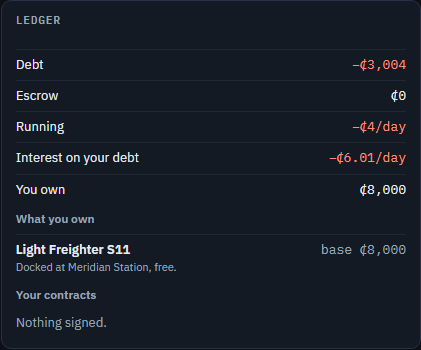

# S8 — Consequences

The step's goal, deliverable and verify are in [`plan.md`](../plan.md) §3, with a status line that links here.
Section references (§n) are to the design, [`by_galactic_accord_gdd_v0.3.md`](../../by_galactic_accord_gdd_v0.3.md).

*S8 status (2026-11-05): done.* Risk has a downside now (design §5.4, §8.4, §16.7, §16.8):

- **A balance can go below ₵0.** Running costs, interest, an incident's cost, rent and docking fees keep charging, and so do
  remedies the deep Accord enforces (a carrier's liability beyond its bond, a late fee beyond escrow). Spending an actor chooses still
  needs the money: production, labour, buying goods or a ship, and locking a price in escrow. Debt costs 0.2% a day, paid to the Accord
  clearing house.
- **Every bond is locked in full** (the defect "a broke player still takes escrow jobs with a ₵0 bond"). What a performer lacks the
  clearing house lends, as debt, while that debt stays within half of what the performer owns. Past that, it can't sign.
- **Insolvency** follows design §16.8. An actor whose debt passes half of what it owns is warned (the player at a pause). It becomes
  insolvent when its debt passes all of what it owns, or stays above half for seven days. Then:
  - its haggles end and its open posts come down;
  - every contract it signed is cancelled: as the performer, for default (the payer takes its bond); as the payer, it walks away and
    the performer gets its break fee;
  - the clearing house sells its ships and goods in fire sales, shown in every system at once and marked down week by week;
  - when nothing is left (or after 60 days, unsold goods written off and ships broken up) it dissolves, and the clearing house writes off
    what it still owes.
- **For the player, insolvency ends the game** on the legacy screen. It tells the story from the record: how it ended and the failures
  that led there, the contracts honoured and broken, the markets moved, the companies outlasted, and the ships flown with their histories.
- **The throttle.** A ship flies its laden leg at cruise or pushed: ×1.25 the speed, ×1.5 the incident chance, ×2 for a drive that runs
  hot (design §16.7). The player chooses in the contract panel, which shows what pushing does. An AI pushes only to beat a late fee.
- **Danger shifts incidents toward the severe end.** On the red Rust Belt run a delay is half as likely as on a safe route and a total
  loss nearly twice. Toughness still scales the damage, and reliability the odds.
- **Docking fees** go to the station operator where a ship docks, owed whether or not its owner can pay.

**Over ten seeds at a million ticks every invariant holds** (credit conservation now counts the debt written off, and a dissolved actor
must hold nothing). 137,005 contracts are fulfilled on average (S7: 135,229) and 1.16% of those signed fail or are cancelled (S7: 1.2%).
**Ten actors went insolvent over the ten seeds:** seven pilots, one shipping company and one producer (twice). The pilots' ships
went to Edge Salvage in fire sales. No more than two failed in any run, and the frontier is supplied as before. **The market reader beats
the board taker on nine seeds of ten, at 1.43× its credits** (S7: ten of ten at 1.93×, inflated by the taker going broke twice). On seed 5
the reader went under, the first bot to.

**The trap contract is visibly a trap.** On the board a deal late at cruise and on time only pushed says so ("20h late at cruise; on time
only if you push, with an incident 50% likely"). The contract panel adds the late fee at cruise, the red route and the doubled odds, and
offers to take it pushed (`ConsequenceTests.The_first_hours_trap_reads_as_a_trap`).

D38 was measured again. Debt and insolvency don't replace the payout to owners: without it, trade halves (traders keeping their surplus)
or collapses (station operators keeping their fees). So station operators still pass their rent, docking and ad fees above their float out
as upkeep, and the fee level holds.

| The push choice | Debt in the ledger |
|---|---|
|  |  |
| **The warning** | **The legacy** |
|  |  |

[The board at the start](S8/01-start.png) · [the ledger](S8/04-ledger.png).

## What was built

**Money below ₵0** (`Simulation/SimulationContext.cs`, `Simulation/Sinks.cs`, new):

- `ApplySink` stays for spending an actor chooses, capped at its balance, and now names a `SinkKind`:
  - production, labour, the payout to owners, an ad's fee where no station takes it;
  - `Sunk(kind)` totals each, so the soak can say what drains the money supply.
- `Charge` destroys an amount whether or not the actor has it. It serves running costs (`ChargeRunningCosts`), interest
  (`Solvency.ChargeInterest`) and an incident's cost.
- `TransferOwed` moves an amount whether or not the payer has it. It serves rent (`SettleRent`), docking fees (`ShipArrived.Dock`, to the
  station operator where the ship docks) and remedies the deep Accord enforces (`Settlement.Pay`, `Fail`, `HandOverBuild` beyond escrow;
  `Settlement.Collect` for a failed Build's deposit). `Settlement.Collectable` in the deep Accord is everything the terms say.
- `WriteOffDebt` brings a dissolved actor's balance back to ₵0 and books it as `DebtWrittenOff`. Credit conservation is now
  initial + faucet − sinks + written off.
- `LockBondToEscrow` locks a performer's bond in full, below ₵0 if it must. `Market.Sign` locks the whole bond only once `Solvency.CanBond`
  allows it, and returns `Signing.CannotBond` otherwise (`DealBlock.CannotBond` for the player). A fill's goods must be paid in cash first
  (`Market.CanBond`, `PlayerActions.CheckFill`, the trader's `FillTake` and `Broker`).

**Solvency** (`Economy/Solvency.cs`, new):

- `ActorState` gains `Debt`, `Solvency` (`SolvencyStatus`: None, Warned, Liquidating, Dissolved), `WarnedSince`, `InsolventSince`,
  `DebtAtInsolvency`, `SolvencyEntry` and `InBusiness`.
- `Assets` is what an actor owns, at value: its plant, its ships at their value, its goods (stock, storage, holds) at base value, and its own
  money in escrow (a payer's price and tax, a performer's bond). `Plant` is a business's working capital (a producer's, factory's, yard's,
  salvage yard's or station's); traders, consumers and the player have none.
- `CanBond(actor, bond, spending)`: the cash spent first must be there; then the bond is lent as long as the actor's debt stays within half
  of what it owns.
- `ChargeInterest` charges `DebtInterestPerDay` (0.2%) of the debt each heartbeat; none once liquidating.
- `Review`, on every heartbeat after the charges:
  - debt above half: warned (`DebtWarningEntry`, the player's an alert);
  - back to half or less: lifted (`DebtWarningLiftedEntry`);
  - above all of it, or above half for `WarnedHoursLimit` (seven days): `Liquidation.Begin`.

**Liquidation** (`Simulation/Liquidation.cs`, new):

- `Begin` records an `InsolventEntry` (`InsolvencyReason`: DebtAboveAssets, StayedAboveHalf; the player's an alert: its game is over).
  - It closes the actor's haggles (`NegotiationEnd.CannotPerform`) and withdraws its open posts.
  - It cancels every contract it signed with `CancelReason.Insolvency`. `Settlement.SettleAs` settles an insolvent performer's as for
    default (escrow back to the payer, the bond forfeited) and an insolvent payer's as walking away (its break fee to the performer).
    The insolvent party is the canceller, so the sentence reads "Verdant Agricombine is insolvent, so its contract with you is cancelled,
    and you got its break fee of ₵14".
- `Run`, on the actor's heartbeat from then on:
  - each ship, once free, has its owner's goods aboard set down in storage where it is, and is listed in a fire sale at 60% of its value;
  - its goods, at home and in storage, go up as fire-sale lots at 60% of base value;
  - both are marked down 10% a week (ships to 30%, goods to 20%) and reposted every four days;
  - every fire sale is shown in every system at once, free (`Contract.FireSale`);
  - after `LongestHours` (60 days) unsold ships are broken up and goods written off;
  - with no ships, goods, storage or contracts left, `Dissolve`: the debt written off (or what is left paid out), an `ActorDissolvedEntry`,
    and its heartbeat stops.
- An actor not `InBusiness` signs nothing (`Signing.Insolvent`), answers no post, replies to no haggle, and an insolvent maker leaves
  `ProducersOf`.
- An insolvent player's posts are the clearing house's, so they don't haggle in game time (`Market.HagglesInGameTime`).

**Staying out of insolvency:**

- A trader in debt sells its idlest free ship however busy its fleet, and a warned one doesn't grow (`ManageFleet`, `WantsShip`).
- A yard in debt asks only what Edge Salvage pays for a ship on its lot (`SellLot`, `InDebtLotShare` 45%).
- What an actor in debt sells (goods for sale, a ship) is shown in every system at posting, free (`Advertising.ShowOnPosting`): it can't pay
  to advertise, and its creditor wants it sold.
- Producers and factories run `SellOff` like traders: goods set down far from home when a sale fell through go up for sale, and are written
  off after 30 days. Before S8 their rent quietly drained them; now it charges into debt.

**The throttle and incidents** (`Domain/Throttle.cs`, `Simulation/Throttles.cs`, new):

- `Throttle` is None (no laden leg), Cruise or Push. `ShipJob.Throttle` carries it.
- `Throttles` holds the rules every laden trip's hours and odds come from: `SpeedFactor` (`PushSpeedFactor` 1.25), `IncidentFactor`
  (`PushIncidentFactor` 1.5, `PushHotIncidentFactor` 2 for a drive that `RunsHot`), `LadenTicks` and `IncidentOdds`. `ShipDeparted`,
  `TransitIncidentCheck` and `Market.NextFree` use them. The empty leg is always flown at cruise.
- The AI's `HaulTake` and `FillTake` score both throttles and keep cruise unless at cruise it would be late and pushing is worth more
  (`Better`). The choice rides `Take`, `TraderOption` and `Plan` into `Market.TakeHaul` and `FillWithShip`. `TermsRisk` weighs the
  throttle's odds and the shifted table.
- `IncidentResolver.Bound` shifts each bound b of the outcome table down by k·b·(1 − b), with k = `IncidentDangerShift` (2) × the route's
  danger, at most 1. `Share(kind, danger, shift)` quotes it. It is decimal arithmetic, so WebAssembly and desktop reach the same outcome.

**Journal and telemetry:**

- Four new entries: `DebtWarningEntry`, `DebtWarningLiftedEntry`, `InsolventEntry` and `ActorDissolvedEntry`, all `IActorEntry` (about an
  actor, not a contract). New failure kinds: `CancelledOnInsolvency` and `Insolvency`.
- The soak harness prints:
  - sinks by kind, the debt written off and what station operators hold;
  - incidents by kind, and laden trips at cruise and pushed;
  - a debt block (warnings, the deepest debt, who went insolvent and when, fire-sale ships sold) and each trader's solvency.
- `soak … --keep traders|stations|both` turns the payout off for those actors (`SimulationConfig.TradersPayOut`, `StationsPayOut`), and
  `--cash-bonds` stops the clearing house lending bonds (`BondsOnCredit`), for the measurements below.
- The bots stop when they go insolvent (`BotReport.WentUnder`).

**Presentation and client:**

- `GameSession.IsOver` (the player is insolvent): the clock won't run, and the Shell shows only the legacy (`LegacyView.cs`,
  `LegacyPanel.razor`; "Start again" reloads). `GameSession.Accept(id, throttle)`. `Grant` charges a negative amount: the browser check
  reaches debt, the warning and the legacy with `?credits=-N`.
- `DealEstimate` takes a throttle; `Pushed` is the same deal pushed and `OnTimeOnlyPushed` says when only pushing makes the deadline.
- The contract panel shows `PushChoice`: when the deal pushed arrives, on time or how late, the odds against cruise's, the take-home, and
  the trap's sentence when only pushing makes the deadline. A second button takes it pushed. The incident line quotes the table as the
  route's danger shifts it, and warns on a red route.
- The board's note for a deal late at cruise says whether pushing makes it. A fire sale says whose.
- In debt, the time bar shows "Debt" in red, its tip the interest and where insolvency starts; while warned it shows the deadline. The
  ledger adds the interest a day and what the player owns.
- The log shows the player's own debt entries and anyone's insolvency and dissolution (another actor's debt is its own business).
- 56 new templates (924 → 980).

## Checks and measurements

On this machine: Windows 11, 16 cores, .NET SDK 10.0.401, Node 22, Playwright 1.63 with its Chromium. S7's figures are from its log (a
4-core Linux container), so its timings are not comparable; its simulation figures are (the same seeds give the same worlds: seed 42's
baseline soak here reproduced S7's 137,108 fulfilled exactly).

| Measure | Before (S7, from its log) | After |
|---|---|---|
| Tests | 302: 272 fast, 30 soak | 321: 289 fast, 32 soak |
| `dotnet test -c Release` | 272 pass | 289 pass, 11 s test time |
| `dotnet test -c Release --filter Category=Soak` | 30 pass, 4 min 23 s | 32 pass, 4 min 51 s |
| `dotnet build -c Release` (whole solution) | 0 warnings | 0 warnings |
| Engine in the browser, 20,000 hours, seed 42 | 2,782 hours a second | 2,434 hours a second (another machine: not comparable) |
| State after 20,000 hours, WebAssembly vs desktop | identical | identical |
| `node check.cjs` | all 52 checks pass | all 57 checks pass |
| C# and Razor lines | engine 13,681, presentation 5,144, client 1,844, harness 381, tests 6,171 | engine 14,783, presentation 5,490, client 1,964, harness 419, tests 6,681 |

**The plan's checks:**

| Verify | Test |
|---|---|
| Insolvency tests for an AI and for the player | `ConsequenceTests`: an insolvent trader's haul cancelled for default (the shipper gets its escrow and the bond), its ship fire-sold, shown everywhere and bought, the trader dissolved and its debt written off; an insolvent actor's goods fire-sold and written off unsold; a carrier whose shipper goes insolvent getting its bond back and the break fee; the player's insolvency withdrawing its post, ending the game (the clock won't run) and its legacy telling the story, the world then fire-selling its ship like anyone's. Also the warning, its lifting and insolvency after seven days above half; insolvency at once above everything; running costs and interest below ₵0; docking and rent to the station operator into debt; every bond locked in full on credit up to half of what the performer owns; the deep Accord collecting liability into debt |
| In a soak, some AI actors fail and their ships resell, but not en masse | `EconomyTests.Some_ai_actors_fail_and_their_ships_resell_but_not_en_masse` (seeds 2 and 6: one to three insolvencies, a fire-sale ship resold, every insolvent dissolved, at least five traders still trading, no producer, factory or yard failing); the ten seeds below |
| The trap contract from the first hour is visibly a trap | `ConsequenceTests.The_first_hours_trap_reads_as_a_trap`: parts from Meridian to Edge Station for ₵900 on strict terms, due in 170 hours (a Light Freighter takes 190 at cruise, 152 pushed). The board's row: red, "on time only if you push", in the loss tone. The contract: the push choice with the trap's sentence and "50%, against 25% at cruise (the drive runs hot)", the incident line warned with "the whole cargo lost 7.2%". Taken pushed, the laden leg takes 152 hours |
| The throttle and incidents | `ConsequenceTests.An_ai_carrier_pushes_when_pushing_beats_the_late_fee` (pushes when late at cruise, not with time to spare); `TransitIncidentTests`: the table's shares at danger 0 and 0.42, the same draws never milder on a red run, pushing ×1.25 the speed and ×1.5 or ×2 the odds |
| The client | The browser check's S8 step: the push choice on the contract taken, debt in the header and ledger, the warning that stops the clock, and insolvency ending on the legacy screen |

**Ten seeds (1–8, 42, 20260619), a million ticks each:** the mean, then the range.

| Measure | S7 | S8 |
|---|---|---|
| Invariants held | 10 of 10 | 10 of 10 |
| Contracts fulfilled | 135,229 (128,184–140,855) | 137,005 (133,786–139,854) |
| Signed Sales and Hauls | 136,837 | 138,619 |
| Failed or cancelled, of those signed | 1.2% (0.5–2.4%) | 1.16% (0.85–1.70%) |
| Payer defaults | 533 (185–1,072) | 178 (83–331) |
| Cancelled at will | 204 (26–387) | 116 (17–276) |
| Late deliveries | — | 3,651 (2,360–5,457) |
| Transit incidents | — (seed 42: 8,873) | 9,414 (9,136–9,813) |
| Laden trips pushed | — | 8.2% (5,389 of 65,516) |
| Ad fees paid | ₵421,989 | ₵493,656 (₵476,353–544,140) |
| Signed by a taker who saw it only through an ad | 13.8% | 15.4% |
| Money supply drift | 0.7% (−6.0 to 7.0%) | −2.2% (−7.2 to 1.4%) |
| Insolvent | — | 1.0 a run (0–2); 10 in all |
| Debt written off | — | ₵4,409 a run (₵0–23,774) |
| Interest paid | — | ₵3,903 a run |
| The traders' ships at the end (9 at the start) | 15.7 | 14 (12–16) |
| Ships sold, broken up | 89, 8.9 | 79, 9 |
| Helios Prime: machinery, food | 100%, 99% | 100%, 100% |
| Edge Station: food, machinery, medicine | 60%, 92%, 47% | 60%, 90%, 50% |
| Rust Belt Camp: food, parts | 74%, 92% | 76%, 94% |
| Verdant Township: machinery, parts | 88%, 86% | 83%, 91% |
| Board taker / market reader, 200,000 ticks | reader wins 10 of 10, 1.93× | reader wins 9 of 10, 1.43× |

Where the money went, a run on average: production ₵26.3M, the payout to owners ₵3.9M, running costs ₵3.0M, tax ₵1.4M, incidents ₵208,000,
labour ₵50,000, interest ₵3,900. Docking fees and rent go to the station operators, and back out with their upkeep.

**Incidents by outcome** (seed 1, 9,136 incidents): a delay 26%, damage 27%, part of the cargo lost 25%, unplanned costs 16%, the whole cargo
lost 6.7%. The table without danger is 40%, 26%, 19%, 11% and 4%. Incidents happen mostly on amber and red routes, where the odds are highest,
so their outcomes lean toward the severe end.

**Who went insolvent:**

| Seed | Day | Who | Owed |
|---|---|---|---|
| 1 | 33,049 | Juno Okafor, pilot | ₵4,089 |
| 2 | 5,613 | Pell Mirza, pilot | ₵4,090 |
| 4 | 20,896 | Sable Vance, pilot | ₵5,849 |
| 5 | 25,380 | Pell Mirza, pilot | ₵4,089 |
| 5 | 28,688 | Halcyon Fuelworks, producer | ₵7,477 |
| 6 | 7,282 | Dust Runner Kael, pilot | ₵4,098 |
| 6 | 8,725 | Juno Okafor, pilot | ₵4,092 |
| 7 | 21,883 | Coreward Logistics, shipping company | ₵15,825 |
| 7 | 25,463 | Halcyon Fuelworks, producer | ₵7,477 |

Seeds 3, 8, 42 and 20260619 had none. The pilots' typical end: one ship worth ₵8,000, no work worth its running cost, a debt that crossed
half its value (₵4,000) and stayed there a week. Their ships went to Edge Salvage in fire sales (four sold). None of the insolvent actors had
a live contract left when they went under, so no contract was cancelled on an insolvency in the long runs; `ConsequenceTests` drives those.

Per seed, contracts fulfilled went:

| Seed | S7 | S8 |
|---|---|---|
| 1 | 131,717 | 133,786 |
| 2 | 133,214 | 135,414 |
| 3 | 137,068 | 136,064 |
| 4 | 138,921 | 138,472 |
| 5 | 128,184 | 137,923 |
| 6 | 137,563 | 139,634 |
| 7 | 134,726 | 139,854 |
| 8 | 140,855 | 137,350 |
| 42 | 137,108 | 136,352 |
| 20260619 | 132,931 | 135,198 |

**Bots, per seed** (board taker / market reader, credits after 200,000 ticks, from ₵3,000):

| Seed | S7 | S8 |
|---|---|---|
| 1 | ₵0 / ₵34,353 | ₵26,197 / ₵37,075 |
| 2 | ₵42,325 / ₵51,929 | ₵19,502 / ₵41,943 |
| 3 | ₵28,006 / ₵49,118 | ₵14,928 / ₵44,852 |
| 4 | ₵34,457 / ₵52,500 | ₵34,065 / ₵34,489 |
| 5 | ₵89 / ₵17,785 | ₵7,187 / −₵4,927 (went under on Day 3,637) |
| 6 | ₵21,542 / ₵36,450 | ₵16,920 / ₵31,820 |
| 7 | ₵25,398 / ₵45,439 | ₵31,972 / ₵36,364 |
| 8 | ₵36,716 / ₵48,375 | ₵35,279 / ₵40,101 |
| 42 | ₵19,200 / ₵47,389 | ₵21,745 / ₵39,716 |
| 20260619 | ₵23,189 / ₵61,595 | ₵40,623 / ₵54,817 |

On average the taker ends with ₵24,842 (S7 ₵23,092) and the reader ₵35,625 (S7 ₵44,493).

**The payout, measured (D38).** The plan expected debt and insolvency to replace the payout to owners, the sink above each AI actor's
working capital. Two ten-seed runs turned it off:

| Measure | S8 | Traders keep their surplus (`--keep traders`) | Station operators keep their fees (`--keep stations`) |
|---|---|---|---|
| Contracts fulfilled | 137,005 | 70,711 (54,216–88,106) | 24,158 (21,958–28,417) |
| Failed or cancelled | 1.16% | 3.73% | 3.17% |
| Insolvent a run | 1.0 | 5 (2–10) | 12 (11–13) |
| The faucet multiplier at the end | 0.66–0.72 | 0.06–1.16 | 0.02 (its floor) on every seed |
| Seed 42 | — | the two companies hold ₵110,000 and ₵172,000; all five pilots dissolved | every trader dissolved; the stations hold ₵14,000 a piece at the start, ₵440,000–640,000 between them at the end |

Kept surpluses are hoarded money. The monitor sees the supply grow, cuts the consumers' income, and trade shrinks until the
weakest go under; their debts written off add to the supply again. Insolvency moves money from the failed to the clearing house's books; it
doesn't take money out of the sector, so it can't stand in for the payout. The fee level and its destination stay as in S6b and S7.

**Cash or credit for bonds.** Ten seeds with bonds paid only in cash (`--cash-bonds`, the display of a debtor's sales kept):

| Measure | Bonds on credit (S8) | Bonds in cash only |
|---|---|---|
| Contracts fulfilled | 137,005 (133,786–139,854) | 136,522 (130,441–142,772) |
| Failed or cancelled | 1.16% | 1.29% |
| Payer defaults, cancelled at will | 178, 116 | 244, 162 |
| Insolvent | 10: seven pilots, a shipping company, Halcyon Fuelworks twice | 9: eight pilots, Halcyon Fuelworks once |
| Fire-sale ships sold | 4 | 5 |

The long runs barely tell them apart. The rule matters for an actor that falls a little below ₵0 with work it could do, which the
player is most likely to be.

## Decisions taken in code

- **Interest is 0.2% a day.** The design names no rate. At 0.5% (the first try) a pilot's ₵5,000 debt cost ₵25 a day, five times its ship's
  running cost, and indebted actors died within months of their first loss. At 0.2% a debt doubles in about a year.
- **The bond is lent by the clearing house within half of what the performer owns.** With bonds paid only in cash, an actor ₵1 in debt
  can take no work in Accord space, and interest compounds until it is insolvent, however much it owns. Lending the bond lets it work its
  way back. That matters most for the player, whose first failure should be survivable (design §17). Design §5.4 calls debt credit from
  the clearing house, and the defect asked only that every bond be real. The cash for goods and prices is never lent. Over the ten seeds
  the two rules end about the same (below, "Cash or credit"). Tycho Yards' failures on two seeds went away with the free display of a
  debtor's sales, not with the credit.
- **What counts as owned** (design §16.8's "asset value"): the plant, ships at their value, goods at base value wherever they are, and the
  actor's own money in escrow. Without the plant, a producer that touched ₵0 with its warehouse sold out was insolvent at once over a ₵1 debt.
  The plant is the business's working capital; Slice 1 can't sell a facility, so it is written off in a liquidation.
- **What changed hands under the insolvency's cancellations.** An insolvent performer's contracts are cancelled for default against it.
  An insolvent payer's settle as walking away: the performer gets the break fee, as it would when any payer walks away. Things already
  moving finish their trip: a cancelled haul still sets the shipper's goods down at its destination, and they join the estate.
- **The insolvent party is the canceller** in the journal, so the record reads "X is insolvent, so its contract with you is cancelled".
- **Fire sales are shown in every system, free,** and so is anything an actor in debt sells. A debtor can't pay to advertise. Before
  this rule, Tycho Yards' spec ship at the salvage price sat at Tycho for a decade, unseen by Edge Salvage, while the yard's debt (₵500
  from the ship's laid-up running cost) compounded to ₵34,000 and the yard went insolvent, on two seeds of ten.
- **The deep Accord collects remedies into debt**; the Accord's edge only from escrow, the frontier only off the payment (design §3.5).
- **Docking fees go to the station operator** at the destination (design §8.1), ₵3 as before, owed below ₵0. A ferry, a ship flying home
  empty, docks free.
- **An AI pushes only to beat a late fee.** Scored freely, pushing a safe route was nearly free (a few hours of running cost saved
  against a few points of incident chance), and AI carriers pushed almost everything. Design §8.4 frames push as "the classic choice
  between beating the late fee and risking the cargo".
- **The empty leg is always cruise**, and an incident is checked only on the laden leg, as before.
- **Danger shifts the table by moving its bounds,** not by bending the roll with a power (`Math.Pow` may differ across platforms, and
  WebAssembly must reach desktop's state). The shift at danger 0 is nothing, so a safe route keeps the design's table.
- **For the player, the world stops at insolvency.** The client shows the legacy, and the clearing house's sale of the player's ships
  happens only if the world runs on (the tests run it on; it is symmetric).
- **Another actor's debt is private.** The player's log shows its own warnings and anyone's insolvency and dissolution (the clearing
  house publishes those), not other actors' warnings (design §11.5: no claims about hidden state).
- **The payout stays,** measured above, and so does `PayOut` for station operators (D38).

## Gotchas

- **The quiet test world charges a heartbeat of a billion hours.** `TestWorld.Quiet` pushes heartbeats out of reach by setting
  `HeartbeatInterval` to 10⁹, and running costs are charged per heartbeat interval: one heartbeat cost the player ₵15 trillion. The tests
  charge a day (`ChargeRunningCosts` and `ChargeInterest` take the hours).
- **An alert stops `RunTo`.** The player's debt warning is an alert, so a test that ran the clock seven days stopped at the first event.
  Clear the alerts first.
- **A ship sale has no bond,** and the full-bond check refused it when its insolvent seller was in debt (₵0 bond against a negative balance).
  The check applies only to a bond above ₵0.
- **Producers kept goods in remote storage for years.** A frontier buyer that can't pay leaves the goods in the producer's storage at
  Rust Belt. Producers never sold them off; their rent went quietly into the payout. With rent owed below ₵0, Verdant's farm went insolvent
  on seed 3 and the sector lost its food. `SellOff` now serves producers and factories.
- **Bash heredocs on this machine mangle some scripts;** the edits went through Python files written with the file tool.

## What the step showed

- **Income decides who fails, not the bond rule.** Cash-only bonds and bonds on credit end the ten seeds alike. The actors that fail have a
  ship that doesn't pay or goods nobody buys, and interest finishes them over years. A debtor's sales being seen everywhere saved more
  (Tycho Yards) than lending it bonds.
- **Insolvency doesn't regulate money; the payout does.** Debt and insolvency move money between actors and the clearing house's books.
  Only spending takes it out of a closed sector with a fixed cast. The payout to owners is that spending until something in the sector
  spends it (station upkeep bought as goods, growth past the fleet caps).
- **Failures come late and slowly.** Most insolvencies happen after year 15 of a 114-year run, after years of a ship that doesn't pay or an
  idle warehouse. In the first hour the danger is a failed contract and the bond and liability it costs, not insolvency.
- **The trap is legible.** A deal late at cruise says "on time only if you push" on the board, and pushing it on the red run doubles the
  odds for a Light Freighter (its drive runs hot) to 50%, with a total loss 7% of incidents there.
- **Fewer defaults.** Payer defaults fell by two thirds (533 → 178) and walking away by half (204 → 116). I didn't measure why.

## Questions for review

- **Bonds on the clearing house's credit** (up to half of what the performer owns): is that how you read design §5.4 and §16.4? The
  alternative, cash only, was measured first: actors in debt couldn't work and died of interest, a yard among them.
- **Interest at 0.2% a day,** doubling a debt in a year: too mild for the first hour, or about right?
- **The plant counted as owned** (a business's working capital): fine? It keeps producers from going insolvent over a ₵1 debt with an empty
  warehouse, but a facility can't be sold in Slice 1.
- **Free display of fire sales and of what a debtor sells:** neither is in the design. Should a debtor have to pay, or should the clearing
  house's notices be news (The Daily Accord) instead?
- **Halcyon Fuelworks fails on two seeds of ten,** in years 50–80 (and once with cash-only bonds). With its warehouse full it asks its
  cost (S3's price model), so it earns nothing and sits near ₵0. On seed 7 it first went under by locking a bond on credit (₵41 to −₵10);
  in its last four years nobody bought its fuel, and interest grew a ₵500 debt to ₵7,477. Fuel stays 96–100% supplied after it goes.
  Accept that as a weak producer failing, or should a producer in debt keep its margin (or a full warehouse ask above cost)?
- **No new actors enter.** A dissolved trader's slot stays empty for the rest of the run (the traders' ships end at 14 against S7's 15.7).
  Design §5.5 names new entrants as an organic regulator; should Slice 1 have them (a new pilot entering when margins are fat)?
- **The bots in debt.** The market reader went under on seed 5: leftovers from failed fills sat in storage in five places, their rent and its
  ship's running cost ran for 227 idle days, and interest finished it. Should the bots sell their leftovers (S10 tunes them), and is a bot
  going under a fair result?
- **Retiring.** Design §10 lets the player retire at any time to see the legacy; S8 shows it only on insolvency. Add a "retire" button now,
  or in S9?
- **Still open from earlier:** S7's questions (the Build board, the ad budget as a total, supply failures only in tests, Kael's armour, the
  fleet caps and spec designs, the two mechanisms not in the design) and S6b's.

## Hand-off: where to start reading

- `src/ByGalacticAccord.Engine/Economy/Solvency.cs` and `Simulation/Liquidation.cs`, all of them.
- `src/ByGalacticAccord.Engine/Simulation/SimulationContext.cs`: `ApplySink`, `Charge`, `TransferOwed`, `WriteOffDebt`, `LockBondToEscrow`.
- `src/ByGalacticAccord.Engine/Events/ControlEvents.cs`: `ActorHeartbeat`.
- `src/ByGalacticAccord.Engine/Simulation/Throttles.cs`, `IncidentResolver.cs`; `Actors/DecisionEngine.Traders.cs`: `HaulTake`, `Better`.
- `src/ByGalacticAccord.Engine/Simulation/Settlement.cs`: `SettleAs`, `Collect`, `Collectable`.
- `src/ByGalacticAccord.Presentation/Views/LegacyView.cs`, `ContractView.Push`, `DealEstimate.Pushed`.
- `tests/ByGalacticAccord.Tests/ConsequenceTests.cs`.
- `CODEMAP.md` §1 ("Consequences"), §3 ("Debt and insolvency", "The throttle"), §5.

## Commands

```bash
dotnet build -c Release                         # from ByGalacticAccord/
dotnet test -c Release                          # fast tests
dotnet test -c Release --filter Category=Soak   # soak-length tests
dotnet run --project src/ByGalacticAccord.Cli -c Release -- soak 1000000 --seed 42                   # the debt block, sinks by kind
dotnet run --project src/ByGalacticAccord.Cli -c Release -- soak 1000000 --seed 42 --keep traders    # the payout measurement
dotnet run --project src/ByGalacticAccord.Cli -c Release -- soak 1000000 --seed 42 --cash-bonds      # bonds in cash only
dotnet run --project src/ByGalacticAccord.Cli -c Release -- bots --seed 42
cd tools/client-check && npm ci && node check.cjs          # screenshots in artifacts/client-check/screenshots
```

The ten-seed comparison is the soak harness and the bots on each seed, one run each (`--keep traders` and `--keep stations` for the
payout measurement, `--cash-bonds` for the bonds).

## Files

- Added:
  - Engine: `Domain/Throttle.cs`, `Economy/Solvency.cs`, `Simulation/Liquidation.cs`, `Simulation/Sinks.cs`, `Simulation/Throttles.cs`.
  - Presentation: `Views/LegacyView.cs`. Client: `Components/LegacyPanel.razor`.
  - Tests: `ConsequenceTests.cs`.
  - `log/S8.md`, `log/S8/*.png`.
- Changed:
  - Engine: `Actors/ActorState.cs`, `DecisionEngine.cs`, `DecisionEngine.Factories.cs`, `DecisionEngine.Haggling.cs`,
    `DecisionEngine.Producers.cs`, `DecisionEngine.Ships.cs`, `DecisionEngine.Traders.cs`, `DecisionEngine.Yards.cs`, `PlayerActions.cs`;
    `Domain/Contract.cs`, `ContractTerms.cs`, `Ship.cs`; `Economy/Advertising.cs`, `TrackRecord.cs`; `Events/ControlEvents.cs`,
    `TransitEvents.cs`; `Simulation/Decisions.cs`, `EventJournal.cs`, `IncidentResolver.cs`, `Invariants.cs`, `Market.cs`, `Market.Ships.cs`,
    `Settlement.cs`, `SimulationConfig.cs`, `SimulationContext.cs`.
  - Presentation: `Bots/BotRun.cs`; `Session/GameSession.cs`; `Text/JournalText.cs`, `Templates.resx`; `Views/BoardView.cs`,
    `ContractView.cs`, `DealEstimate.cs`, `HeaderView.cs`, `LedgerView.cs`, `LogView.cs`.
  - Client: `Shell.razor`, `Components/ContractPanel.razor`, `TimeBar.razor`, `wwwroot/css/app.css`.
  - Harness: `Program.cs`, `Soak.cs`, `Bots.cs`. Browser check: `check.cjs`.
  - Tests: `EconomyTests.cs`, `InvariantTests.cs`, `TransitIncidentTests.cs`.
  - The design (A.2), `CODEMAP.md`, `README.md`, `plan.md`, `log/README.md`.

## Next: S9, the interface complete

- **Every number gets its explanation** (plan S9): the debt's interest, what the player owns, the push odds and the shifted table are
  first candidates; the board's estimate still doesn't count a cancellation for default past the grace (`DealEstimate.Late`).
- **Retiring** to the legacy (design §10), if the review wants it.
- **The legacy is short in a short game.** It reads the record; a richer story (markets moved by share, rivals by name and cause) belongs
  with S9's polish.
- **S10:** the seeded first hour needs the trap on Meridian's board at the start; the bots should sell their leftovers.
