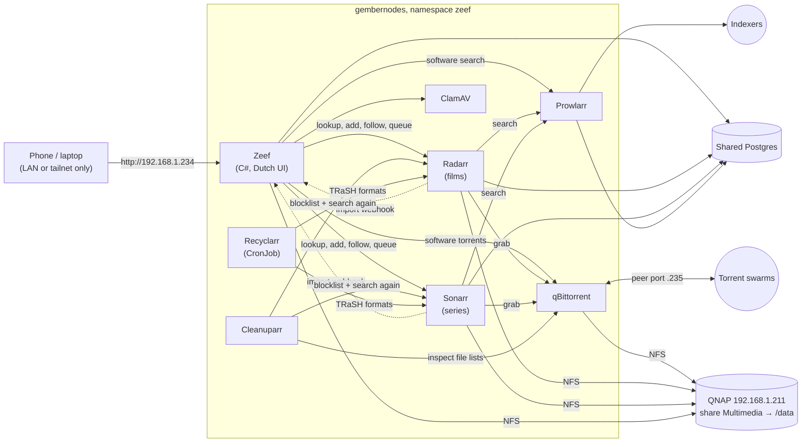
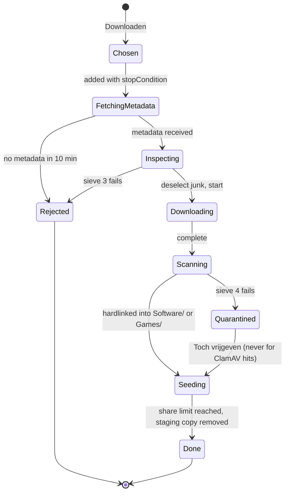

# Zeef: design

_Zeef_ (Dutch for "sieve") replaces QNAP's Download Station, which is being retired. You look for a
film, a series or a piece of software. Zeef finds a clean release, keeps fakes, malware and junk
out, and puts the result in the right folder of the NAS's **Multimedia** share. Series you follow
keep arriving by themselves. It runs on gembernodes and, like Grafana, can only be reached from home
or over Tailscale.

_To understand this, read this file first. Then read gembernodes `NOTES.md` (the 2026-09-26 and
2026-10-04 sections cover NFS and Tailscale) and `Kluskat/DEPLOY.md` (the deploy loop Zeef copies).
Once building starts, `Zeef/NOTES.md` records what was built and what comes next._

Status (2026-11-06):

- **Phase 0 (Servarr stack) and phase 0b (Jellyfin) are done and running.**
- **Phase 1 is done:** Seerr for films and series, Maintainerr, and every UI on
  `https://<app>.lan.gemberkoekje.nl` (gembernodes PRs #122–#128).
- **Phase 2**, the Zeef app for software & games, is next.

See [NOTES.md](NOTES.md) and [DEPLOY.md](DEPLOY.md).

## 1. What it does

| You want | Who finds and fetches it | Where it lands |
|---|---|---|
| A **film** | Radarr, through Zeef's search box | `Movies/Title (Year)/Title (Year).mkv` |
| A **series**, now and future episodes | Sonarr, through Zeef ("Volgen") | `TV Shows/Show (Year)/Season 01/Show (Year) - S01E01.mkv` |
| **Software or a game** | Zeef's own pipeline | `Software/…` or `Games/…` |
| _Later:_ a plain download link or a video page | Zeef, with aria2 / yt-dlp | `Other/…`, `Videos/…` |

- **One search box.** Zeef is the only screen you use day to day. Behind it, Prowlarr searches your
  indexers, Sonarr and Radarr pick and organise films and series, and qBittorrent downloads. You
  never open a torrent site, so you never see its pop-ups, fake download buttons or "update your
  codec" banners.
- **Five sieves** (section 4) keep junk out, before, during and after the download.
- **Nothing lands in the library unchecked.** Downloads go to a staging folder first, and only
  checked files are hardlinked into `Movies/`, `TV Shows/`, `Software/` or `Games/`.
- **Only reachable from home and Tailscale** (6.3).

**Scope note.** Zeef is a download manager with a filter, like Download Station was. What you
fetch is your choice. One fact for the Netherlands: downloading films, series, music or software
from an unauthorized source has been illegal since 2014. BitTorrent also uploads while it
downloads, and uploading counts as distribution. The test plan (section 9) uses only content that
is free to share.

## 2. Decisions

| Topic | Decision | Why |
|---|---|---|
| Name and language | **Zeef**, Dutch UI. Folder names stay as they are (English: `Movies`, `TV Shows`). | Your answer. The existing library names are kept. |
| Films and series | **Radarr** (films) and **Sonarr** (series) do the finding, choosing, following and naming. Zeef is their front door. | You want series followed automatically. That is exactly what they do, and they already follow your `Title (Year)` layout. |
| Release filtering for films and series | **TRaSH Guides custom formats, synced by Recyclarr**, from a config file in gembernodes. | The community-maintained ruleset (low-quality groups, CAM, bad encodes, scoring of good groups). The config is in Git and no hand-clicking is needed. |
| Malware in film and series torrents | **Cleanuparr** (Malware Blocker and Queue Cleaner). | It checks a torrent's file list as soon as the metadata arrives, then removes it, blocklists it in Sonarr/Radarr and has them search again. It also clears stalled downloads. |
| Software and games | **Zeef's own pipeline** (sieves 2 to 5 in section 4), with a mandatory virus scan. | Sonarr/Radarr don't do software. Its rules are different too: executables are expected there. |
| Front end | **Zeef**, not Overseerr/Jellyseerr. | Both need a Plex, Jellyfin or Emby server for login and library data, and you use the QNAP apps and TV/Kodi instead. Zeef also has to cover software. |
| Indexer search | **Prowlarr**, which syncs your indexers into Sonarr and Radarr. | One place to manage indexers. |
| Torrent engine | **qBittorrent 5.x**. | Mature, with a complete WebAPI. |
| Where | gembernodes, namespace `zeef`. | Your choice. It brings GitOps, Loki/Grafana, Tailscale and the Postgres backups. The cost is that torrent I/O goes over NFS (~110 MB/s on 1 GbE), which is faster than most home internet lines. |
| Storage | One static NFS volume for the QNAP `Multimedia` share, mounted at **`/data` in every pod**. Staging lives inside the same share. | Moving a download into the library is then a hardlink: instant, with no extra space. The same path everywhere means every app's paths are valid in the others. |
| Access | **LAN and tailnet only, like Grafana**: MetalLB IP `192.168.1.234`, no router forward, plus Zeef's password. | Your requirement. The Tailscale subnet router already routes `.224/28`, so the same URL works at home and away. |
| Users | Just you: one password, remembered on the device for a year (as in Kluskat). | Your answer. |
| Torrent traffic | **Direct for now**: the peer port on `192.168.1.235` with one router forward. A VPN sidecar (gluetun) can be added later without redesigning (6.4). | Your answer: "start direct, VPN later". |
| Databases | Sonarr, Radarr, Prowlarr and Zeef on the **shared Postgres**. | Servarr apps corrupt SQLite on network shares, and the cluster's only shared storage is NFS. The nightly `pg_dumpall` covers them. |
| App stack | .NET 10, four layers, Razor Pages, Marten, Qowaiv `Result`. Kluskat is the template. | House defaults and an existing deploy loop. |
| Cloudflare-protected indexers | **Not supported** (no FlareSolverr). | The sites that need it are mostly where the junk lives. |
| Seeding | qBittorrent stops a torrent at ratio 1.0 or 7 days. Then Sonarr/Radarr ("Remove Completed") remove it and its staging copy; Zeef does the same for software. The library copy, a hardlink, stays. | Fair to the swarm, and staging doesn't fill up. Private trackers may need more (per-category share limits). |
| Other download methods | Direct links (aria2) and video sites (yt-dlp) in **phase 3**. | Your answer: add them if easy. They are cheap behind Zeef's "Plak een link" box. |

## 3. Architecture



| Component | Image (tags pinned) | State | Role |
|---|---|---|---|
| Zeef | `ghcr.io/gemberkoekje/zeef:<sha>` | Postgres `zeef` | Front door, software pipeline, import verifier |
| Radarr | `lscr.io/linuxserver/radarr` | Postgres `radarr-main`/`radarr-log` + small config volume | Films |
| Sonarr | `lscr.io/linuxserver/sonarr` | Postgres `sonarr-main`/`sonarr-log` + small config volume | Series |
| Prowlarr | `lscr.io/linuxserver/prowlarr` | Postgres `prowlarr-main`/`prowlarr-log` + small config volume | Indexers |
| qBittorrent | `lscr.io/linuxserver/qbittorrent` (5.x) | Config volume on `qnap-nfs` | Downloads; fastresume files, not the optional SQLite store |
| Cleanuparr | `ghcr.io/cleanuparr/cleanuparr` | Postgres `cleanuparr` + small config volume | File-list malware check and stalled-download cleanup for the Sonarr/Radarr categories |
| Recyclarr | `ghcr.io/recyclarr/recyclarr` | none (config from a ConfigMap) | Nightly CronJob: pushes TRaSH custom formats, quality profiles and quality definitions into Sonarr/Radarr |
| ClamAV | `clamav/clamav` | Signature DB in an `emptyDir` | Virus scan for the software path (phase 2) |

## 4. How "no trash" works: five sieves

No single check catches everything, so each sieve catches what the earlier ones can't see. Films
and series go through the Servarr tools. Software goes through Zeef. Zeef also double-checks every
film and series file that gets imported.

| Sieve | Films & series | Software & games |
|---|---|---|
| 1. Sources | Prowlarr indexer priority and per-indexer minimum seeders | Zeef's trust tiers; only curated-or-better indexers |
| 2. Result list | TRaSH custom formats via Recyclarr, plus Radarr/Sonarr size limits per quality | Zeef's hard rejects and score (4.2) |
| 3. File list, before the payload | Cleanuparr Malware Blocker | Zeef (4.3) |
| 4. After the download | Sonarr/Radarr import only video and subtitle files and reject short "samples"; then **Zeef's import verifier** (4.4) | Magic bytes + **ClamAV**, mandatory (4.4) |
| 5. Failure | Blocklisted, and Sonarr/Radarr search again automatically | Quarantine for 14 days (4.5) |

### 4.1 Sieve 1: sources

The cleanest results come from good sources. Phase 0 includes picking the starting indexers
together. Prowlarr's list shows for each one whether it is public, semi-private or private. Prefer
indexers with a proper API, verified-uploader flags and no Cloudflare wall. For software, prefer
official sources: distribution torrents and publishers' own releases.

Zeef gives every Prowlarr indexer a **trust tier** for the software path:

| Tier | Score | Software allowed? |
|---|---|---|
| Private | +40 | yes |
| Curated public (verified uploaders) | +15 | yes |
| Open public | 0 | no |
| Blocked | | never queried |

### 4.2 Sieve 2: the result list (software path)

Hard rejects:

- Fewer than 5 seeders.
- Payload far below what the listing claims (a "40 GB game" as a 2 MB download is a scam
  downloader).
- Title tokens: `password`, `survey`, `unlock`, `free download`, `.lnk`.
- Uploader or group on the blocklist.

The score ranks what is left:

| Signal | Points |
|---|---|
| Indexer tier | 0 / +15 / +40 |
| Same info-hash on 2 or more indexers | +15 |
| Indexer flag internal / trusted uploader | +10 |
| Seeders | +5 × log₂(seeders), at most +20 |
| Uploader or group on the allowlist | +15 |
| Under 6 h old with over 1,000 seeders (fake-swarm pattern) | −30 |

A result scoring 50 or more shows as **green**, 25 to 49 as **orange**. Anything below 25 sits
behind "Toon meer". "Afgekeurd (waarom?)" lists the rejects with their reasons, so the rules can be
tuned instead of guessed. These are starting weights, tuned on real searches in phase 2.

### 4.3 Sieve 3: the file list, before the payload (software path)

A magnet link carries no file list, and the list arrives with the metadata. Zeef adds software
torrents with **`stopCondition=MetadataReceived`**. qBittorrent fetches the metadata, stops, and
downloads nothing else. Zeef reads `/torrents/files` and decides.

**Reject** if any file:

- is a shortcut or script that installers don't ship: `.lnk .url .scr .pif .hta .vbs .vbe .js .jse
  .wsf .reg .cpl`;
- hides an executable behind a double extension or padding: `setup.pdf.exe`, `game.iso   .exe`;
- is named like a password lure: `password.txt`, "how to unlock", or a file pointing at a website
  for the archive password.

Also reject when the total size differs from the listing by more than 10%.

**Deselect** (never downloaded): `.url`, ad `.txt` files and promo videos named after websites.

Executables (`.exe`, `.msi`), disc images and archives are **allowed** here. Sieve 4 scans them.

Films and series get the media version of this check from **Cleanuparr**: executables, archives
where a film should be, `.lnk`, `.zipx` and the like. Cleanuparr blocklists the release, and
Sonarr/Radarr search for another one.

### 4.4 Sieve 4: after the download

**Software path.** The download is still in staging (`/data/@Downloads/complete/software/`).

- Every executable, script, installer and archive is scanned by **ClamAV**, including archive
  contents up to the configured limits.
- A file ClamAV can't scan (too big, encrypted, an unknown compression) is allowed only if its
  magic bytes show it is plain data, not an executable or archive.
- An encrypted archive that comes with a "password" text file is rejected.

**Films and series: the import verifier.** Sonarr/Radarr call Zeef's webhook (`On Import`) for
every imported file. Zeef checks:

- **Magic bytes match the extension.** MKV starts with `1A 45 DF A3`, MP4 has `ftyp` at offset 4,
  AVI is `RIFF…AVI `. A "film.mkv" that starts with `MZ` is an executable.
- **ffprobe:** the file has a video stream, and its duration is at least 70% of the runtime
  Radarr/Sonarr know.

If a check fails, Zeef deletes the file through Radarr's or Sonarr's API and marks the grab as
failed, so they blocklist it and search again. The bad file was in the library for seconds. It
can't harm anything there: Sonarr/Radarr only import video and subtitle files, never executables.

### 4.5 Sieve 5: quarantine (software path)

A software release that fails sieve 4 is removed from qBittorrent, so it stops seeding. Its files
go to `/data/@Downloads/quarantine/<job>/` with the reasons. They are purged after 14 days.
**ClamAV hits are never released.** Other failures can be released by hand ("Toch vrijgeven").

### 4.6 What this cannot promise

- **ClamAV catches known malware, not new malware.** Game and software downloads are the most
  common way malware spreads, and the source matters most. That is why software comes only from
  curated-or-better indexers. Large installers with custom compression can't be unpacked by
  ClamAV, so only the installer itself is scanned.
- Quality rules (TRaSH formats, groups) are taste, and adjustable. Safety rules (executables, magic
  bytes, ClamAV) are not adjustable in the UI.

## 5. Storage on the NAS

### 5.1 Folder layout (share `Multimedia`, mounted at `/data`)

```
/data
├── @Downloads/                      staging, hidden from indexing (5.4)
│   ├── incomplete/                  qBittorrent temp path
│   ├── complete/radarr|sonarr|software|games/   save paths per category; seeding from here
│   └── quarantine/<job>/            failed software releases, purged after 14 days
├── Movies/                          Radarr root folder (existing, adopted as-is)
├── TV Shows/                        Sonarr root folder (existing, adopted as-is)
├── Software/                        new
├── Games/                           new
├── Nichijou/                        move into TV Shows/Nichijou (2011)/ (phase 0)
└── temp/, @DownloadStationTempFiles Download Station's; left alone until it is uninstalled
```

The `@` prefix follows QNAP's own convention for system folders (`@Recycle`,
`@DownloadStationTempFiles`). Phase 0 checks that the QNAP media apps skip it (5.4).

### 5.2 Naming, matched to what is there

- **Sonarr**, which already matches your episodes exactly:
  - series folder `{Series TitleYear}`;
  - season folder `Season {season:00}`;
  - file `{Series TitleYear} - S{season:00}E{episode:00}`;
  - extra files `srt` (keeps the `.en.srt` subtitles).
- **Radarr**:
  - folder and file `{Movie Title} ({Release Year})`, with colons replaced by " - ".
- These formats are set once in Sonarr/Radarr themselves (DEPLOY.md B5). Recyclarr's naming sync
  only offers the guide's presets.
  - Radarr spells titles as TMDB does, so a new film may say "Dungeons & Dragons" where a
    hand-named folder says "and". Existing files are **adopted without renaming**. Radarr never
    renames existing files unless you ask it to.
- **Nichijou** becomes an Anime-type series in Sonarr (absolute episode numbers) once it is in
  `TV Shows/`.
- **Software/games:** `Software/<release name>/` and `Games/<release name>/`, with ad files
  removed.

### 5.3 Promotion by hardlink

Sonarr and Radarr have "Use hardlinks instead of copy" switched on. Zeef uses libc `link()` for
software. If a hardlink fails, that is an error, never a silent copy. qBittorrent keeps seeding the
staging copy. When seeding ends it deletes that copy, and the library copy remains.

### 5.4 NFS export, permissions, indexing

- QNAP: enable NFS on the `Multimedia` share for `192.168.1.201–203`, read/write, modelled on the
  `gembernodes-pvcs` export.
- Every pod that writes `/data` runs as the **same UID/GID** with `umask 002`, through the images'
  `PUID`/`PGID`/`UMASK`. The GID must be one your SMB users share (on QNAP, `everyone` is GID 100),
  so you can still rename and delete from Windows.
- ⚠ **No `fsGroup` on any pod that mounts `/data`.** With `fsGroup` the kubelet chowns every file on
  the volume at mount time. Here that would be your entire media library. Not even with
  `OnRootMismatch`.
- ⚠ **The PV is static, with `persistentVolumeReclaimPolicy: Retain`.** With `Delete`, removing the
  claim could make the CSI driver delete the directory, which is the whole share.
- **Indexing:**
  - QNAP Multimedia Console / QuMagie: make sure `@Downloads` is not a content source (exclude it
    explicitly if the `@` prefix isn't enough).
  - Kodi (confirmed 2026-11-06): its sources stay `Movies/` and `TV Shows/`. Sonarr/Radarr's
    built-in Kodi connection refreshes its library after each import. That needs Kodi's
    remote-control-over-HTTP setting switched on.

## 6. On gembernodes

### 6.1 Planned file map (gembernodes repo)

As built in phase 0 (NOTES.md has the details):

| File | Contents |
|---|---|
| `namespaces/zeef-namespace.yaml` | Namespace (pod-security baseline) |
| `infrastructure/pvcs/zeef.yaml` | Static PV `multimedia-nfs` (server `192.168.1.211`, share `/Multimedia`, NFS 4.1, **Retain**, no Flux prune) and PVC `multimedia` bound to it by `volumeName`. Config PVCs on `qnap-nfs` for qBittorrent, Sonarr, Radarr, Prowlarr and Cleanuparr. |
| `apps/zeef/qbittorrent.yaml` | Deployment (1 replica, `Recreate`); WebUI Service on `.234`; peer Service on `.235` (6.4) |
| `apps/zeef/sonarr.yaml`, `radarr.yaml`, `prowlarr.yaml` | Deployments on Postgres (`<APP>__POSTGRES__*`, API key via `<APP>__AUTH__APIKEY`); one LoadBalancer Service each on the shared `.234` |
| `apps/zeef/cleanuparr.yaml` | Deployment on Postgres; Service on `.234` |
| `apps/zeef/recyclarr.yaml` | ConfigMap with `recyclarr.yml` (TRaSH profiles) and a nightly CronJob |
| `apps/zeef/zeef-stack-secrets.yaml` | `OnePasswordItem` `zeef-stack` (6.5) |
| `apps/zeef/zeef.yaml` | Deployment and Service on `.234:80` (phase 1) |
| `apps/zeef/clamav.yaml` | Deployment with freshclam (phase 2) |

There is no file in `ingress/`. Nothing of Zeef is on the public Traefik.

### 6.2 Projects repo

`projects/Zeef/` gets the solution. `.github/workflows/zeef-build-and-push.yml` is a copy of
Kluskat's: test, publish, push `ghcr.io/gemberkoekje/zeef:<sha>`. Deploys bump the tag in
gembernodes by hand. One deliberate deviation from the runtime-only Dockerfile: it installs
`ffprobe` (`apt-get install --no-install-recommends ffmpeg`), which the import verifier needs.

### 6.3 Access: like Grafana, never online

All web UIs share one LAN address through MetalLB IP sharing (`metallb.io/allow-shared-ip`):

| URL | What | Used for |
|---|---|---|
| `:5055` / `:8096` | Seerr / Jellyfin (phase 1 and 0b) | daily use |
| `:8989` / `:7878` / `:9696` | Sonarr / Radarr / Prowlarr | setup and troubleshooting |
| `:8080` / `:11011` / `:6246` | qBittorrent / Cleanuparr / Maintainerr | setup and troubleshooting |

**Names instead of ports (added in phase 1).** Every UI, Grafana included, also has a name
`https://<app>.lan.gemberkoekje.nl`, with a start page at `https://lan.gemberkoekje.nl`.

- DNS points `*.lan` at `192.168.1.236`, a Caddy switchboard (gembernodes
  `infrastructure/lan-proxy`) that routes by name to each app's cluster Service.
- It serves a real Let's Encrypt wildcard certificate, issued by cert-manager through acme-dns.
- HTTPS is required, not a nicety: the apex domain sends HSTS with `includeSubDomains`, so browsers
  refuse plain http for every subdomain.
- The `192.168.1.234:<port>` addresses keep working.
- The Zeef app (phase 2) gets `https://zeef.lan.gemberkoekje.nl`, one more block in the Caddyfile.

The rules:

- **The router forwards nothing to `.234` or `.236`**, so they are unreachable from the internet. At
  home you reach them directly. Away from home, the Tailscale subnet router already routes
  `192.168.1.224/28` (which contains both), so the same URL works, as with Grafana.
- Grafana's own route (the nginx ingress allowlist on `.230`) goes away in the ingress migration's
  phase 4. The LAN name doesn't depend on that.
- Every UI keeps its own login on top: Zeef's password, and Forms authentication on the Servarr
  apps and qBittorrent. The credentials are in 1Password.
- Plain HTTP on the IP:port addresses is fine: at home it stays on the LAN, and away from home it
  travels inside Tailscale's WireGuard tunnel.

### 6.4 Torrent traffic (direct for now)

- qBittorrent listens on one fixed peer port, `49160`, exposed on `192.168.1.235` (TCP and UDP).
  The router forwards that one port. Without the forward downloads still work, just with fewer peers.
- This is the **only** thing the internet can reach. It speaks the BitTorrent protocol, with no web
  UI behind it.
- Cap qBittorrent's upload so it can't saturate the home line.
- **Later, the VPN:** add gluetun as a sidecar in the qBittorrent pod. Then:
  - remove the router forward and `peer-port.yaml`;
  - pick a provider with WireGuard and port forwarding (for example ProtonVPN or AirVPN);
  - gluetun passes the forwarded port to qBittorrent through `VPN_PORT_FORWARDING_UP_COMMAND`;
  - the sidecar needs `NET_ADMIN` and a tun device;
  - its firewall must allow the WebUI port in (`FIREWALL_INPUT_PORTS=8080`) and the cluster CIDRs
    out (`FIREWALL_OUTBOUND_SUBNETS`).

  No other component changes.

### 6.5 Secrets and config

1Password, vault **Gembercluster**:

- `zeef-stack` (phase 0): per Servarr app its API key and Postgres password
  (`SONARR__AUTH__APIKEY`, `SONARR__POSTGRES__PASSWORD`, …), Cleanuparr's Postgres password, and
  the qBittorrent WebUI password (`QBITTORRENT__PASSWORD`, stored for Cleanuparr and Zeef). These
  are the same keys Zeef, Prowlarr, Recyclarr and Cleanuparr use, so nobody copies keys out of a UI.
- `zeef-secrets` (phase 1): `ConnectionStrings__Postgres`, `Auth__Password`, `Webhook__Secret`.
  Zeef reads the API keys and the qBittorrent password from `zeef-stack`.

Zeef's plain config, read through `Configuration["Section:Key"]`:

- `Radarr:BaseUrl`, `Sonarr:BaseUrl`, `Prowlarr:BaseUrl`, `QBittorrent:BaseUrl` (service DNS
  names);
- `QBittorrent:Username` and `Library:Root` (`/data`);
- `ClamAv:Host`. This is a feature gate: with no host configured the software path can't promote
  anything.

Databases, made once as in Kluskat's DEPLOY.md:

- role `zeef` owning `zeef`;
- per Servarr app a role owning `<app>-main` and `<app>-log`.

### 6.6 Resources

| Pod | Requests | Limits |
|---|---|---|
| qBittorrent | 100m / 256Mi | 1 CPU / 1Gi |
| Sonarr | 100m / 256Mi | 768Mi |
| Radarr | 100m / 256Mi | 768Mi |
| Prowlarr | 50m / 192Mi | 512Mi |
| Cleanuparr | 50m / 128Mi | 256Mi |
| Recyclarr (nightly, minutes) | 50m / 128Mi | 256Mi |
| Zeef | 50m / 192Mi | 512Mi |
| ClamAV (phase 2) | 100m / 1.2Gi | 2Gi, with `ConcurrentDatabaseReload no` (a reload otherwise doubles memory) |

That is about 2.6 GB requested and 6 GB at the limits. The cluster used about 11 of its 23 GB on
2026-11-06. The Postgres, Loki and Prometheus volumes share this QNAP, so keep qBittorrent's disk
queue modest.

## 7. The Zeef app

> **Since 2026-11-06, films and series go through Seerr (phase 1).** The Zeef app below is built in
> phase 2 for software & games, "Plak een link" and the import verifier. Its film/series screens
> (the Films/Series parts of Zoeken, and Gevolgd) are dropped.

### 7.1 Screens (Dutch UI, phone-first)

- **Zoeken.** One box. Results in three groups:
  - **Films**, from Radarr's lookup: poster, year, "Al in je bibliotheek" when you have it, and
    **Downloaden** (adds it to Radarr and starts a search).
  - **Series**, from Sonarr's lookup: poster, years and **Volgen**, with a choice of "Alles",
    "Vanaf nu" or "Laatste seizoen".
  - **Software & games**, from Prowlarr: ranked releases with green/orange badges and reasons, and
    **Downloaden**.
- **Bezig.** One list of everything in progress, merging the Radarr queue, the Sonarr queue and
  Zeef's software jobs. It shows state and progress, and Annuleren (with "zoek een andere").
- **Binnen.** What arrived recently, including the import verifier's verdict.
- **Gevolgd.** Followed series with the next episode's air date, and Ontvolgen.
- **Quarantaine.** Failed software releases with reasons, "Toch vrijgeven" where allowed, and
  Wissen. Below them, the import verifier's rejections.
- **Regels.** The software path's indexer tiers, tokens, allow/blocklists and seeding limits. The
  film and series rules live in `recyclarr.yml` in Git.
- **Plak een link** (phase 3). A magnet goes through the software path. A plain `http(s)` file goes
  to aria2. A video page goes to yt-dlp.
- **Login.** One password, remembered for a year.

### 7.2 A software download's life



Every state can also go to `Cancelled`. When a release is rejected at sieve 3, Zeef offers the
next-best candidate in one tap.

### 7.3 Layers

- **`Zeef.core`:** no I/O, and where most of the tests live.
  - Value objects: `Release`, `Score`, `Verdict`, `FileEntry`, `RuleSet`, `Category`.
  - The pure sieves: `ReleaseScreen` (4.2), `FileListScreen` (4.3), `ScanPolicy` and
    `ImportVerification` (4.4).
  - The event-sourced `SoftwareDownload` aggregate.
- **`Zeef.application`:**
  - Ports: `IMovieCatalog` (Radarr), `ISeriesCatalog` (Sonarr), `IIndexerSearch` (Prowlarr),
    `ITorrentClient`, `IMediaProbe`, `IMalwareScanner`, `ISoftwareLibrary`, `IDownloadStore`,
    `IRuleSetStore`. Phase 3 adds `IDirectDownloader` and `IVideoDownloader`.
  - Handlers: search, add film, follow/unfollow series, choose software release, advance download
    (the worker tick), verify import, release from quarantine, purge.
- **`Zeef.infrastructure`:**
  - `RadarrMovieCatalog`, `SonarrSeriesCatalog`, `ProwlarrIndexerSearch` and
    `QBittorrentTorrentClient`, all on `HttpClient`. qBittorrent needs a cookie login.
  - `FfprobeMediaProbe`.
  - `ClamAvMalwareScanner`, which streams files to clamd with `INSTREAM` over TCP 3310.
  - `NfsHardlinkSoftwareLibrary`.
  - `MartenDownloadStore`.
- **`Zeef.WebApp`:**
  - Razor Pages and cookie auth.
  - The webhook endpoint `/hooks/import`: basic auth, checked with `FixedTimeEquals`.
  - A `BackgroundService` that ticks every 5 s.

### 7.4 Data

Zeef stores only what it owns. Followed series and the film list live in Sonarr and Radarr, which
stay the source of truth.

- **The `SoftwareDownload` stream:**
  - `ReleaseChosen`: query, a snapshot of the release, score and reasons;
  - `TorrentAdded`;
  - `MetadataInspected`: file list, verdict, reasons and deselected files;
  - `DownloadStarted`, `DownloadCompleted`;
  - `Scanned` or `Quarantined`, with the results per file;
  - `ReleasedFromQuarantine`, `Promoted`, `SeedingFinished`, `Cancelled`.
- **`ImportVerification` documents:** one per imported film/episode file, with the checks, the
  verdict and what was done.
- **The rule set:** one versioned document, plus indexer tiers per Prowlarr indexer id.

## 8. Phases

Each phase ends with an entry in `Zeef/NOTES.md`: decisions, gotchas, file map, and where to start
reading.

**Phase 0: plumbing and the Servarr stack (gembernodes only, no code).**

- Storage:
  - The QNAP NFS export, and the PV/PVC with `Retain` and no `fsGroup`.
  - `@Downloads/`, `Software/` and `Games/` created.
  - Nichijou moved into `TV Shows/`.
- Apps:
  - qBittorrent with categories, paths and share limits.
  - Prowlarr, Sonarr and Radarr on Postgres, with the Prowlarr → Sonarr/Radarr sync.
  - Cleanuparr.
  - Recyclarr with the TRaSH profiles. The naming from 5.2 is set in Sonarr/Radarr.
  - The Kodi connection in Sonarr/Radarr.
- Network: LAN services on `.234`, the peer port on `.235`, and the router forward.
- Adopting the library:
  - library import of `Movies/` and `TV Shows/`, without renaming;
  - indexers picked together;
  - optionally, Sonarr/Radarr's own notifications (email or ntfy) when something arrives.
- Checks:
  - pods write to `/data/@Downloads`;
  - `ln` from `@Downloads` into `Movies/` works;
  - new files can be renamed and deleted over SMB;
  - the QNAP apps don't index `@Downloads`;
  - everything survives a kured reboot;
  - `.234` doesn't answer from mobile data without Tailscale, and does with it;
  - a public-domain film arrives end to end (section 9).
- Result: **Download Station is replaced for films and series**, through the Sonarr/Radarr UIs.

**Phase 0b: Jellyfin, one always-on library** (section 12). It replaces QuMagie for watching on
the phone, and gives Kodi on the PC a central library. Added 2026-11-06.

**Phase 1: Seerr for films and series** (decided and done 2026-11-06; see 12.3). It's the
ready-made request page, at `https://seerr.lan.gemberkoekje.nl`: you sign in with Jellyfin, the UI
is in Dutch, and requests go to Radarr/Sonarr. It replaces the originally planned home-built
Zoeken/Bezig/Binnen/Gevolgd screens for films and series. Phase 1 also brought Maintainerr (watched
seasons are cleared) and the LAN names with https (6.3).

**Phase 2: the Zeef app, for what Seerr can't do: software & games, and the import verifier.** The
screens in section 7 shrink accordingly. Zoeken covers software & games; Bezig, Quarantaine and Regels
stay; films and series are left to Seerr.

- Prowlarr search with sieves 2 and 3.
- ClamAV, Quarantaine and the Regels page.
- The `On Import` webhook with magic-byte and ffprobe checks.
- Tuning the score weights on real searches.

**Phase 3: other download methods.** "Plak een link":

- magnets through the software path;
- direct `http(s)` files through an aria2 pod, then ClamAV, into `Other/`;
- video pages through MeTube, a small yt-dlp web service with an API, into `Videos/`.

**Phase 4: when wanted.**

- The VPN sidecar (6.4).
- A NetworkPolicy so only Zeef, Sonarr, Radarr and Cleanuparr reach qBittorrent's API.
- TMDB-based names for software and games.

## 9. Testing

- **Unit tests (core).** Every rule in section 4 gets at least one passing and one failing case.
  Fixtures:
  - real Prowlarr, Radarr and Sonarr responses captured in phase 0, with the keys removed;
  - file lists for the known-bad software patterns (double extensions, `.lnk`, password lures, the
    tiny "downloader" passing as a big game);
  - media files whose content doesn't match their extension, for the import verifier.
- **Contract tests.** `QBittorrentTorrentClient` against the pinned qBittorrent image in
  Testcontainers. Adding a local `.torrent` with `stopCondition` and reading its files needs no
  peers.
- **ClamAV.** A fixture software torrent that contains the EICAR test file, a harmless standard
  string every virus scanner detects. It must end up in quarantine with no release option.
- **End to end on the cluster, free content only:**
  - Radarr fetches a public-domain film (*Night of the Living Dead*, 1968) or a Blender open movie
    (*Big Buck Bunny*, *Sintel*). Both are on TMDB, and the Internet Archive offers torrents for
    them. If Prowlarr's indexer list includes the Internet Archive, that is a fully legal source.
  - Sonarr follows a public-domain series from the Internet Archive.
  - The software path fetches a Debian ISO.

## 10. Answers and small open points

Answered 2026-11-06:

| Question | Answer |
|---|---|
| What gets fetched | Films & series, and software/games |
| VPN | Start direct, add the VPN later |
| Indexers | Not decided yet; picked together in phase 0 |
| What plays the share | QNAP app and TV/Kodi straight from the share |
| Name and language | Zeef, Dutch UI |
| Follow series | Yes, automatically |
| Users | Just you |
| Other download methods | Torrents only today; add direct links and video sites if easy (phase 3) |
| Reachability | LAN and Tailscale only, like Grafana |
| Who plays the files | Kodi, so Sonarr/Radarr refresh its library after each import |
| Rename existing films to Radarr's spelling | No preference, so no: existing files keep their names and only new films use Radarr's spelling |
| `Games/` next to `Software/` | Yes, two folders |

Nothing is open. The indexers are picked together during phase 0 (DEPLOY.md B4).

## 11. Gotchas known up front

- **Servarr + SQLite + NFS = corruption.** Sonarr, Radarr and Prowlarr use Postgres.
- **The same path in every pod** (`/data`), or one app's paths mean nothing to another.
- **Hardlinks only work inside one export.** That is why staging is `Multimedia/@Downloads`.
- **No `fsGroup` on `/data` pods, and the PV uses `Retain`** (5.4). Getting either wrong touches the
  entire library.
- **Don't use qBittorrent's global "Excluded file names".** An excluded file makes the torrent
  "finish" without it, and Sonarr/Radarr then can neither import it nor mark it failed. Cleanuparr
  does this job properly for their categories, and Zeef does it for software.
- **Magnets have no file list until metadata arrives.** Hence `stopCondition=MetadataReceived`.
  Check it against the pinned qBittorrent's WebAPI docs. Version 5.0 also renamed pause/resume to
  **stop/start** (`torrents/stop`, `torrents/start`, the `stopped` parameter).
- **Prowlarr's `downloadUrl` may redirect to a magnet** instead of returning a `.torrent`. Handle
  both.
- **Servarr env-var config** (`SONARR__POSTGRES__HOST`, `SONARR__AUTH__APIKEY`, ...). Verified
  against the Servarr wiki in phase 0.
- **Recyclarr can't set custom naming.** Its `media_naming` takes only the guide's preset keys, so
  the `Title (Year)` formats are set in Sonarr/Radarr directly.
- **The import webhook comes after the import.** Sonarr/Radarr have no veto hook. That is
  acceptable only because they never import non-video files (4.4).
- **ClamAV's size limits** (`MaxFileSize`, `MaxScanSize`) skip big files silently. Set them
  explicitly and treat "skipped" as "not clean" unless the magic bytes say plain data.
- **Pin every third-party image by version.** `latest` has bitten this cluster before (Postgres
  drift, gembernodes NOTES 2026-09-26).

## 12. Jellyfin (phase 0b)

Added 2026-11-06. You watch on your phone with QuMagie, which handles subtitles poorly, and Kodi
on the PC only learns about new files when it starts.

**Jellyfin** is a media server: one library in the cluster, always on and always up to date. The
phone, Kodi and a browser all play from it, with your watched status kept in one place.

### 12.1 Decisions

| Topic | Decision | Why |
|---|---|---|
| Image | `jellyfin/jellyfin`, pinned (`12.4.20261026-211555` on 2026-11-06) | Official image; Jellyfin 12.4 is current |
| Settings database | Jellyfin's SQLite in `/config`, on a **`local-path`** volume (the node's own disk), **not NFS** | Jellyfin 12 only supports SQLite, and SQLite on NFS corrupts (the same lesson as the Servarr apps). The cost: the pod stays on one node, so Jellyfin is away for a few minutes while kured reboots that node |
| Backup of `/config` | Jellyfin's built-in backups, written to a small `qnap-nfs` volume | A lost node disk would otherwise mean a full re-scan and lost watched status |
| Media | The existing `multimedia` claim, mounted **read-only** at `/media` | Jellyfin only reads; Sonarr/Radarr own the files. No `fsGroup`; it runs as 1000:100 |
| Cache and transcodes | An `emptyDir` | Throwaway data that doesn't belong on the QNAP |
| Access | `https://jellyfin.lan.gemberkoekje.nl` (since phase 1; `192.168.1.234:8096` still works), LAN and Tailscale only, like everything else | The same URL at home and on the phone away from home (Tailscale on) |
| Library refresh | Sonarr/Radarr → Connect → **Emby / Jellyfin** with a Jellyfin API key | A new episode appears seconds after import. No fixed PC address is needed any more |
| Kodi on the PC | The **Jellyfin for Kodi** add-on syncs Jellyfin's library into Kodi's own library, along with watched status | Kodi keeps its interface and subtitle handling; the library comes from the cluster |
| Libraries | **Movies** → `/media/Movies`, **Shows** → `/media/TV Shows` (anime included) | The existing layout, which is already Jellyfin's naming convention |

### 12.2 Playback: play as-is, don't convert

The nodes have an Intel Core i3-4160 (2014, 2 cores / 4 threads), with no graphics chip passed
through to the pods. Converting video in software manages one 1080p H.264 stream at most, and
practically nothing for HEVC/x265. So:

- **Choose phone apps that play the files as they are.** The official Jellyfin app plays most
  formats directly.
  - Android: **Findroid**, built on mpv, also plays styled anime subtitles (ASS) without the server
    burning them in.
  - iOS: **Swiftfin**, built on VLC, does the same.
  - Burning in ASS or image subtitles (PGS from Blu-ray) is exactly the expensive conversion.
- **Away from home over Tailscale,** playing as-is works on a decent mobile connection: a 1080p
  WEB-DL episode is about 5–10 Mbit/s.
- **Later, if conversion turns out to be needed:** hardware conversion through the iGPU, using the
  Intel GPU device plugin. It gives the pod `/dev/dri` without a hostPath volume, which the
  namespace's pod-security baseline forbids.

### 12.3 Effect on phase 1

**Decided 2026-11-06: Seerr.** Jellyseerr has since been renamed **Seerr** and absorbed Overseerr,
which is archived. v3.5.1 supports PostgreSQL (`DB_TYPE=postgres`) and has a complete Dutch
translation. Zeef narrows to software, games, "Plak een link" and the import check. The original
reasoning follows.

With a Jellyfin login in place, **Jellyseerr** (a ready-made "request a film or series" front end
for Sonarr/Radarr) becomes an option. Phase 1 can then choose:

- Zeef keeps its own Dutch search box for films and series, as designed;
- or Jellyseerr takes films and series, and Zeef narrows to software, games and "Plak een link".

That's decided at the start of phase 1, after Jellyfin has been used for a while.

### 12.4 Steps

1. **Manifests** (a gembernodes PR, same pattern as `apps/zeef/`):
   - a Deployment and Service on `.234:8096`;
   - a `local-path` PVC for `/config` and a `qnap-nfs` PVC for backups;
   - `multimedia` mounted read-only.
2. **First-run wizard** at `http://192.168.1.234:8096`:
   - create the admin user;
   - add the two libraries;
   - metadata language English or Dutch;
   - turn off real-time monitoring, which doesn't work over NFS. The Sonarr/Radarr notification
     does that job.
3. **Dashboard → API Keys:** make a key, then Sonarr and Radarr → Connect → Emby / Jellyfin
   (host `jellyfin.zeef.svc.cluster.local`, port `8096`), with "Update Library" on.
4. **Backups:** schedule them to the NFS volume.
5. **English subtitles on by default** (the user asked for this on 2026-11-06):
   - **Jellyfin:** this is per user, under your profile → **Playback → Subtitles**. Set Preferred
     subtitle language **English** and Subtitle mode **Always**. ("Smart" shows them only when
     the audio isn't in your language.)
   - The phone apps (Findroid, Swiftfin) also have their own subtitle setting. Set it the same way.
   - **Kodi:** Settings → Player → Language → Preferred subtitle language **English**.
   - Sonarr's `.en.srt` files and properly tagged embedded subtitles are recognised as English by
     both.
6. **Kodi on the PC:**
   - install the Jellyfin repository, then the **Jellyfin for Kodi** add-on;
   - log in with your Jellyfin user;
   - choose "Add-on" mode (Jellyfin plays its own paths);
   - remove the old `Movies/` and `TV Shows/` sources from Kodi's library, so nothing is doubled.
7. **Phone:** install Findroid or Swiftfin, then connect to `https://jellyfin.lan.gemberkoekje.nl`
   (at home, or with Tailscale on; `http://192.168.1.234:8096` also works).
8. **Checks:**
   - a new Sonarr import appears in Jellyfin within a minute;
   - an episode with `.srt` subtitles plays on the phone with subtitles and without conversion
     (the Dashboard shows "Direct Play");
   - it works over Tailscale on mobile data, and not without it.
